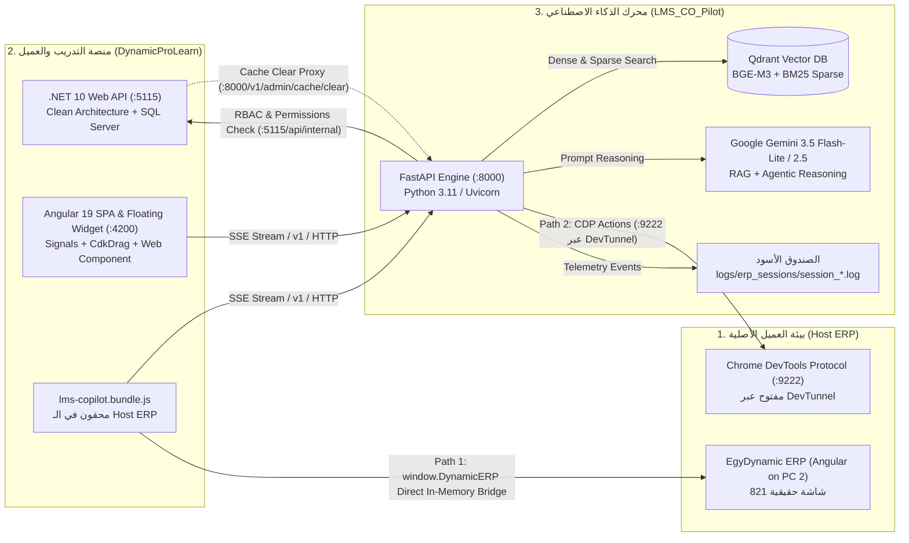
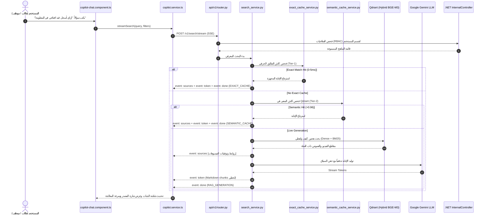
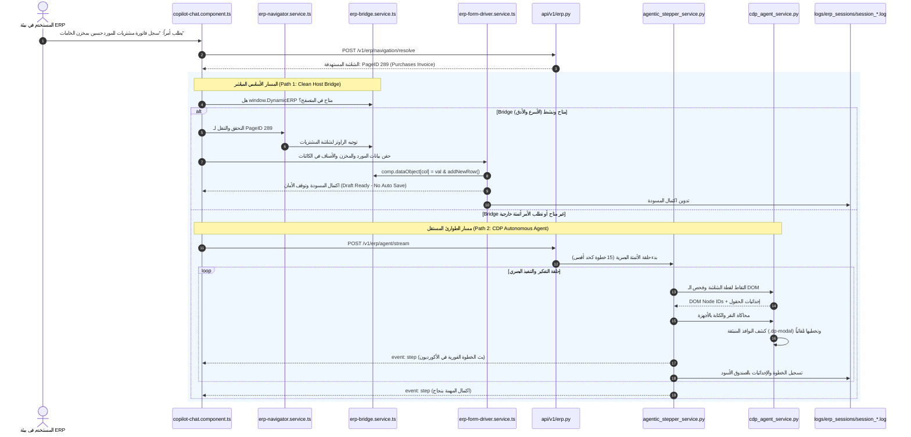
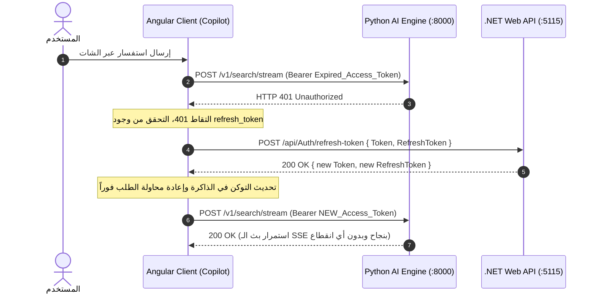

# 🧭 DynamicPro AI Co-Pilot & Chat Architecture — Master File Inventory, Pipelines & Bug-Hunting Playbook

> **Document Classification:** Single Source of Truth (SSOT) & Technical Deep-Dive  
> **Target Projects:** `DynamicProLearn` (.NET 10 / Angular 19) & `LMS_CO_Pilot` (Python FastAPI / Qdrant / CDP)  
> **Last Updated:** November 2026  
> **Author:** Tech Lead & Antigravity Agent  

---

## 📑 جدول المحتويات والتقسيم الهيكلي (Regions Map)

- [Region 0: توزيع الأدوار المعمارية بين المشاريع (Ecosystem Role Distribution)](#region-0-توزيع-الأدوار-المعمارية-بين-المشاريع-ecosystem-role-distribution)
- [Region 1: واجهة المستخدم والتحكم في المتصفح (Angular 19 Client Tier)](#region-1-واجهة-المستخدم-والتحكم-في-المتصفح-angular-19-client-tier)
- [Region 2: خدمات الأتمتة وجسر المتصفح بالعميل (Frontend Bridge & Form Drivers)](#region-2-خدمات-الأتمتة-وجسر-المتصفح-بالعميل-frontend-bridge--form-drivers)
- [Region 3: خادم المنصة الأساسية وإدارة الصلاحيات (.NET 10 Clean Architecture)](#region-3-خادم-المنصة-الأساسية-وإدارة-الصلاحيات-net-10-clean-architecture)
- [Region 4: بوابة ومحرك الذكاء الاصطناعي (FastAPI Gateway, Lifespan & Auth)](#region-4-بوابة-ومحرك-الذكاء-الاصطناعي-fastapi-gateway-lifespan--auth)
- [Region 5: محرك الاسترجاع الدلالي والكاش (RAG Intelligence, Qdrant & Caches)](#region-5-محرك-الاسترجاع-الدلالي-والكاش-rag-intelligence-qdrant--caches)
- [Region 6: الموجه الدلالي لشاشات الـ ERP (Semantic Navigation & Decision Memory)](#region-6-الموجه-الدلالي-لشاشات-الـ-erp-semantic-navigation--decision-memory)
- [Region 7: العميل البصري المستقل وأتمتة المتصفح (Autonomous CDP & Stepper Engine)](#region-7-العميل-البصري-المستقل-وأتمتة-المتصفح-autonomous-cdp--stepper-engine)
- [Region 8: مخططات تسلسل مسارات العمل (End-to-End Execution Pipelines)](#region-8-مخططات-تسلسل-مسارات-العمل-end-to-end-execution-pipelines)
- [Region 9: دليل تتبع الأخطاء والصندوق الأسود (Master Bug-Hunting Playbook)](#region-9-دليل-تتبع-الأخطاء-والصندوق-الأسود-master-bug-hunting-playbook)

---

# #region 0: توزيع الأدوار المعمارية بين المشاريع (Ecosystem Role Distribution)

المنظومة تعمل بتكامل ثلاثي الأقطاب:

### 1. مشروع `DynamicProLearn`:
* **المسار الأساسي:** `e:\Mazen\DynamicProLearn`
* **الدور الوظيفي:** المنصة الأم (Host LMS) وواجهة التفاعل الأمامية.
* **المكونات الجوهرية:**
  1. خادم `.NET 10` يوفر المصادقة، صلاحيات المستخدمين (RBAC)، محتوى الدروس والشهادات، وتفويض الصلاحيات إلى محرك بايثون.
  2. واجهة `Angular 19` توفر ويدجت الشات العائم والمتحرك (`copilot-chat`)، وإدارة فلاتر البحث، والاتصال بدفقات SSE.
  3. حزمة `lms-copilot.bundle.js` المستقلة التي تُحقن في بيئة الـ ERP الأصلية لتمكين المستخدم من استخدام الكوبيلوت مباشرة داخل شاشات عمله.

### 2. مشروع `LMS_CO_Pilot`:
* **المسار الأساسي:** `e:\Mazen\EgyDynamic\LMS_CO_Pilot`
* **الدور الوظيفي:** محرك الذكاء الاصطناعي الدلالي، الأتمتة البصرية المستقلة، وبنك المتجهات.
* **المكونات الجوهرية:**
  1. مسار البحث المعرفي والتعليمي (RAG Engine): تحويل الأسئلة لمتجهات، البحث الهجين، التوليد اللحظي، وإرجاع توقيتات فيديوهات الشرح في اليوتيوب.
  2. مسار التوجيه الدلالي لـ ERP (Semantic Navigation & Form Fill): مطابقة نوايا المستخدم بدقة مع 821 شاشة حقيقية، وتحليل أزرار وحقول النماذج.
  3. مسار الأتمتة البصرية المستقل (Autonomous CDP Stepper): التحكم المباشر بمتصفح الـ ERP عن بُعد عبر بروتوكول CDP لتعبئة الحقول والنقر وتخطي النوافذ المنبثقة.
  4. الصندوق الأسود الموحد (Unified Telemetry Blackbox): توثيق كل خطوة في ملفات السجلات (`logs/erp_sessions/session_<id>.log`).

# #endregion

---

# #region 1: واجهة المستخدم والتحكم في المتصفح (Angular 19 Client Tier)

المسار الجذري للواجهة: `e:\Mazen\DynamicProLearn\learn-dynamic-pro-ui`

### 1. مكون الشات الرئيسي العائم
* **المسار:** `src/app/shared/components/copilot-chat/copilot-chat.component.ts` (والمصاحب له `.html` و `.css`)
* **المسؤولية المباشرة:**
  - إدارة حالة الشات بالكامل باستخدام Angular Signals (`messages()`, `isStreaming()`, `currentProvenance()`).
  - دعم السحب والإسقاط الحر على مستوى الشاشة بالكامل عبر `@angular/cdk/drag-drop` (`cdkDrag`, `cdkDragBoundary="body"`).
  - استقبال دفقات الـ SSE من بايثون للبحث العادي (`streamSearch`) أو للعميل المستقل (`streamAgentExecution`).
  - فحص جاهزية الخادم لحظة الفتح عبر `copilotService.checkReadiness()`.
  - إدارة التقييمات اللحظية للردود (👍 / 👎) وإظهار نوافذ الملاحظات للطالب.
  - التعامل مع كروت الإجراءات التنفيذية للـ ERP وعرض خطوات التنفيذ (Stepping Accordion) والتنقل التلقائي.
* **أثره الفعلي حالياً:** نقطة الاتصال المرئية الوحيدة للمستخدم؛ إذا تعطل هذا الملف لا تظهر أي رسائل أو استجابات.
* **موقع رصد الأخطاء:**
  - أخطاء انقطاع الاتصال تظهر في `streamSearch.onError` في الكونسول تحت بادئة `[CoPilot Chat]`.
  - التحقق من تفعيل وضع الـ Vision Agent يتم في المتغير `isVisionAgentMode`.

### 2. شريط الفلاتر العلوية
* **المسار:** `src/app/shared/components/copilot-top-filter-bar/copilot-top-filter-bar.component.ts`
* **المسؤولية المباشرة:**
  - استعراض شجرة الفلاتر (الموديول، الوحدة، الدرس، المستوى، النوع) التي تم استردادها من الباك إند المصرح بها للمستخدم فقط.
  - إرسال نطاق الفلترة المختار (`filters`) مع كل طلب بايلود مرسل إلى بايثون لتطبيق الـ Hard Isolation في Qdrant.
* **أثره الفعلي حالياً:** منع تسريب بيانات الكورسات التي لا يملك المستخدم صلاحية عليها وضبط تركيز محرك RAG.

### 3. مجمع الـ Web Component للحقن الميداني
* **المسار:** `scripts/bundle-element.js` وحزمة الإنتاج `public/lms-copilot.bundle.js`
* **المسؤولية المباشرة:**
  - دمج مكونات الشات والأنماط في ملف JavaScript مستقل واحد بصيغة Web Component (`<lms-copilot-widget>`).
  - السماح بتحميل الكوبيلوت داخل الـ Host ERP على أجهزة أخرى (مثل PC 2) عبر سطر واحد: ``.
* **أثره الفعلي حالياً:** تشغيل الكوبيلوت داخل الـ ERP الفعلي؛ إذا كان الملف غير مبني بآخر تحديث عبر `npm run build:element`، سيعمل الـ ERP على كود فرونت إند قديم!

# #endregion

---

# #region 2: خدمات الأتمتة وجسر المتصفح بالعميل (Frontend Bridge & Form Drivers)

المسار الجذري للخدمات: `e:\Mazen\DynamicProLearn\learn-dynamic-pro-ui/src/app/core/services`

### 1. منسق اتصالات الكوبيلوت الأساسي
* **المسار:** `copilot.service.ts`
* **المسؤولية المباشرة:**
  - الاكتشاف التلقائي لروابط DevTunnel السحابية أو المحلية (`detectDefaultAiUrl` لبورت 8000، و `detectDefaultBackendUrl` لبورت 5115).
  - دالة `streamSearch(...)`: فتح دفق SSE مع `POST /v1/search/stream` وقراءة الأحداث (`sources`, `token`, `form_fill`, `done`).
  - التجديد الصامت للتوكنات (Silent Refresh Token): عند استلام `401 Unauthorized` من بايثون، تقوم الدالة صامتاً باستدعاء `.NET API` عبر `authService.refreshToken()` ثم إعادة استئناف الاتصال فوراً بدون انقطاع تجربة المستخدم!
  - دالة `streamAgentExecution(...)`: فتح دفق SSE مع `POST /v1/erp/agent/stream` للتحكم البصري عبر بروتوكول CDP.
* **أثره الفعلي حالياً:** شريان نقل البيانات اللحظية بين Angular ومحرك بايثون.

### 2. جسر الـ ERP للذاكرة الحية (Host Bridge)
* **المسار:** `erp-bridge.service.ts`
* **المسؤولية المباشرة:**
  - التعامل المباشر مع واجهة المتصفح للـ Host ERP عبر الكائن `window.DynamicERP`.
  - استخراج الشاشة الفعالة حالياً (`getActiveScreen()`)، واستخراج قائمة الشاشات المصرح بها (`listScreens()` أو `listUserPages()`).
  - قراءة سياق النموذج النشط (`getActiveFormContext()`) وتنفيذ الحفظ التلقائي عند اكتمال المسودة.
* **أثره الفعلي حالياً:** يمثل **المسار الأول (Path 1: Clean Host Bridge)**؛ سريع جداً (0-50ms) لأنه يعمل بذاكرة المتصفح دون الحاجة لمحاكاة النقر البصري.

### 3. موجه التنقل بين الشاشات
* **المسار:** `erp-navigator.service.ts`
* **المسؤولية المباشرة:**
  - فحص ما إذا كانت الشاشة المطلوبة نشطة حالياً في الصفحة (`isScreenActive`).
  - استدعاء الباك إند عبر `POST /v1/erp/navigation/resolve` لتحديد الشاشة الدقيقة من بين الشاشات المتاحة.
  - النقر المبرمج على عناصر القوائم والتابات للتنقل للشاشة المستهدفة.
* **أثره الفعلي حالياً:** المسؤول عن فتح الشاشات التلقائي (مثل: "افتح اعتماد مستخلصات المقاولين").

### 4. محرك تعبئة النماذج الذكي (Form Drivers)
* **المسارات:**
  - المنسق الرئيسي: `erp-form-driver.service.ts`
  - التفاعل مع حقول الإدخال والـ Dropdowns: `form-driver/control-interactor.ts`
  - التفاعل مع جداول الفواتير والأسطر (Grid): `form-driver/grid-driver.ts`
  - فحص عناصر الشاشة واستخراج المعرفات: `form-driver/form-inspector.ts`
  - تطبيع النصوص واللهجات العربية: `form-driver/arabic-normalizer.ts`
* **المسؤولية المباشرة:**
  - التعرف على حقول Angular المعقدة مثل `@ng-select` ومحاكاة فتح القائمة المنسدلة الملحقة بالـ `document.body`.
  - تعبئة حقول الهيدر (المورد، المخزن، نوع الدفع) ثم إضافة أسطر الأصناف في الجداول الحسابية.
  - إيقاف التنفيذ عند اكتمال المسودة (Safety Gate) دون حفظ نهائي تجنباً للأخطاء المحاسبية.
* **أثره الفعلي حالياً:** تنفيذ أوامر مثل "سجل فاتورة مشتريات للمورد فلان بمخزن كذا وصنف كذا".

### 5. الصندوق الأسود اللحظي بالواجهة
* **المسار:** `erp-telemetry.service.ts`
* **المسؤولية المباشرة:**
  - التقاط كل حدث تنقل، نقر، خطأ، أو استجابة جسر وتجميعه في حزم (Batching).
  - إرسال الحزم فوراً عبر `POST /v1/erp/telemetry` ليتم حفظها في ملف سجل الجلسة بالباك إند.
* **أثره الفعلي حالياً:** ضمان تسجيل خطوات الفرونت إند في سجل السيرفر لتتبع الـ Bugs.

# #endregion

---

# #region 3: خادم المنصة الأساسية وإدارة الصلاحيات (.NET 10 Clean Architecture)

المسار الجذري للباك إند: `e:\Mazen\DynamicProLearn\src\LearnDynamicPro.API`

### 1. المتحكم الداخلي لصلاحيات الذكاء الاصطناعي
* **المسار:** `Controllers/InternalController.cs`
* **المسؤولية المباشرة:**
  - توفير مسار `GET /api/internal/user-permissions/{userId}` المحمي عبر `X-Service-Token` الخاص بمحرك بايثون.
  - إرجاع شجرة الموديولات والوحدات والدروس المصرح بها لقسم المستخدم (أو كل المنظومة إذا كان Admin).
  - توفير مسار `GET /api/internal/lessons/{lessonId}/full-context` لتزويد بايثون ببيانات الدرس والسياق الأكاديمي.
* **أثره الفعلي حالياً:** المحرك الرئيسي لحماية البيانات وصلاحيات الـ Multi-Tenancy و RBAC لمنع الطالب من استجواب محتوى أقسام أخرى.

### 2. وسيط تفريغ كاش الذكاء الاصطناعي للمشرفين
* **المسار:** `Controllers/AdminController.cs`
* **المسؤولية المباشرة:**
  - استقبال طلب تفريغ الكاش من لوحة المشرفين عبر `POST /api/Admin/ai/cache/clear`.
  - التأكد من دور المشرف (Admin) ثم إعادة توجيه الطلب إلى محرك بايثون على `POST /v1/admin/cache/clear`.
* **أثره الفعلي حالياً:** إتاحة مسح الكاش بنقرة زر عند تعديل المناهج والدروس في .NET.

### 3. موفر فلاتر الكوبيلوت للطلاب
* **المسار:** `Controllers/StudentController.cs`
* **المسؤولية المباشرة:**
  - توفير مسار `GET /api/student/copilot-filters` لإرجاع شجرة المناهج المخصصة للطالب المسجل دخوله لعرضها في الشات.

# #endregion

---

# #region 4: بوابة ومحرك الذكاء الاصطناعي (FastAPI Gateway, Lifespan & Auth)

المسار الجذري: `e:\Mazen\EgyDynamic\LMS_CO_Pilot\src`

### 1. المدخل الرئيسي والتكوين والـ Middlewares
* **المسار:** `main.py` و `core/config.py` و `core/middleware.py`
* **المسؤولية المباشرة:**
  - نقطة انطلاق السيرفر وضبط الـ Event Loop لبيئة Windows.
  - إدارة عمر التطبيق عبر `lifespan` في `db/session.py` (تحميل الموديلات والاتصال بـ Qdrant وإجراء Warm-up).
  - توفير مسار الجاهزية الحاسم `GET /v1/ready` لحماية الواجهة من الإرسال قبل اكتمال الإقلاع.
  - إعداد حماية CORS الديناميكية مع دعم أنفاق DevTunnel و ngrok عبر Regular Expressions.
  - تطبيق الـ Rate Limiter المتقدم وتسجيل مقاييس Prometheus.
* **أثره الفعلي حالياً:** بوابة المرور لكافة طلبات الذكاء الاصطناعي؛ في حال وجود خطأ هنا يعطي السيرفر `503 Warming Up` أو `429 Too Many Requests`.

### 2. خدمات التوثيق والتحقق من الهوية
* **المسار:** `services/auth_service.py` و `services/lms_client.py`
* **المسؤولية المباشرة:**
  - فك تشفير وتوثيق الـ JWT القادم من Angular أو .NET والتحقق من صحته بنفس الـ Secret.
  - استخراج هوية المستخدم وصلاحياته والتأكد من انتمائه لشركة وقسم محددين (`UserContext`).
  - دعم وضع الضيف (Guest Mode) تلقائياً عند استخدام الكوبيلوت من داخل شاشات ERP الأصلية.
  - استدعاء `.NET API` للتحقق من الصلاحيات اللحظية عبر `lms_client.py`.
* **أثره الفعلي حالياً:** منع التلاعب بالهويات وعزل الشركات والأقسام في بيئات الـ Multi-Tenant.

# #endregion

---

# #region 5: محرك الاسترجاع الدلالي والكاش (RAG Intelligence, Qdrant & Caches)

المسار الجذري: `e:\Mazen\EgyDynamic\LMS_CO_Pilot\src/services` و `src/api/v1/router.py`

### 1. مسار الاستعلام اللحظي والبث التدفقي
* **المسار:** `api/v1/router.py` (الدوال: `search_stream_endpoint` و `search` و `search_feedback_endpoint`)
* **المسؤولية المباشرة:**
  - معالجة طلب `POST /v1/search/stream` وإطلاق تدفق Server-Sent Events (SSE).
  - إرسال حدث `sources` فورياً لإظهار كروت الفيديوهات في الواجهة، ثم إرسال أحداث `token` لنصوص الإجابة، وختامها بحدث `done` الذي يحمل شارة المصدر وسرعة المعالجة.
  - إدارة تقييمات الطلاب وتخزينها عبر مسار غير حاجب (Async Background Task) مع كاش لمنع التكرار (Dedup Cache).
* **أثره الفعلي حالياً:** قلب تجربة الشات للمستخدمين في الاستفسارات التعليمية.

### 2. منسق البحث الدلالي المتقدم
* **المسار:** `services/search_service.py`
* **المسؤولية المباشرة:**
  - تنفيذ الاستراتيجية الهرمية:
    1. **Tier-1 Exact Memory Cache:** فحص الذاكرة السريعة (0-5ms) بناء على تجزئة السؤال والمحددات.
    2. **Tier-2 Semantic Vector Cache:** فحص تطابق المعنى في Qdrant بنسبة تشابه > 0.96.
    3. **Live RAG Pipeline:** في حال عدم وجود كاش، يتم تحويل السؤال لمتجه عبر `embedding_service.py`، والبحث الهجين بـ Qdrant عبر `qdrant_service.py`، وإعادة ترتيب المقاطع عبر `reranker_service.py`، ثم حقن السياق وتوليد الرد عبر Gemini.
  - رصد مقاييس الأداء: زمن أول توكن (TTFT) وزمن كل توكن (TPOT).
* **أثره الفعلي حالياً:** تقديم إجابات موثقة بروابط الفيديوهات مع أسرع زمن استجابة ممكن.

### 3. خدمات المتجهات والتضمين وإعادة الترتيب
* **المسارات:**
  - المتجهات: `services/qdrant_service.py`
  - التضمين اللغوي: `services/embedding_service.py`
  - إعادة الترتيب: `services/reranker_service.py`
  - كاش الذاكرة وكاش المتجهات: `services/exact_cache_service.py` و `services/semantic_cache_service.py`
* **المسؤولية المباشرة:**
  - إدارة المجموعات في Qdrant وتطبيق الفلاتر الصارمة حسب الدرس والقسم والموديول.
  - تطبيق البحث الكثيف (Dense) والبحث اللفظي المتناثر (BM25 Sparse).

# #endregion

---

# #region 6: الموجه الدلالي لشاشات الـ ERP (Semantic Navigation & Decision Memory)

المسار الجذري: `e:\Mazen\EgyDynamic\LMS_CO_Pilot\src`

### 1. موجه ومسارات الـ ERP في واجهة برمجة التطبيقات
* **المسار:** `api/v1/erp.py`
* **المسؤولية المباشرة:**
  - توفير مسار `POST /v1/erp/navigation/resolve`: تحديد الشاشة المقصودة ونوع الإجراء.
  - توفير مسار `POST /v1/erp/controls/resolve`: استنتاج الأزرار الوظيفية (إضافة سطر، حفظ، بدء جديد).
  - توفير مسار `POST /v1/erp/form-fill/resolve-leftover`: حل الحقول التتابعية التلقائية.
  - توفير مسار `POST /v1/erp/telemetry`: تسجيل أحداث المتصفح في الصندوق الأسود الموحد.
* **أثره الفعلي حالياً:** العقل المفكر لربط أوامر المستخدم اللغوية بعناصر الـ ERP.

### 2. محرك القرارات الدلالية لشاشات الـ ERP
* **المسار:** `services/erp_service.py` و `services/forms_catalog_service.py`
* **المسؤولية المباشرة:**
  - مطابقة هدف المستخدم مع دليل الشاشات الحقيقي (821 شاشة).
  - تطبيق قواعد تفضيل المعاملات: معاقبة شاشات التقارير والإعدادات (`Settings`, `Details`, `تقرير`) عندما يكون طلب المستخدم تنفيذي (`سجل`, `فاتورة`, `أضف`).
  - معالجة اللهجات والجموع العربية (مثل: "سلف" ↔ "سلفة"، "مستخلصات" ↔ "اعتماد المستخلصات").
* **أثره الفعلي حالياً:** منع فتح شاشة خاطئة أو الوقوع في فخ الشاشات غير القابلة للإدخال.

### 3. ذاكرة قرارات التوجيه المؤكدة
* **المسار:** `services/erp_decision_memory_service.py`
* **المسؤولية المباشرة:**
  - تخزين قرارات التوجيه التي أكدها المستخدم بنجاح داخل مجموعة متجهات خاصة في Qdrant.
  - عند تكرار نفس العبارة مستقبلاً، يتم التوجيه في أقل من 5ms دون الحاجة لاستشارة الـ LLM!
  - حذف وتعديل القرارات التي رفضها المستخدم عبر مسار الفيدباك.

# #endregion

---

# #region 7: العميل البصري المستقل وأتمتة المتصفح (Autonomous CDP & Stepper Engine)

المسار الجذري: `e:\Mazen\EgyDynamic\LMS_CO_Pilot\src`

### 1. محرك التفكير والخطوات المستقل (Autonomous Stepper)
* **المسار:** `services/agentic_stepper_service.py`
* **المسؤولية المباشرة:**
  - تمثيل **المسار الثاني (Path 2: Hybrid CDP Agent)**.
  - إدارة حلقة التفكير والتنفيذ المستقلة (`execute_goal_stream`):
    `الملاحظة (Observe) -> التفكير (Think) -> تحديد الإجراء (Act) -> التحقق (Verify)`.
  - بث خطوات التنفيذ الحية عبر مسار `POST /v1/erp/agent/stream` لتظهر كأكورديون تفاعلي في واجهة الشات للمستخدم لحظة بلحظة.
  - استخراج بايلود المعاملات ديناميكياً وتحديد الحقول المطلوبة.
  - التوثيق الشامل في الصندوق الأسود لكل جلسة (`logs/erp_sessions/session_<id>.log`).
* **أثره الفعلي حالياً:** الملاذ الأخير لتنفيذ الأتمتة الميدانية الكاملة عن بُعد عبر المتصفح حتى لو فشل جسر الفرونت إند.

### 2. سائق بروتوكول المتصفح الميداني
* **المسار:** `services/cdp_agent_service.py`
* **المسؤولية المباشرة:**
  - الاتصال المباشر بمتصفح Chrome الفعلي عبر بروتوكول Chrome DevTools Protocol (CDP) على بورت 9222 عبر نفق DevTunnel.
  - قراءة شجرة الـ DOM، التقاط لقطات الشاشة (Screenshots)، ومحاكاة أحداث الفأرة ولوحة المفاتيح على مستوى الهاردوير (`Input.dispatchMouseEvent`).
  - التعامل التلقائي مع النوافذ المنبثقة التابعة للمنظومة (`.dp-modal.dp-pdm` لتأكيد كمية الصنف والنقر على "متابعة").
* **أثره الفعلي حالياً:** تنفيذ النقرات والحقن الفعلي في المتصفح الخارجي للـ ERP.

### 3. خدمة الرصد البصري والمطابقة
* **المسار:** `services/vision_grounding_service.py`
* **المسؤولية المباشرة:**
  - تحليل إحداثيات العناصر بصرياً على الشاشة لضمان دقة النقر حتى لو تغيرت مسميات فئات CSS في Angular.

# #endregion

---

# #region 8: مخططات تسلسل مسارات العمل (End-to-End Execution Pipelines)

### 🔄 خط سير 1: مسار الاستفسار المعرفي والتعليمي (Educational RAG Pipeline)

---

### ⚡ خط سير 2: مسار أوامر الـ ERP والتنفيذ الميداني (Dual-Path ERP Action Pipeline)

---

### 🛡️ خط سير 3: التجديد الصامت للتوكنات (Silent Refresh Token Flow)

# #endregion

---

# #region 9: دليل تتبع الأخطاء والصندوق الأسود (Master Bug-Hunting Playbook)

إذا ظهرت لك أي مشكلة أو سلوك غير متوقع، اتبع جدول التشخيص الميداني التالي فوراً:

| العَرَض (Symptom) | السبب الجذري المرجح (Root Cause) | أين تبحث وما هو الملف المسؤول؟ | كيفية الحل الفوري وتتبع الـ Bug |
| :--- | :--- | :--- | :--- |
| **1. الشات معلق ولا يستجيب أو يظهر: "جاري تهيئة المحرك... ⏳"** | محرك بايثون لم يكتمل إقلاعه أو مسار الجاهزية معطل أو DevTunnel مغلق. | • [src/main.py](file:///e:/Mazen/EgyDynamic/LMS_CO_Pilot/src/main.py#L116-L141) • [src/db/session.py](file:///e:/Mazen/EgyDynamic/LMS_CO_Pilot/src/db/session.py) • [copilot.service.ts](file:///e:/Mazen/DynamicProLearn/learn-dynamic-pro-ui/src/app/core/services/copilot.service.ts#L209-L212) | افتح المتصفح وتأكد من استجابة الرابط: `http://localhost:8000/v1/ready`. إذا أعاد `503` راجع تيرمينال بايثون للتأكد من انتهاء الـ Lifespan وتحميل الموديلات. إذا كنت تستخدم نفقاً سحابياً، تأكد من تشغيل `devtunnel host lms-copilot`. |
| **2. خطأ 401 Unauthorized عند إرسال أي رسالة بالشات** | انتهاء صلاحية الـ JWT وعدم عمل التجديد الصامت، أو عدم توافق مفتاح التشفير بين بايثون ودوت نت. | • [copilot.service.ts](file:///e:/Mazen/DynamicProLearn/learn-dynamic-pro-ui/src/app/core/services/copilot.service.ts#L343-L370) • [auth_service.py](file:///e:/Mazen/EgyDynamic/LMS_CO_Pilot/src/services/auth_service.py) • [InternalController.cs](file:///e:/Mazen/DynamicProLearn/src/LearnDynamicPro.API/Controllers/InternalController.cs#L31-L54) | 1. تأكد أن قيمة `JWT_SECRET` في ملف `.env` لبايثون مطابقة لـ `appsettings.json` في دوت نت. 2. افتح كونسول المتصفح وابحث عن `[CoPilot SSE] 401 Unauthorized`؛ إذا فشل الـ Silent Refresh تأكد من صحة مسار `POST /api/Auth/refresh-token`. |
| **3. الذكاء يجيب بإجابة قديمة أو كاش غير مرغوب فيه** | الإجابة مسجلة في Tier-1 Memory Cache أو Tier-2 Qdrant Semantic Cache. | • [copilot-chat.component.ts](file:///e:/Mazen/DynamicProLearn/learn-dynamic-pro-ui/src/app/shared/components/copilot-chat/copilot-chat.component.ts) • [exact_cache_service.py](file:///e:/Mazen/EgyDynamic/LMS_CO_Pilot/src/services/exact_cache_service.py) • [semantic_cache_service.py](file:///e:/Mazen/EgyDynamic/LMS_CO_Pilot/src/services/semantic_cache_service.py) | 1. اضغط زر **🔄 إعادة المحاولة** في واجهة الشات؛ يقوم بإرسال `skip_cache: true` لتخطي الكاش تماماً. 2. للمشرفين: استخدم زر `🧹 تفريغ الكاش` الذي يستدعي `POST /v1/admin/cache/clear`. |
| **4. الكوبيلوت يختار شاشة خاطئة في الـ ERP (مثل شاشة تقارير بدل فاتورة)** | خوارزمية التوجيه وقعت في فخ المسميات المتشابهة (The Details/Setting Trap). | • [services/erp_service.py](file:///e:/Mazen/EgyDynamic/LMS_CO_Pilot/src/services/erp_service.py) • [services/forms_catalog_service.py](file:///e:/Mazen/EgyDynamic/LMS_CO_Pilot/src/services/forms_catalog_service.py) • [logs/erp_sessions/session_*.log](file:///e:/Mazen/EgyDynamic/LMS_CO_Pilot/logs/erp_sessions) | افتح ملف الجلسة النشط `session_<id>.log` وابحث عن مرحلة `[NAV_RESOLVE]` لمعرفة الشاشة المرشحة ودرجة المطابقة (Score). تأكد من تطبيق قاعدة معاقبة الشاشات التي تحتوي على كلمات `تقرير` أو `Setting` أو `Details`. |
| **5. التنقل نجح ولكن تعبئة الحقول فشلت في الفرونت إند (Path 1)** | عنصر القائمة المنسدلة (`@ng-select`) تم إلحاق خياراته بـ `document.body` أو الحقل موجود داخل تاب غير نشط. | • [control-interactor.ts](file:///e:/Mazen/DynamicProLearn/learn-dynamic-pro-ui/src/app/core/services/form-driver/control-interactor.ts) • [grid-driver.ts](file:///e:/Mazen/DynamicProLearn/learn-dynamic-pro-ui/src/app/core/services/form-driver/grid-driver.ts) | تأكد أن محددات العناصر تستخدم `:not([hidden])` لتفادي التابات المخفية، وتأكد من استدعاء البحث داخل الحاوية العلوية `.ng-dropdown-panel` الملحقة بالـ body. |
| **6. مسار الأتمتة البصرية المستقل (Path 2) معلق أو يعطي خطأ CDP** | متصفح Chrome على جهاز PC 2 غير مشغل بباراميتر التصحيح البعيد `--remote-debugging-port=9222` أو النفق مغلق. | • [cdp_agent_service.py](file:///e:/Mazen/EgyDynamic/LMS_CO_Pilot/src/services/cdp_agent_service.py) • [agentic_stepper_service.py](file:///e:/Mazen/EgyDynamic/LMS_CO_Pilot/src/services/agentic_stepper_service.py) | 1. تأكد من فتح كروم بالأمر: `chrome.exe --remote-debugging-port=9222`. 2. تأكد أن نفق DevTunnel يوجه بورت 9222 بدون طلب مصادقة ميكروسوفت (`--allow-anonymous`). |
| **7. تقييم الطالب (Feedback 👍 / 👎) لا يُحفظ** | تجاوز الـ Rate Limit أو تكرار إرسال التقييم لنفس الإجابة والسؤال خلال 24 ساعة. | • [api/v1/router.py](file:///e:/Mazen/EgyDynamic/LMS_CO_Pilot/src/api/v1/router.py#L123-L192) • [feedback_service.py](file:///e:/Mazen/EgyDynamic/LMS_CO_Pilot/src/services/feedback_service.py) | راجع سجل السيرفر؛ إذا ظهر `Duplicate student feedback ignored` فهذا يعني أن الكاش الذكي منع تكرار نفس التقييم خلال 24 ساعة للحفاظ على سلامة البيانات. |

### 📁 أين تجد ملفات السجلات الحية أثناء التطوير الميداني؟
1. **الصندوق الأسود الموحد لكل جلسة:**
   `e:\Mazen\EgyDynamic\LMS_CO_Pilot\logs\erp_sessions\session_<session_id>.log`
   *يسجل بالتوقيت ومستوى الخطأ كل مرحلة: `[NAV_RESOLVE]`, `[FORM_INSPECT]`, `[STEPPER]`, `[CDP_EVENT]`*.
2. **سجل التصحيح الموحد الشامل لوكيل الذكاء الاصطناعي:**
   `e:\Mazen\EgyDynamic\LMS_CO_Pilot\logs\erp_sessions\agent_unified_debug.log`
3. **سجل تيرمينال بايثون المباشر:** يظهر فيه الـ Structured Logging مع تفاصيل الـ Request ID والـ Latency لكل استدعاء.

# #endregion
