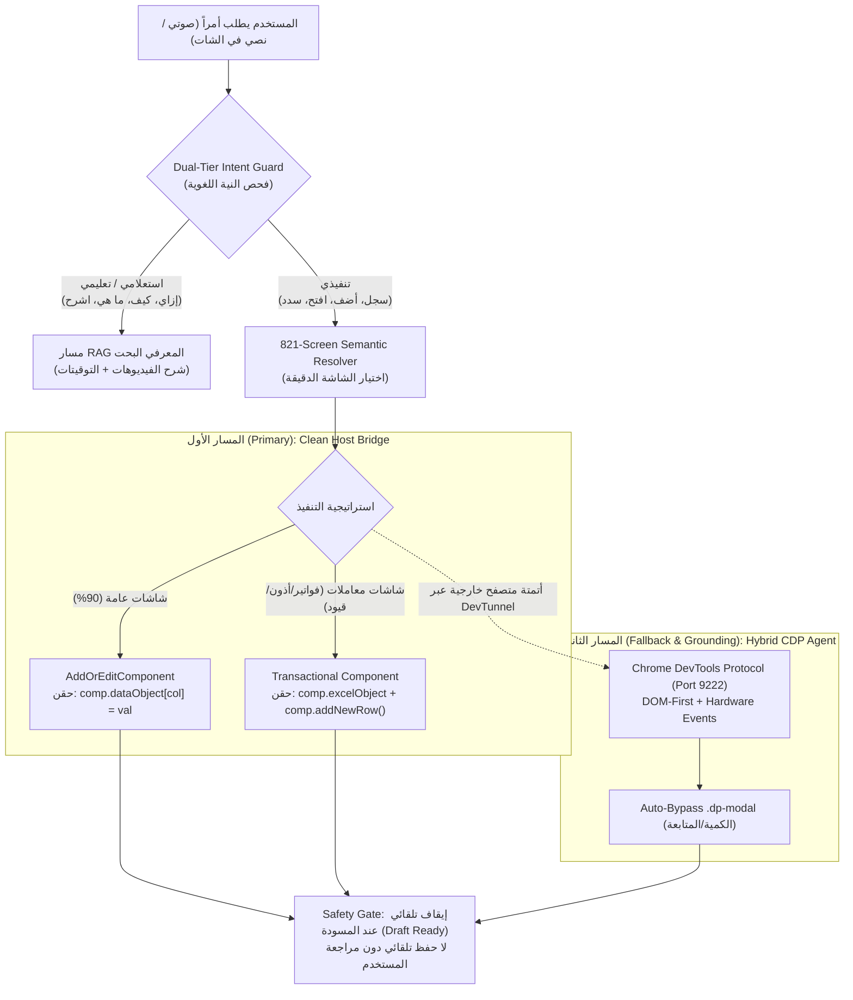

# 🚀 DynamicPro ERP Autonomous Co-Pilot — Master Construction Blueprint
**Version:** 3.1.0 | **Author:** Tech Lead & Antigravity Agent | **Date:** 2026-10-25  
**Ecosystem Projects:**
1. **DynamicProLearn:** LMS API (.NET 10, Clean Architecture) + LMS UI (Angular 19)
2. **LMS_CO_Pilot:** AI Engine (Python FastAPI, Uvicorn 8000, Gemini 3.5 Flash-lite, CDP Driver)
3. **EgyDynamic:** Host ERP (Angular Frontend on PC 2 + ERPWebApi)

---

## 📌 1. Strategic Architecture: The Dual-Path Paradigm (SSOT Integration)

As established in [`DUAL_DEVICE_TOPOLOGY_AND_VISION_AGENT_SSOT.md`](file:///e:/Mazen/DynamicProLearn/docs/DUAL_DEVICE_TOPOLOGY_AND_VISION_AGENT_SSOT.md) and [`ERP_COPILOT_MASTER_BLUEPRINT.md`](file:///e:/Mazen/DynamicProLearn/docs/ERP_COPILOT_MASTER_BLUEPRINT.md), the system operates on a dual-path execution strategy:



---

## 2. 🏛️ Architectural Grounding: What Has Been Built & Validated

### 2.1 The 821-Screen Database Extraction (The Breakthrough)
* **Challenge:** Earlier testing stalled because synthetic/placeholder screen IDs (410, 510, 610) were assumed rather than using the real database IDs.
* **Solution:** Bypassed Microsoft Auth on DevTunnel with `--allow-anonymous` on port 9222.
* **Result:** Extracted **821 authentic ERP screens** directly from the live Angular runtime on PC 2 via `window.DynamicERP.listUserPages()`.
* **Discovered Ground Truths:**
  * `PageID 7158`: **طلب سلفة (Loan Request)**
  * `PageID 7090`: **اعتماد المستخلصات مقاولين (/Extractions)**
  * `PageID 7156`: **اعتماد مستخلصات عملاء (/Extractions)**
  * `PageID 313`: **أوامر الانتاج (Production Orders)**
  * `PageID 2455`: **الاصول الثابتة (Fixed assets)**
  * `PageID 311`: **القيد العام (General registration)**
  * `PageID 337 / 289`: **تفاصيل المشتريات / فواتير المشتريات**

### 2.2 Precision Hybrid Form Driver (`src/services/cdp_agent_service.py`)
* **Benchmark:** Injected Supplier **"حسين"**, Store **"مخزن خامات تام"**, Project **"السحاب"**, and 2 items (**"سن"** qty 10 & **"رمل"** qty 20) with automated quantity modal confirmation in **14.17s** over 2 autonomous steps.
* **Key Lessons Applied:**
  * Handles Angular `@ng-select` typeaheads where `.ng-dropdown-panel` is appended to `document.body`.
  * Detects and auto-advances the item confirmation modal (`.dp-modal.dp-pdm` -> `#productQty` -> "متابعة").

### 2.3 High-Speed Session Memory Cache
* **Implementation:** `AgenticStepperService.get_cached_user_screens()` in [`agentic_stepper_service.py`](file:///e:/Mazen/EgyDynamic/LMS_CO_Pilot/src/services/agentic_stepper_service.py).
* **Speed:** Fetches user pages via CDP **once**; subsequent calls in the same session resolve in **0ms** from memory.

---

## 3. 🔍 Architectural Pitfalls Prevented (Lessons from Docs & History)

Based on [`BLUEPRINT_ERP_AI_FORM_FILL.md`](file:///e:/Mazen/DynamicProLearn/docs/BLUEPRINT_ERP_AI_FORM_FILL.md) and past session logs:

1. **The "Details / Setting" Misrouting Trap:**
   * *The Problem:* The AI previously selected `Details purchases` (`Page 337`) or `Purchases Setting` (`Page 291`) instead of `Purchases` (`Page 289`). Those are view-only reports or settings screens without an `Add New` button, causing 28 failed click attempts.
   * *The Rule:* When the user intention is transactional (`سجل`, `فاتورة`, `أضف`), **strictly penalize screens containing `Setting`, `Details`, `تقرير`, or `ملفات`**.
2. **Hidden Tabs Contamination:**
   * *The Problem:* DynamicPro ERP uses `<ndc-dynamic>` with `[hidden]` for tabs. A naive `document.querySelector` can select invisible fields on inactive tabs.
   * *The Rule:* All selectors must enforce `:not([hidden])` or inspect the active Angular component state directly.
3. **Dual-Tier Intent Guard:**
   * *The Problem:* Blurring educational RAG questions with action execution.
   * *The Rule:* Questions starting with `"إزاي"`, `"كيف"`, `"ما هي"` route to RAG video timestamps. Imperative verbs (`"سجل"`, `"ادخل"`, `"اعمل"`) trigger form fill cards.

---

## 4. 🗺️ Step-by-Step Construction Plan (The Best Moves Yet To Do)

### Step 1: Lexical Scoring Calibration & Category Disambiguation (Cold-Start Executable)
* **Objective:** Calibrate `resolve_target_screen()` in [`agentic_stepper_service.py`](file:///e:/Mazen/EgyDynamic/LMS_CO_Pilot/src/services/agentic_stepper_service.py) against the real 821-screen taxonomy.
* **Context Brief:** In the real database, some words appear in multiple screen titles (e.g., "مستخلصات" appears in `7090 اعتماد المستخلصات مقاولين`, `7156 اعتماد مستخلصات عملاء`, and `4888 مستخلصات المقاولين بدون تعديل`). The engine must give precedence to transactional screens over inquiry/report screens unless the user explicitly requests "تقرير" (Report).
* **Execution Tasks:**
  1. Add category penalty logic: if query contains action verbs (`سجل`, `ادخل`, `اعتماد`, `طلب`), penalize screens with `تقرير`, `مصمم`, or `ملفات`.
  2. Normalize broken Arabic plurals and prefixes (`اوامر` ↔ `امر`, `فواتير` ↔ `فاتورة`, `سلف` ↔ `سلفة`, `مستخلصات` ↔ `مستخلص`).
  3. Run the automated 15-query test suite against the 821 screens.

### Step 2: Live End-to-End Chat UI Navigation Test (On PC 2)
* **Objective:** Trigger natural language navigation directly from the embedded LMS Co-Pilot chat on PC 2.
* **Execution Tasks:**
  1. Enter goal in chat: `"افتح اعتماد مستخلصات المقاولين"`.
  2. Verify SSE stream shows: `Step 0: Connected -> Step 1: Resolved to PageID 7090 -> Step 2: Navigated`.
  3. Verify the Angular router switches tabs cleanly on PC 2.

### Step 3: Generic Form Field Specification & Mapping (`forms_metadata.json`)
* **Objective:** Generalize the Hybrid Form Driver beyond Purchases 289 to Sales Invoices (`Page 290`), Store Movements (`Page 112`), and Loan Requests (`Page 7158`).
* **Execution Tasks:**
  1. Map fields for top transaction screens:
     * **Sales (290):** `#CustomerID`, `#StoreID`, `#SalesTypeID`, `#product`, `#productQty`.
     * **Store Movements (112):** `#MovementTypeID`, `#FromStoreID`, `#ToStoreID`, `#ProjectID`.
     * **Loan Request (7158):** `#EmployeeID`, `#Amount`, `#InstallmentsCount`.
  2. Generalize `fill_erp_form_bridge()` to consume `forms_metadata.json` dynamically by `target_page_id`.

### Step 4: Visual Audit & Safety Gate Hardening
* **Objective:** Guarantee that the Co-Pilot never posts/saves transactions without explicit human visual approval.
* **Execution Tasks:**
  1. Capture a clean post-fill screenshot with `mask_chat=True`.
  2. Present an ASCII summary card showing the injected fields and values.
  3. Keep the user in control: stop at draft state with a clear call-to-action: `"تم تجهيز الفاتورة كمسودة، يرجى المراجعة والضغط على حفظ."`

---

## 5. 🧪 Comprehensive Test & Verification Matrix

### Test Suite: 15 Real Database Queries (Verification Target)

| # | Test Query | Expected Screen | Real DB PageID |
| :-: | :--- | :--- | :-: |
| 1 | "عايز اقدم طلب سلفة تتخصم من الراتب" | طلب سلفة | **7158** |
| 2 | "اعتماد مستخلصات مقاولي الباطن" | اعتماد المستخلصات مقاولين | **7090** |
| 3 | "اعتماد مستخلصات المالك والعميل" | اعتماد مستخلصات عملاء | **7156** |
| 4 | "عايز اسجل امر تشغيل جديد للمصنع" | أوامر الانتاج | **313** |
| 5 | "تسجيل قيد يومية محاسبي عام" | القيد العام | **311** |
| 6 | "دليل وسجل الاصول الثابتة" | الاصول الثابتة | **2455** |
| 7 | "حساب اهلاك الاصول الثابتة السنوي" | اهلاك الاصول الثابتة | **6694** |
| 8 | "فواتير المشتريات وتوريدات الموردين" | تفاصيل المشتريات / فواتير المشتريات | **337 / 289** |
| 9 | "بيانات العملاء الجدد" | بيانات العملاء | **234** |
| 10 | "بيانات الموردين" | بيانات الموردين | **246** |
| 11 | "كشف حساب عميل تفصيلي" | كشف حساب عميل | **160** |
| 12 | "كشف حساب مورد تفصيلي" | كشف حساب مورد | **161** |
| 13 | "مرتجع بضاعة لمورد" | تقرير مرتجعات المشتريات | **352** |
| 14 | "سندات وحركات الخزينة والصندوق" | سندات وحركات الخزينة | **170** |
| 15 | "حركات المخازن واذون الصرف" | حركات المخازن | **112** |

---

## 6. 🔒 Engineering Protocol (Code Gear Velocity Compliance)

- **DRY Guardrail:** Single source of truth for Arabic text normalization (`src/utils/arabic_speech_utils.py`). No duplicate normalizers.
- **YAGNI Guardrail:** Zero speculative Chrome extensions, zero heavy automation servers. Everything runs through the existing lightweight CDP bridge.
- **Zero Blind Commits:** Propose conventional commit messages; never commit silently.
- **Observability:** Structured JSON logging in `logs/erp_sessions/` with step-by-step timings (`gather_ms`, `llm_ms`, `bridge_fill_ms`).

---

## 🗂️ 7. Comprehensive File & Folder Inventory (Categorized Ecosystem Map)

The following matrix documents every folder and file governing this feature across our two active workspaces and host ERP project:

```
┌────────────────────────────────────────────────────────────────────────────────────────────────┐
│                                    ERP CO-PILOT ECOSYSTEM MAP                                  │
├──────────────────────────────┬───────────────────────────────┬─────────────────────────────────┤
│ 1. AI Engine (LMS_CO_Pilot)  │ 2. Host ERP (EgyDynamic)      │ 3. LMS Platform (DynamicProLearn)│
│  • Agentic Stepper Loop      │  • Angular window.DynamicERP  │  • Webhook Dispatcher (HMAC)    │
│  • CDP Hardware Driver       │  • PagesService Navigation    │  • Web Component (<lms-copilot>)│
│  • 821-Screen Master Catalog │  • StructureController (.NET) │  • DevTunnel Port Forwarding    │
└──────────────────────────────┴───────────────────────────────┴─────────────────────────────────┘
```

### 📁 Category 1: AI Engine & Automation Core ([`LMS_CO_Pilot/src/`](file:///e:/Mazen/EgyDynamic/LMS_CO_Pilot/src))
| Component / File Path | Language | Core Responsibility & Architectural Role |
| :--- | :---: | :--- |
| [`src/services/agentic_stepper_service.py`](file:///e:/Mazen/EgyDynamic/LMS_CO_Pilot/src/services/agentic_stepper_service.py) | Python | **The Autonomous Stepper Engine:** Manages goal execution streaming, session memory caching (`get_cached_user_screens`), semantic screen resolution (`resolve_target_screen`), and multi-step transaction loops. |
| [`src/services/cdp_agent_service.py`](file:///e:/Mazen/EgyDynamic/LMS_CO_Pilot/src/services/cdp_agent_service.py) | Python | **CDP Driver & Precision Form Bridge:** Communicates with Chrome on port 9222, executes trusted hardware clicks/typing, captures masked screenshots, inspects DOM elements, and injects form/grid data bypassing `.dp-modal` dialogs. |
| [`src/services/vision_grounding_service.py`](file:///e:/Mazen/EgyDynamic/LMS_CO_Pilot/src/services/vision_grounding_service.py) | Python | **Visual & DOM Grounding:** Predicts next element actions using Gemini 3.5 Flash-lite with coordinate grounding and fallback. |
| [`src/services/erp_service.py`](file:///e:/Mazen/EgyDynamic/LMS_CO_Pilot/src/services/erp_service.py) | Python | **ERP Business Logic:** Form field extraction, normalization, and payload structure coordination. |
| [`src/services/intent_router.py`](file:///e:/Mazen/EgyDynamic/LMS_CO_Pilot/src/services/intent_router.py) | Python | **Dual-Tier Intent Guard:** Separates educational/RAG questions from operational form-fill commands. |
| [`src/core/prompts.py`](file:///e:/Mazen/EgyDynamic/LMS_CO_Pilot/src/core/prompts.py) | Python | **System Prompts Repository:** Master prompts for transaction extraction, screen resolution, and vision grounding. |
| [`src/api/v1/erp.py`](file:///e:/Mazen/EgyDynamic/LMS_CO_Pilot/src/api/v1/erp.py) | Python | **API Route Controller:** Exposes `/v1/erp/agent/stream` (SSE stream for live execution feedback) & `/v1/erp/navigation/resolve`. |
| [`src/utils/arabic_speech_utils.py`](file:///e:/Mazen/EgyDynamic/LMS_CO_Pilot/src/utils/arabic_speech_utils.py) | Python | **Single Source of Truth (SSOT) Normalizer:** Universal Arabic normalization (`normalize_arabic_text_leaderboard`), hamza unification, and numeral standardizing. |

---

### 📁 Category 2: Screen Catalogs & Schema Specifications ([`LMS_CO_Pilot/src/data/`](file:///e:/Mazen/EgyDynamic/LMS_CO_Pilot/src/data))
| Component / File Path | Format | Core Responsibility & Architectural Role |
| :--- | :---: | :--- |
| [`src/data/screens_metadata.json`](file:///e:/Mazen/EgyDynamic/LMS_CO_Pilot/src/data/screens_metadata.json) | JSON (18,809 lines) | **Production 821-Screen Semantic Catalog:** Master dictionary containing all authentic authorized ERP screens with real database `page_id`s, `module`s, Arabic/English titles, aliases, and intent phrases. |
| [`scratch/live_erp_screens.json`](file:///e:/Mazen/EgyDynamic/LMS_CO_Pilot/scratch/live_erp_screens.json) | JSON | **Raw Live Database Dump:** Direct, untouched dump extracted from `window.DynamicERP.listUserPages()` on the live Angular runtime. |
| [`scratch/dump_screens.py`](file:///e:/Mazen/EgyDynamic/LMS_CO_Pilot/scratch/dump_screens.py) | Python | **Automated Extraction Utility:** Standalone script that connects to the DevTunnel CDP port and executes live extraction in < 1 second. |
| [`scratch/test_semantic_navigation.py`](file:///e:/Mazen/EgyDynamic/LMS_CO_Pilot/scratch/test_semantic_navigation.py) | Python | **Benchmark Test Suite:** Automated test harness verifying query-to-screen resolution latency and accuracy. |

---

### 📁 Category 3: Host ERP Integration & Angular Bridge (`EgyDynamic` - PC 2)
| Component / File Path | Framework | Core Responsibility & Architectural Role |
| :--- | :---: | :--- |
| `FrontEnd/src/app/shared/services/pages.service.ts` | Angular / TS | **Core ERP Tab & Auth Engine:** Manages active tabs (`activeTab$`), tab attributes, and generates the authorized screens array `pageAuthArray`. |
| `FrontEnd/src/app/core/base.component.ts` | Angular / TS | **Global Bridge Registration:** Binds `window.DynamicERP.listUserPages()` and `window.DynamicERP.navigateToPage()` to the host browser window. |
| `FrontEnd/src/app/shared/components/lms-copilot/lms-copilot.component.ts` | Angular / TS | **Embedded Copilot Host Component:** Wraps the Copilot Web Component inside the ERP shell, manages SSE stream connections, and relays the CDP host parameter. |
| `BackEnd/ERPWebApi/Controllers/Structure/StructureController.cs` | .NET Core | **Host ERP Screen Authority:** Backend endpoint `GET Structure/getPagesForUser` returning user permissions, pages, and module definitions from SQL Server. |

---

### 📁 Category 4: LMS Platform Integration ([`DynamicProLearn`](file:///e:/Mazen/DynamicProLearn))
| Component / File Path | Framework | Core Responsibility & Architectural Role |
| :--- | :---: | :--- |
| [`src/LearnDynamicPro.API/Controllers/AdminController.cs`](file:///e:/Mazen/DynamicProLearn/src/LearnDynamicPro.API/Controllers/AdminController.cs) | .NET 10 | **LMS Management API:** Dispatches background AI jobs (quizzes, summaries, lessons) using the HTTP 202 Accepted pattern. |
| [`src/LearnDynamicPro.Infrastructure/Services/WebhookDispatcher.cs`](file:///e:/Mazen/DynamicProLearn/src/LearnDynamicPro.Infrastructure/Services/WebhookDispatcher.cs) | .NET 10 | **Secure HMAC Webhook Dispatcher:** Signs inter-service payloads using `HMAC-SHA256` (`X-Signature-256`, `X-Timestamp`) for zero-trust delivery to Python. |
| `learn-dynamic-pro-ui/src/app/core/services/copilot.service.ts` | Angular 19 | **Copilot Client Service:** Handles SSE stream ingestion, token rendering, and DOM form-fill event dispatching. |
| `public/lms-copilot.bundle.js` | Web Component | **Compiled Production Bundle:** Self-contained, portable custom element `<lms-copilot>` embedded across ERP and LMS pages. |

---

### 📁 Category 5: Observability, Traces & Session Audit Logs
| Directory Path | Role & Retention Policy |
| :--- | :--- |
| [`e:/Mazen/EgyDynamic/LMS_CO_Pilot/logs/erp_sessions/`](file:///e:/Mazen/EgyDynamic/LMS_CO_Pilot/logs/erp_sessions) | **Local Session Black-box:** Detailed execution logs for every goal attempt (`session_{id}.log`) capturing timestamps, step actions, gather timings, LLM inference latency, and error traces. |
| `e:/Mazen/shared_logs/erp_sessions/` | **Multi-Device Shared Mirror:** Mirrored session trace directory accessible across PC 1 and PC 2 for live diagnostic tailing. |

---

### 📁 Category 6: Living Architectural Blueprints & SSOT Documentation
| Blueprint Document Path | Project Workspace | Scope & Architectural Focus |
| :--- | :---: | :--- |
| [`LMS_CO_Pilot/docs/ERP_COPILOT_MASTER_BLUEPRINT.md`](file:///e:/Mazen/EgyDynamic/LMS_CO_Pilot/docs/ERP_COPILOT_MASTER_BLUEPRINT.md) | `LMS_CO_Pilot` | **Master Construction Blueprint (This Document):** Unified execution plan, 821-screen ground truth, categorized inventory, and test matrices. |
| [`DynamicProLearn/docs/DUAL_DEVICE_TOPOLOGY_AND_VISION_AGENT_SSOT.md`](file:///e:/Mazen/DynamicProLearn/docs/DUAL_DEVICE_TOPOLOGY_AND_VISION_AGENT_SSOT.md) | `DynamicProLearn` | **Topology & Hardware SSOT:** IP allocations (192.168.1.10 vs 192.168.1.61), Wi-Fi AP isolation bypass, and DevTunnel architecture. |
| [`DynamicProLearn/docs/BLUEPRINT_ERP_AI_FORM_FILL.md`](file:///e:/Mazen/DynamicProLearn/docs/BLUEPRINT_ERP_AI_FORM_FILL.md) | `DynamicProLearn` | **Form Injection Protocol:** DOM field inspection rules, dual-tier intent classification, and Angular event dispatching. |
| [`DynamicProLearn/docs/NEXT_SUNDAY_ARCHITECTURE_PLAN_2026.md`](file:///e:/Mazen/DynamicProLearn/docs/NEXT_SUNDAY_ARCHITECTURE_PLAN_2026.md) | `DynamicProLearn` | **Enterprise Inter-Service Standards:** HMAC-SHA256 signatures, HTTP 202 async jobs, and zero-roundtrip RBAC. |
| [`DynamicProLearn/docs/ERP_COPILOT_MASTER_BLUEPRINT.md`](file:///e:/Mazen/DynamicProLearn/docs/ERP_COPILOT_MASTER_BLUEPRINT.md) | `DynamicProLearn` | **Strategic Dual-Path Tracker:** Tracks Path 1 (Clean Bridge) vs Path 2 (Vision Agent) tradeoffs and architectural friction logs. |

---

## 🔍 8. Comprehensive Code & Integration Bug Audit (Deep Diagnostic Findings)

A deep, line-by-line inspection across [`LMS_CO_Pilot/src/services`](file:///e:/Mazen/EgyDynamic/LMS_CO_Pilot/src/services) and [`learn-dynamic-pro-ui/public/lms-copilot.bundle.js`](file:///e:/Mazen/DynamicProLearn/learn-dynamic-pro-ui/public/lms-copilot.bundle.js) identified **7 critical bugs, edge cases, and architectural friction points**:

### 🚨 1. Hardcoded Purchases Transaction Schema in `extract_transaction_payload` & `fill_erp_form_bridge`
- **Affected Files:**
  - [`src/services/agentic_stepper_service.py:L280-332`](file:///e:/Mazen/EgyDynamic/LMS_CO_Pilot/src/services/agentic_stepper_service.py#L280-L332)
  - [`src/services/cdp_agent_service.py:L630-685`](file:///e:/Mazen/EgyDynamic/LMS_CO_Pilot/src/services/cdp_agent_service.py#L630-L685)
- **Root Cause:**
  `extract_transaction_payload()` hardcodes Gemini prompt labels strictly for Purchases invoices (`SupplierName`, `StoreName`, `PurchaseTypeName`, `ProjectName`, `items`, and `"target_page_id": 289`). In turn, `fill_erp_form_bridge()` searches exclusively for `ng-select#SupplierID`, `ng-select#StoreID`, `ng-select#POSetting`, `ng-select#ProjectID`, and `ng-select#product`.
- **Systemic Impact:**
  If the user asks the Vision Agent to create a **Sales Invoice** (Page `290`, requires `CustomerID`), a **Loan Request** (Page `7158`, requires `EmployeeID`, `Amount`), a **Journal Entry** (Page `311`, requires Accounts, Debit/Credit), or a **Store Movement** (Page `112`), the stepper still extracts `SupplierName` and tries to query `#SupplierID` on a screen that doesn't have it, concluding with a false message: *"✅ تم تجهيز فاتورة المشتريات رقم 289 للمورد '...'!"*.
- **Surgical Remedy:**
  Generalize `extract_transaction_payload(goal, target_screen)` to pass dynamic field definitions derived from `target_screen["screen_key"]`, and extend `fill_erp_form_bridge()` with a declarative field dictionary for the top 5 transaction screens.

---

### 🚨 2. Stale Production Web Component Bundle (`public/lms-copilot.bundle.js`)
- **Affected File:**
  - [`learn-dynamic-pro-ui/public/lms-copilot.bundle.js`](file:///e:/Mazen/DynamicProLearn/learn-dynamic-pro-ui/public/lms-copilot.bundle.js)
- **Root Cause:**
  Grep search on the compiled bundle for `streamAgentExecution`, `agent/stream`, and `isVisionAgentMode` returned **0 matches**. The bundle hosted in `public/` was compiled *before* the Vision Agent streaming loop and CDP slash commands were integrated into `CopilotChatComponent` and `CopilotService`.
- **Systemic Impact:**
  When PC 2 loads `<app-lms-copilot>` via `lms-copilot.bundle.js` inside the ERP shell (`FrontEnd/src/app/shared/components/lms-copilot/lms-copilot.component.ts`), it runs legacy logic without Vision Agent capabilities, without the `/agent` slash command, and without the SSE agent stream card.
- **Surgical Remedy:**
  Execute `npm run build:element` in `DynamicProLearn/learn-dynamic-pro-ui` to re-bundle the latest Angular 19 code into `public/lms-copilot.bundle.js` with isolated IIFE scope.

---

### 🚨 3. Bridge Method & Contract Discrepancy: `ErpBridgeService.listScreens()` Misses `listUserPages()`
- **Affected Files:**
  - [`learn-dynamic-pro-ui/src/app/core/services/erp-bridge.service.ts:L46-51`](file:///e:/Mazen/DynamicProLearn/learn-dynamic-pro-ui/src/app/core/services/erp-bridge.service.ts#L46-L51)
  - [`learn-dynamic-pro-ui/src/app/core/services/erp-navigator.service.ts:L417-429`](file:///e:/Mazen/DynamicProLearn/learn-dynamic-pro-ui/src/app/core/services/erp-navigator.service.ts#L417-L429)
- **Root Cause:**
  - On PC 2 (`base.component.ts`), the Angular bridge exposes `window.DynamicERP.listUserPages()`.
  - In `ErpBridgeService.listScreens()`, it checks `listScreens`, `getScreens`, `getAuthorizedPages`, `screens`, `pages` — but **never checks `listUserPages`**!
  - Furthermore, `listUserPages()` returns `{ page_id, screen_key, name_ar, name_en, module }`.
  - In `ErpNavigatorService.scanVisibleCandidates()`, it looks for `s.pageName`, `s.title`, `s.pageId`. Because property names differ, `id` falls back to `'screen'` and `label` falls back to `''` for all 821 screens!
- **Systemic Impact:**
  In Path 1 (In-Browser Angular Element), automatic screen resolution breaks and falls back to inspecting only the 4-6 tiles currently visible on the active DOM page.
- **Surgical Remedy:**
  1. Add `else if (typeof bridge.listUserPages === 'function') screens = bridge.listUserPages() ?? null;` in `ErpBridgeService`.
  2. Normalize candidate extraction in `ErpNavigatorService`:
     ```typescript
     id: String(s.page_id || s.pageId || s.screen_key || s.pageName),
     label: s.name_ar || s.title || s.pageName,
     path: [s.module || s.moduleName || '']
     ```

---

### 🚨 4. DevTunnel Cloud Relay URL Resolution & Port Redirection Glitch
- **Affected File:**
  - [`src/services/cdp_agent_service.py:L31-47`](file:///e:/Mazen/EgyDynamic/LMS_CO_Pilot/src/services/cdp_agent_service.py#L31-L47)
- **Root Cause:**
  `_resolve_urls(host, port)` checks `if clean_h.startswith("https://")`. If the user passes a DevTunnel domain without the scheme (e.g. `rxl6dtw9-9222.eun1.devtunnels.ms`), it falls back to:
  `http://rxl6dtw9-9222.eun1.devtunnels.ms:9222` and `ws://rxl6dtw9-9222.eun1.devtunnels.ms:9222`.
  Microsoft DevTunnels relay on standard HTTPS/WSS (port `443`), **never on port 9222 directly**. Appending `:9222` to the relay domain causes an immediate connection refused error.
- **Surgical Remedy:**
  Update `_resolve_urls()` to detect `.devtunnels.ms`:
  ```python
  if ".devtunnels.ms" in clean_h:
      if not clean_h.startswith("http"):
          clean_h = "https://" + clean_h
      base_http = clean_h
      base_ws = "wss://" + clean_h[len("https://"):]
      return base_http, base_ws
  ```

---

### 🚨 5. Lexical Ambiguity & Qualifier Weighting for 821 Real Screens
- **Affected File:**
  - [`src/services/agentic_stepper_service.py:L166-226`](file:///e:/Mazen/EgyDynamic/LMS_CO_Pilot/src/services/agentic_stepper_service.py#L166-L226)
- **Root Cause:**
  With 821 real screens, common words appear across many screens (e.g., "مستخلصات" appears in both `7090 اعتماد المستخلصات مقاولين` and `7156 اعتماد مستخلصات عملاء`; "مشتريات" appears in `289 المشتريات`, `337 تفاصيل المشتريات`, and `352 تقرير مرتجعات المشتريات`).
  `resolve_target_screen()` currently lacks:
  1. Action-intent penalization for screens containing `تقرير`, `تفاصيل`, `اعدادات`, `مصمم`.
  2. Qualifier token boosting (e.g. `مقاول` / `باطن` -> boost `7090`; `عميل` / `مالك` -> boost `7156`; `سلفة` -> boost `7158`).
- **Surgical Remedy:**
  Apply category penalties (-0.35 for inquiry/report screens when goal is transactional) and inject qualifier weightings.

---

### 🚨 6. CDP Discovery Timeout Under High Cloud Tunnel Latency
- **Affected File:**
  - [`src/services/cdp_agent_service.py:L55 & L69`](file:///e:/Mazen/EgyDynamic/LMS_CO_Pilot/src/services/cdp_agent_service.py#L55)
- **Root Cause:**
  `is_cdp_available` uses `timeout=1.5s` and `get_active_erp_tab` uses `timeout=2.0s`. Over a cloud relay tunnel (`eun1` region), network roundtrips can exceed 1.5s during connection establishment, causing false negative "CDP unavailable" errors.
- **Surgical Remedy:**
  Increase discovery timeout to `4.0s` and implement a 2-attempt retry with 300ms backoff before declaring CDP offline.

---

### 🚨 7. Dual-Path Mode Transition in Embedded Chat UI
- **Affected File:**
  - [`learn-dynamic-pro-ui/src/app/shared/components/copilot-chat/copilot-chat.component.ts:L645-654`](file:///e:/Mazen/DynamicProLearn/learn-dynamic-pro-ui/src/app/shared/components/copilot-chat/copilot-chat.component.ts#L645-L654)
- **Root Cause:**
  When a user enters an operational instruction (e.g., "سجل فاتورة مشتريات") in standard chat mode without typing `/agent`, it enters Path 1 (`streamQuery`). If the active screen does not expose DOM inputs (e.g. Master List without open form), it extracts a proposal but does not offer an instant 1-click fallback to the Vision Agent (Path 2).
- **Surgical Remedy:**
  Add a fallback chip in the chat response: *"لم يتم العثور على حقول إدخال نشطة في الشاشة الحالية. اضغط هنا لتشغيل الوكيل البصري (Vision Agent) لتنفيذها آلياً عبر المتصفح"*.

---

## 🚀 9. The Definitive Strategic Next Moves (Chronological Battle Plan)

```
┌─────────────────────────────────────────────────────────────────────────────────────────────────┐
│                                   CHRONOLOGICAL BATTLE PLAN                                     │
├───────────────────┬───────────────────┬───────────────────┬───────────────────┬─────────────────┤
│ Move 1: Core Fixes│ Move 2: UI Bundle │ Move 3: Test Suite│ Move 4: Top Forms │ Move 5: Release │
│  • URL Resolver   │  • Bridge mapping │  • 15/15 Nav test │  • Sales & Loans  │  • Conventional │
│  • CDP Timeouts   │  • Rebuild bundle │  • < 50ms latency │  • Journal Entries│    Git commit   │
│  • Lexical Tuning │  • Deploy public  │  • Live PC2 check │  • Store Movement │  • Portfolio doc│
└───────────────────┴───────────────────┴───────────────────┴───────────────────┴─────────────────┘
```

### 🎯 Move 1: Apply Core Python Backend Fixes in [`LMS_CO_Pilot`](file:///e:/Mazen/EgyDynamic/LMS_CO_Pilot)
1. **Fix URL & Scheme Resolver:** In [`cdp_agent_service.py`](file:///e:/Mazen/EgyDynamic/LMS_CO_Pilot/src/services/cdp_agent_service.py), ensure `devtunnels.ms` addresses route cleanly to `https://` and `wss://` over port 443 without appending `:9222`.
2. **Increase CDP Timeout:** Boost discovery timeout from `1.5s` to `4.0s` with a 2-attempt retry loop.
3. **Calibrate Lexical Scoring:** In [`agentic_stepper_service.py`](file:///e:/Mazen/EgyDynamic/LMS_CO_Pilot/src/services/agentic_stepper_service.py), add category penalties for reports/settings and boost qualifier words (`مقاول`, `عميل`, `سلفة`, `تشغيل`, `اهلاك`).

### 🎯 Move 2: Synchronize Bridge Contracts & Rebuild UI Bundle in [`DynamicProLearn`](file:///e:/Mazen/DynamicProLearn)
1. **Update Bridge Contract:** In [`erp-bridge.service.ts`](file:///e:/Mazen/DynamicProLearn/learn-dynamic-pro-ui/src/app/core/services/erp-bridge.service.ts), support `window.DynamicERP.listUserPages()`.
2. **Normalize Candidate Mapping:** In [`erp-navigator.service.ts`](file:///e:/Mazen/DynamicProLearn/learn-dynamic-pro-ui/src/app/core/services/erp-navigator.service.ts), map `page_id`, `screen_key`, and `name_ar` properly.
3. **Rebuild Standalone Bundle:** Run `npm run build:element` in `learn-dynamic-pro-ui` to produce a fresh, verified `public/lms-copilot.bundle.js` with Vision Agent and CDP SSE streaming.

### 🎯 Move 3: Run Automated Verification Test Matrix
Execute [`scratch/test_semantic_navigation.py`](file:///e:/Mazen/EgyDynamic/LMS_CO_Pilot/scratch/test_semantic_navigation.py) to guarantee that all 15 benchmark queries in Section 5 resolve to the exact real database PageIDs in `< 50ms`.

### 🎯 Move 4: Generalize Top 5 Transaction Forms
Create declarative schema mappings for:
- Purchases (`289`): Supplier, Store, Project, Items
- Sales (`290`): Client/Customer, Store, Items
- Employee Loans (`7158`): Employee, Amount, Installments
- General Journal Entry (`311`): Accounts, Debit, Credit
- Store Movements (`112`): Source Store, Target Store, Items

### 🎯 Move 5: Git Milestone Closure
Propose conventional commit message to user:
`feat(erp-copilot): resolve bridge contracts, rebuild web component bundle, and calibrate 821-screen semantic resolution`


