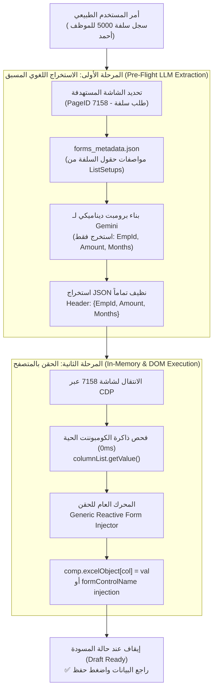

# DynamicPro ERP Co-Pilot — Metadata Integration Strategy & Next Move Plan

**Document Type:** Strategic Assessment & Chronological Engineering Plan  
**Classification:** Core System Architecture  
**Author:** Tech Lead & Antigravity Agent  
**Date:** 2026-10-25  
**Related Documents:** [ERP_METADATA_DISCOVERY_REFERENCE.md](file:///e:/Mazen/EgyDynamic/LMS_CO_Pilot/docs/ERP_METADATA_DISCOVERY_REFERENCE.md) & [ERP_COPILOT_MASTER_BLUEPRINT.md](file:///e:/Mazen/EgyDynamic/LMS_CO_Pilot/docs/ERP_COPILOT_MASTER_BLUEPRINT.md)

---

## 1. Tech Lead Assessment & Strategic Thoughts (تقييم ورؤية قائد الفريق التقني)

### 🌟 1.1 The Breakthrough: Why This Changes Everything
The findings delivered by the ERP engineering team represent the most critical breakthrough since the project began. We now have complete architectural clarity:

* **Elimination of Guesswork:** Previously, we were attempting to reverse-engineer HTML IDs (`#SupplierID`, `#StoreID`) and CSS classes across individual screens. We now know that the single source of truth across all 821 screens is the database column `ListSetups.ColumnName`, which maps 1-to-1 with Angular's `formControlName`.
* **The Magic of `IsGeneral`:** The historic challenge in ERP document automation has always been distinguishing between header fields (e.g. Supplier, Branch, Date) and table line items (e.g. Item, Quantity, Price). The column `IsGeneral = 1` (Header) versus `IsGeneral = 0` (Grid Lines) solves this problem deterministically.
* **The Dual-Access Superpower:** We have discovered that we have **two independent ways** to access this metadata:
  * **Way 1: The Offline Metadata Cache (`src/data/forms_metadata.json`)**  
    Pre-cached JSON schema allowing Gemini to know what fields to extract from the user's voice/text command *before* touching the browser.
  * **Way 2: The In-Memory 0ms Reflection Bridge**  
    `window.DynamicERP.getActiveComponentInstance().columnList.getValue()` allows the CDP driver to inspect the exact live fields of the active component at 0ms latency with zero database roundtrips.

---

### 💡 1.2 The Two-Stage Synergy Architecture



---

## 2. Chronological Next Move Plan (خطة الخطوات القادمة التنفيذية)

The execution of this architecture is organized into five surgical, verified phases:

---

### 🎯 Phase 1: Establish the Standard `forms_metadata.json` Schema Catalog

#### Objective:
Create the permanent production schema catalog file [`src/data/forms_metadata.json`](file:///e:/Mazen/EgyDynamic/LMS_CO_Pilot/src/data/forms_metadata.json) structured around the verified `ListSetups` contract.

#### Structure of Each Form Entry:
* **`page_id` (Integer):** Real database identifier (e.g. `289`, `290`, `7158`, `311`, `112`).
* **`screen_key` (String):** Canonical key (e.g. `Purchases`, `SalesDetails`, `Loans`, `JournalEntry`, `StoreMovement`).
* **`name_ar` and `name_en` (Strings):** Screen display names.
* **`is_excel` (Boolean):** Whether the screen uses the transactional grid (`Excel = true`) or flat master form.
* **`header_fields` (Array of Objects):**
  * `column_name`: Exact `formControlName` / model key.
  * `label_ar`: Arabic label for matching user intent.
  * `type`: Control type (`dropdown`, `input`, `number`, `date`, `account`, `checkbox`).
  * `is_required`: Boolean.
  * `lookup_model`: Source lookup entity (e.g. `Vendor`, `Customer`, `Store`, `Employee`).
* **`grid_fields` (Array of Objects, if `is_excel` is true):**
  * Line item column definitions (`Product`, `Qty`, `Price`, `DebitAccount`, `CreditAccount`).

#### Immediate Target Screens for Initial Deployment:
1. **Purchases Invoice (Page 289):** Header (`VendorID`, `StoreID`, `POSetting`, `ProjectID`), Lines (`product`, `productQty`).
2. **Sales Invoice (Page 290):** Header (`CustomerID`, `StoreID`, `PaymentType`), Lines (`product`, `productQty`).
3. **Employee Loans (Page 7158):** Header (`EmpId`, `Amount`, `Months`, `StartDate`), Lines (`None`).
4. **General Journal Entry (Page 311):** Header (`DocDate`, `Description`), Lines (`AccID`, `Debit`, `Credit`, `LineNote`).
5. **Store Movements (Page 112):** Header (`MovementType`, `FromStoreID`, `ToStoreID`), Lines (`product`, `productQty`).

---

### 🎯 Phase 2: Implement the Polymorphic AI Extractor in `agentic_stepper_service.py`

#### Objective:
Replace the hardcoded Purchases extraction prompt with a dynamic prompt builder that reads from `forms_metadata.json`.

#### Concrete Implementation Steps:
1. Load `forms_metadata.json` alongside `screens_metadata.json` in `AgenticStepperService`.
2. When a goal is classified as a transaction:
   * Resolve the target screen (`target_screen = await self.resolve_target_screen(goal, screens)`).
   * Fetch the corresponding schema from `forms_metadata.json` by `page_id` or `screen_key`.
   * Construct the Gemini prompt containing *only* the expected header and grid fields of that specific document.
3. Call Gemini with temperature 0.0 and schema enforcement.
4. Return a normalized payload:
   ```json
   {
     "page_id": 7158,
     "screen_key": "Loans",
     "header": {
       "EmpId": "محمود السيد",
       "Amount": 8000,
       "Months": 8
     },
     "lines": []
   }
   ```

---

### 🎯 Phase 3: Build the Generic Reactive Form & Grid Injector in `cdp_agent_service.py`

#### Objective:
Deprecate the hardcoded `#SupplierID` / `#StoreID` logic in `fill_erp_form_bridge()` and replace it with a universal Angular Reactive Form injector.

#### Injection Mechanism Priority:
* **Priority 1 (In-Memory Direct Injection via Bridge):**
  If `window.DynamicERP.fillFormData` or `activeComp.dataObject` / `activeComp.excelObject` is directly accessible, inject values into memory and trigger Angular Change Detection (`activeComp.cdr.detectChanges()`).
* **Priority 2 (Generic DOM Attribute Targeting):**
  If in-memory bridge is unavailable, locate fields by their standard Angular attribute:
  `[formcontrolname='${column_name}']` or `id='${column_name}'`.
  * For `type === 'dropdown'`: Focus container, type search query, and click matching `.ng-option`.
  * For `type === 'input'` or `number`: Use prototype setter dispatching `input` and `change` events.
  * For `type === 'date'`: Set ISO date string and dispatch `change`.
* **Priority 3 (Grid Automation):**
  If lines exist in payload:
  * Click `button.dp-list__act` or call `activeComp.addNewRow()`.
  * Fill line items sequentially.
  * If `.dp-modal.dp-pdm` appears (quantity confirmation), auto-enter quantity and click "متابعة".

---

### 🎯 Phase 4: Dynamic Outcome Reporting in Stepper

#### Objective:
Ensure execution feedback accurately reflects the document that was actually processed.

#### Implementation:
```python
screen_title = target_screen.get("name_ar", "المعاملة")
header_values = list(tx_payload.get("header", {}).values())
primary_entity = header_values[0] if header_values else ""
lines_count = len(tx_payload.get("lines", []))

if lines_count > 0:
    done_msg = f"✅ تم تجهيز مستند {screen_title} لـ '{primary_entity}' وإضافة ({lines_count}) أسطر بنجاح! يرجى المراجعة والضغط على حفظ."
else:
    done_msg = f"✅ تم تعبئة حقول {screen_title} لـ '{primary_entity}' بنجاح! يرجى المراجعة والضغط على حفظ."
```

---

### 🎯 Phase 5: Automated Test Suite & Multi-Document Verification

#### Objective:
Verify end-to-end autonomous execution across five distinct business document types.

#### Verification Test Cases:
1. **Purchases Invoice Test:** Goal: *"سجل فاتورة مشتريات للمورد حسين مخزن خامات تام صنف سن كمية 10"* -> Verify Page 289 populated.
2. **Sales Invoice Test:** Goal: *"سجل فاتورة مبيعات للعميل شركة الأمل من مخزن تام صنف رمل كمية 50"* -> Verify Page 290 populated.
3. **Employee Loan Test:** Goal: *"عايز اقدم طلب سلفة 5000 للموظف أحمد علي تخصم على 10 شهور"* -> Verify Page 7158 populated.
4. **General Journal Entry Test:** Goal: *"تسجيل قيد يومية عام 10000 من حساب الصندوق الى حساب البنك"* -> Verify Page 311 populated.
5. **Store Movement Test:** Goal: *"اذن تحويل مخزني من مخزن خامات الى مخزن تام صنف سن كمية 15"* -> Verify Page 112 populated.

---

## 3. Summary of Deliverables & Milestones

* **Milestone A:** [`docs/ERP_METADATA_DISCOVERY_REFERENCE.md`](file:///e:/Mazen/EgyDynamic/LMS_CO_Pilot/docs/ERP_METADATA_DISCOVERY_REFERENCE.md) — Permanent technical reference document.
* **Milestone B:** [`docs/ERP_METADATA_INTEGRATION_PLAN.md`](file:///e:/Mazen/EgyDynamic/LMS_CO_Pilot/docs/ERP_METADATA_INTEGRATION_PLAN.md) — Strategic execution blueprint (This document).
* **Milestone C:** [`src/data/forms_metadata.json`](file:///e:/Mazen/EgyDynamic/LMS_CO_Pilot/src/data/forms_metadata.json) — Production schema catalog for top 5 transactions.
* **Milestone D:** Refactored [`agentic_stepper_service.py`](file:///e:/Mazen/EgyDynamic/LMS_CO_Pilot/src/services/agentic_stepper_service.py) & [`cdp_agent_service.py`](file:///e:/Mazen/EgyDynamic/LMS_CO_Pilot/src/services/cdp_agent_service.py).
* **Milestone E:** Automated verification suite running across all 5 test scenarios.
