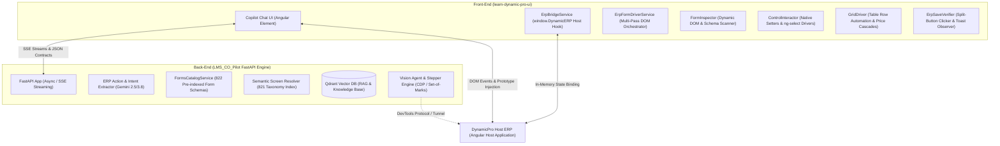

# 📑 وثيقة الحالة الفنية الشاملة والمعمارية الهندسية لمشروع ERP & LMS Co-Pilot
## Comprehensive Technical Dossier & Systems Status Report

> **تاريخ التقرير:** نوفمبر 2026  
> **معد التقرير:** Lead AI & Systems Architect (Pair-Programming Agent)  
> **الفئة المستهدفة:** مهندسو النظم الكبار، مدراء الهندسة، استشاريو الذكاء الاصطناعي (Senior / Principal Engineers & Tech Leads)  
> **النطاق:** الأتمتة المعرفية الذكية لمنظومة DynamicPro ERP وحلول المحادثة التوليدية

---

## 1. 🌐 الرؤية العامة وطبيعة المشروع (Project Overview & Vision)

### المشكلة الهندسية المستهدفة (The Core Problem)
نظام **DynamicPro ERP** هو نظام إدارة موارد مؤسسات ضخم مبني على تقنيات **Angular**، يضم ما يزيد عن **821 شاشة** تشغيلية وتجارية ومحاسبية (مشتريات، مبيعات، مخازن، مقاولات، حسابات عامة، رواتب).  
التعامل البشري مع هذا النظام يعاني من:
1. **ارتفاع معدل الاحتكاك (High Operational Friction):** الفاتورة الواحدة تتطلب ملء أكثر من 15-20 حقل هيدر، وإدخال أسطر أصناف متعددة، واختيار معقد من قوائم منسدلة معتمدة على البحث (`ng-select`)، واحتساب الضرائب وسعر الصرف والسداد.
2. **أخطاء الإدخال البشري:** عدم تطابق العملات، نسيان تحديد الخزينة أو طريقة الشراء، أو عدم ربط الصنف بمشروع/مخزن محدد.

### الحل المبتكر (The Intelligent Co-Pilot Solution)
بناء **مساعد ذكاء اصطناعي هجين ومستقل (Autonomous Hybrid AI Co-Pilot)** يعمل داخل النظام كعنصر واجهة مدمج (**Web Component / Custom Element**)، يقدم قدرتين رئيسيتين:
1. **المسار التعليمي والمعرفي (Educational Q&A / RAG Mode):** الإجابة الفورية والشرح المفصل لأي إجراء محاسبي أو خطوات عمل في النظام باللغة العربية مدعوماً بالبحث الدلالي وقاعدة المعرفة المتجهة (Qdrant).
2. **مسار الأتمتة والتنفيذ الذاتي (Unified Action & Vision Mode):** تحويل أوامر المستخدم باللغة الطبيعية الدارجة (مثل: *"سجل فاتورة مشتريات من المورد حسين على مخزن خامات تام لمشروع السحاب وسدد كاش وأضف 10 سن و20 رمل"*) إلى:
   - انتقال آلي للشاشة المطلوبة.
   - فتح وتجهيز النموذج وإدخال بيانات الهيدر بدقة عبر الـ DOM.
   - بناء صفوف الجدول واختيار الأصناف وربط كود المنتج والأسعار تلقائياً.
   - احتساب الإجمالي ومزامنة المدفوع نقداً.
   - الضغط على زر الحفظ التفاعلي والتحقق من حفظ المستند فعلياً في قاعدة البيانات.
   - الاستدراك الحواري التلقائي (Conversational Slot-Filling) في حال وجود حقول ناقصة دون إعادة كتابة الطلب.

---

## 2. 🏗️ المعمارية الهندسية ومكونات النظام (System Architecture)

يتكون المشروع من مكوّنين رئيسيين يعملان في تناغم كامل:



### أولاً: الفرونت إند (`learn-dynamic-pro-ui`)
- **التقنية:** Angular 18/19، مجمّع كحزمة واحدة معزولة (`lms-copilot.bundle.js` بحجم تقريبي **712 KB**).
- **الطبقات والخدمات الجوهرية:**
  1. [`erp-form-driver.service.ts`](file:///e:/Mazen/DynamicProLearn/learn-dynamic-pro-ui/src/app/core/services/erp-automation/erp-form-driver.service.ts): المنسق العام (Façade Orchestrator) المسؤول عن التعبئة متعددة الأدوار (Multi-Pass Filling).
  2. [`form-inspector.ts`](file:///e:/Mazen/DynamicProLearn/learn-dynamic-pro-ui/src/app/core/services/erp-automation/form-driver/form-inspector.ts): المسح اللحظي لعناصر الـ DOM وتحديد أنواع الحقول وحالات التعطيل واستخراج الـ Labels.
  3. [`control-interactor.ts`](file:///e:/Mazen/DynamicProLearn/learn-dynamic-pro-ui/src/app/core/services/erp-automation/form-driver/control-interactor.ts): التعامل مع عناصر التحكم الخاصة بـ Angular مثل `ng-select` و `eg-select` وإرسال أحداث الكيبورد والبحث، وحقن القيم في الـ Inputs عبر الـ Native Prototype Setter لتجاوز قيود Angular Reactive Forms.
  4. [`grid-driver.ts`](file:///e:/Mazen/DynamicProLearn/learn-dynamic-pro-ui/src/app/core/services/erp-automation/form-driver/grid-driver.ts): أتمتة جداول الفواتير التفصيلية، إدراج السطور، ملء المنتج وتتبع أسعار التكلفة وكميات الشراء.
  5. [`erp-save-verifier.ts`](file:///e:/Mazen/DynamicProLearn/learn-dynamic-pro-ui/src/app/core/services/erp-automation/save-recovery/erp-save-verifier.ts): التعامل مع زر الحفظ ثنائي المرحلة (Split-Button `.dp-edit__save` ثم اختيار `span.dp-menu__text` "حفظ") ومراقبة الـ Toasts.
  6. [`copilot-chat.component.ts`](file:///e:/Mazen/DynamicProLearn/learn-dynamic-pro-ui/src/app/shared/components/copilot-chat/copilot-chat.component.ts): الواجهة التفاعلية وإدارة الحالة ودعم الاسترجاع الحواري (Conversational Recovery).

### ثانياً: الباك إند (`LMS_CO_Pilot`)
- **التقنية:** Python 3.13، FastAPI مع معالجة غير متزامنة بالكامل (Async/Await).
- **الطبقات والخدمات الجوهرية:**
  1. **نماذج الذكاء الاصطناعي:** Google Gemini 2.5 / 3.8 Flash & Pro عبر مكتبة `google-genai` الرسمية.
  2. **كتالوج النماذج والشاشات:**
     - [`forms_metadata.json`](file:///e:/Mazen/EgyDynamic/LMS_CO_Pilot/src/data/forms_metadata.json): كتالوج مفهرس يضم **822 شاشة ونموذجاً** بمواصفات حقول الهيدر والجدول، ومصفوفات الأسماء البديلة (Aliases).
     - [`forms_catalog_service.py`](file:///e:/Mazen/EgyDynamic/LMS_CO_Pilot/src/services/erp_copilot/forms_catalog_service.py): استرجاع سريع بدقة $O(1)$ لمخطط أي شاشة.
  3. **محرك الرؤية والتنفيذ البصري (Agentic Stepper & Vision Grounding):**
     - [`stepper_engine.py`](file:///e:/Mazen/EgyDynamic/LMS_CO_Pilot/src/services/erp_copilot/agentic_stepper/stepper_engine.py): مسار هجين بديل في حال عدم التمكن من التعامل المباشر مع الـ DOM، يعتمد على بروتوكول Chrome DevTools Protocol (CDP) مع تقنية Set-of-Marks للتعرف البصري على العناصر.

---

## 3. 📍 النقطة التي نقف عندها بدقة (Current Milestone & Standing Point)

### ما تم إنجازه بنجاح 100% (Solid Production Achievements):
1. **الانتقال السلس بين الشاشات (Cross-Screen Navigation):** الانتقال الآلي مع فترة استقرار (Settle Guard) لانتظار تحميل الـ DOM للشاشة الجديدة.
2. **التعبئة التلقائية لحقول الهيدر المركبة (Header Form Filling):** المورد، الخزينة، المخزن، المشروع، طريقة الشراء، نوع العقد، رجل المشتريات.
3. **أتمتة سطور الأصناف والجدول (Grid Row Ingestion):**
   - فتح السطر والبحث عن الصنف في قائمة `eg-select`.
   - اختيار الصنف وتأكيد ربطه بالـ `ProductID` الخاص به داخل نموذج الـ Host.
   - إدخال الكمية واحتساب الإجمالي وتحديثه تلقائياً.
4. **مزامنة السداد والمدفوع نقداً (Auto Cash-Paid Sync):** نقل القيمة الإجمالية المحسوبة مباشرة إلى خانة السداد والمدفوع نقداً (`POPaidCurrancy`).
5. **تنفيذ عملية الحفظ التفاعلية والتحقق منها (Save Verification):**
   - النقر على زر الحفظ الرئيسي لفتح القائمة المنسدلة.
   - النقر على خيار "حفظ" الفرعي.
   - **التحقق من نجاح العملية:** حفظ الفاتورة بنجاح في قاعدة بيانات الـ ERP وظهور رسالة: `"Update Changed تم الحفظ بنجاح"` (مثبت بالدليل في سجلات الجلسات).
6. **الاسترجاع الحواري للنواقص (Conversational Slot-Filling Recovery):**
   - في حال ظهور رسالة خطأ بنقص حقل معين (مثل سعر الصرف)، يطلب المساعد القيمة من المستخدم، وعندما يجيب المستخدم (مثل: "1") يتم حقن القيمة تلقائياً وإعادة الحفظ دون تكرار كامل الطلب.

---

## 4. 🔬 تشريح اللوج الأخير بالأدلة والأرقام (`session_session_20261109_160407_77zm.log`)

يكشف السجل الأخير بوضوح تام الفارق بين ما يعمل بنجاح مبهر وما يحتاج إلى صقل معماري:

```text
+----------------------------------------------------------------------------------------------------+
| خط زمني لأحداث الجلسة 77zm                                                                          |
+----------------------------------------------------------------------------------------------------+
| L1 - L50   | تعبئة فاتورة مشتريات (حسين، مخزن خامات، السحاب، 10 سن، 20 رمل) -> نجاح تعبئة 14 حقلاً  |
| L55        | الحفظ الأول يظهر خطأ 'حدد سعر الصرف' (بسبب مسح Angular للحقل عند اختيار العملة EGP)   |
| L57 - L64  | المستخدم يكتب "1" -> السائق يحقن سعر الصرف فوراً في الـ DOM                         |
| L66        | DynamicERP.submitActiveForm() -> تم الحفظ بنجاح (Update Changed) ✅                    |
+----------------------------------------------------------------------------------------------------+
| L68 - L135 | تكرار نفس العملية لفاتورة ثانية -> تعبئة كاملة ثم رسالة سعر الصرف                     |
| L137 - L145| المستخدم يكتب "1" -> حقن فوري في الـ DOM                                             |
| L146       | DynamicERP.submitActiveForm() -> تم الحفظ بنجاح (Update Changed) ✅                    |
+----------------------------------------------------------------------------------------------------+
| L147 - L189| المستخدم يطلب: "عدل الفاتورة السابقة وسجل المشروع تحت"                                |
|            | 1. النظام يفتقر لـ Edit Mode ويضغط Add New بدلاً من فتح الفاتورة.                     |
|            | 2. الـ Resolver يهلوس بكلمة "السابقة" ويحوّل لشاشة مسير الرواتب السابقة (7864)!     |
|            | 3. عميل الرؤية يصطدم بـ 'ClientConnection' object has no attribute 'closed'.          |
+----------------------------------------------------------------------------------------------------+
| L196 - L316| المستخدم يطلب: "احذف المشروع من فوق وخليه تحت مع المنتج فقط"                           |
|            | 1. الـ LLM يضع "مطلوب نقله إلى السطر" كقيمة لخلية الجدول!                             |
|            | 2. الـ Resolver يهلوس بكلمة "المشروع" ويحوّل لشاشة المنتجات المصروفة للمشروع (7899)! |
|            | 3. حلقة مفرغة لـ 15 خطوة فاشلة في عميل الرؤية بسبب كود الـ WebSocket.                 |
+----------------------------------------------------------------------------------------------------+
```

---

## 5. 🛑 الحدود الهندسية والتحديات الحالية (Current Limitations & Boundaries)

| المكون | الوضع الحالي | التحدي الهندسي (The Limitation) |
|---|---|---|
| **توقيت سعر الصرف (Exchange Rate)** | يعمل عبر الـ Recovery (يكتب 1) | عند ملء العملة `EGP`، يقوم كود الـ Angular الداخلي بمسح قيمة سعر الصرف إذا كُتب مبكراً. الحل: حقنه في الخطوة الأخيرة قبل الحفظ مباشرة. |
| **وضع التعديل (Edit Mode vs Add New)** | يدعم الإنشاء الجديد بنسبة 100% | النظام يفترض حالياً أن كل معاملة هي معاملة جديدة (`triggerAddNew`). لا توجد آلية بعد للبحث عن فاتورة برقمها (مثل 231) لفتحها وتعديلها. |
| **تحديد الشاشة (Screen Resolution)** | دقيق في الأوامر المباشرة | في الأوامر الحوارية الضمنية ("الفاتورة السابقة"، "المشروع تحت")، يلتقط كلمات مفتاحية فرعية وينتقل لشاشات غير مقصودة لغياب الـ **Screen Pinning**. |
| **استخراج بيانات الجداول (Table Prompt Leakage)** | دقيق في البيانات الصريحة | في الأوامر التحويلية ("شيل ده وحطه تحت")، قد يتسرب نص الأمر اللغوي ("مطلوب نقله") كقيمة للخلية بدلاً من نقل القيمة الأصلية. |
| **عميل الرؤية CDP (Vision Agent)** | يدعم التوجيه البصري | متوقف مؤقتاً بسبب عدم توافق دالة فحص اتصال الـ WebSocket (`.closed`) مع إصدار مكتبة `websockets` الأخير في بايثون. |

---

## 6. 🚀 خارطة الطريق والخطوات التالية المقترحة (Engineering Roadmap)

### المرحلة 1: الاستقرار النهائي للإنشاء التلقائي (Immediate Stability)
1. **Atomic Pre-Save Pass:** نقل استدعاء `writeExchangePriceDom(1)` ليكون آخر خطوة تنفيذية بعد استقرار جميع الـ Dropdowns وقبل الضغط على زر الحفظ مباشرة، لإنهاء ظهور رسالة `'حدد سعر الصرف'` من المرة الأولى نهائياً.
2. **WebSocket Polyfill:** تحديث السطر 54 في [`connection_manager.py`](file:///e:/Mazen/EgyDynamic/LMS_CO_Pilot/src/services/erp_copilot/cdp/connection_manager.py) لدعم خواص `websockets` الحديثة ومنع انهيار الـ CDP Agent.

### المرحلة 2: دعم التعديل وتثبيت السياق (Context Pinning & Edit Engine)
1. **Active Screen Pinning:** حظر أي محاولة تغيير للشاشة إذا كان هناك نموذج قيد المعالجة، إلا إذا طلب المستخدم صراحة شاشة أخرى.
2. **In-Context Invoice Resolver:** إضافة مسار "تعديل مستند":
   - فحص رقم المستند المطلوب (مثل 231).
   - استخدام شريط البحث الخاص بجدول الفواتير في الشاشة لفتح المستند مباشرة بدلاً من الضغط على "إضافة جديد".

### المرحلة 3: تنقية التعليمات اللغوية (Meta-Instruction Sanitization)
- تدريب/توجيه الـ Extractor للتعرف على الجمل التوجيهية وتطبيقها هيكلياً (نقل قيمة المشروع القديمة "السحاب" إلى أسطر الجدول بدلاً من كتابة نص التعليمات).

---

## 7. 💡 الخلاصة للمهندس المختص (Summary for the Lead Engineer)

> إن بنية النظام الحالية قطعت **أصعب شوط تقني في أتمتة الـ Enterprise ERP**:
> - تجاوزنا بنجاح قيود Angular DOM و Reactive Forms و Shadow Selectors.
> - أتمتنا تعبئة الهيدر والجداول واحتساب الإجماليات بدقة متناهية.
> - وثّقنا حفظ المعاملات رسمياً في قاعدة بيانات الـ ERP مع التوافق التام مع الـ Backend.
> 
> ما تبقى الآن هو **تنظيم إدارة السياق والذاكرة الحوارية (Context Management)** ومعالجة فروق التوقيت بين أحداث الـ UI، وهو عمل تنقيحي دقيق (Refinement Phase) يرتكز على أرضية صلبة وناجحة ومثبتة عملياً في السجلات.

