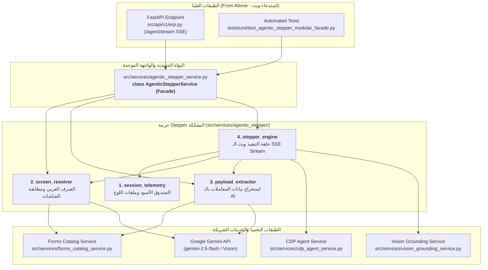

# الدليل الشامل والمفصل لمحرك الأتمتة البصرية المستقل: حزمة `agentic_stepper/` والواجهة الموحدة `AgenticStepperService`
## Autonomous Agentic Stepper Master Architectural Reference & Modular Implementation

---

## 📑 الفهرس (Table of Contents)

1. [المقدمة: دور المحرك ومسؤوليته بأسلوب بسيط](#1-المقدمة-دور-المحرك-ومسؤوليته-بأسلوب-بسيط)
2. [أمثلة واقعية على عمل المحرك في الميدان](#2-أمثلة-واقعية-على-عمل-المحرك-في-الميدان)
3. [التحول المعماري: من الملف الأحادي (God Class) إلى الحزمة النظيفة (Modular Facade)](#3-التحول-المعماري-من-الملف-الأحادي-إلى-الحزمة-النظيفة)
4. [الهيكل الشجري للحزمة الجديدة وتوزيع المسؤوليات](#4-الهيكل-الشجري-للحزمة-الجديدة-وتوزيع-المسؤوليات)
5. [خريطة العلاقات المعمارية (من فوق ومن تحت)](#5-خريطة-العلاقات-المعمارية-من-فوق-ومن-تحت)
   - [الملفات المرتبطة من فوق (Callers & Upstream)](#أ-الملفات-المرتبطة-من-فوق-callers--upstream)
   - [الملفات والأنظمة المرتبطة من تحت (Downstream & Subsystems)](#ب-الملفات-والأنظمة-المرتبطة-من-تحت-downstream--subsystems)
6. [التشريح المفصل للوحدات الفرعية الأربعة وكافة الدوال](#6-التشريح-المفصل-للوحدات-الفرعية-الأربعة-وكافة-الدوال)
   - [الوحدة 1: session_telemetry (سجل الصندوق الأسود للجلسات)](#الوحدة-1-session_telemetry-سجل-الصندوق-الأسود-للجلسات)
   - [الوحدة 2: screen_resolver (المطابقة الدلالية والمعالجة الصرفية العربية)](#الوحدة-2-screen_resolver-المطابقة-الدلالية-والمعالجة-الصرفية-العربية)
   - [الوحدة 3: payload_extractor (محرك استخراج بيانات المعاملات بالـ AI)](#الوحدة-3-payload_extractor-محرك-استخراج-بيانات-المعاملات-بالـ-ai)
   - [الوحدة 4: stepper_engine (محرك حلقة التنفيذ التكرارية وبث الـ SSE)](#الوحدة-4-stepper_engine-محرك-حلقة-التنفيذ-التكرارية-وبث-الـ-sse)
7. [الجدول المرجعي الشامل لكافة الدوال](#7-الجدول-المرجعي-الشامل-لكافة-الدوال)
8. [نمط الواجهة الموحدة وضمان عدم كسر التوافقية (Zero Breaking Changes)](#8-نمط-الواجهة-الموحدة-وضمان-عدم-كسر-التوافقية)
9. [إثبات الجودة واختبارات التحقق الآلي الممررة بنجاح](#9-إثبات-الجودة-واختبارات-التحقق-الآلي)
10. [الخلاصة والقيمة الهندسية للمشروع](#10-الخلاصة-والقيمة-الهندسية-للمشروع)

---

## 1. المقدمة: دور المحرك ومسؤوليته بأسلوب بسيط

خدمة **[`AgenticStepperService`](file:///e:/Mazen/EgyDynamic/LMS_CO_Pilot/src/services/agentic_stepper_service.py)** هي **"العقل المدبر والمخطط التنفيذي (Orchestrator Brain) للوكيل الذكي داخل نظام الـ ERP"**.

### ما هي المشكلة التي يحلها؟
المستخدم يتحدث باللغة الطبيعية العامية أو الفصحى (مثال: *"عايز أسجل فاتورة مشتريات للشركة الهندسية بـ 15000 ومخزن الخامات، وسددت كاش"* أو *"افتح لي اعتماد مستخلصات مقاولين"*).
- نظام الـ ERP يضم أكثر من **820 شاشة معقدة** تختلف مسمياتها وأرقام صفحاتها.
- كل شاشة لها حقول خاصة، وجداول أصناف، وقواعد سداد، وحسابات إجماليات.
- النقر والتنقل يحتاج وعياً استباقياً: هل الشاشة مفتوحة بالفعل؟ كيف ننتقل إليها بأسرع وسيلة؟ وكيف نتأكد من اكتمال تعبئة الحقول والتحقق البصري منها؟

### الحل الذي يقدمه هذا المحرك:
يقود حلقة تفكير وتنفيذ تكرارية متكاملة (Autonomous Agentic Loop):
1. **فهم النية وتحديد الوجهة (Screen Resolution):** يحلل كلمات الهدف ويطابقها مع شاشات المستخدم المصرح بها وفهارس النظام الدلالية في أجزاء من الثانية.
2. **استخراج البيانات المنظمة (Dynamic Payload Extraction):** يستخلص بيانات الهيدر وجدول الأصناف ومبالغ السداد بالذكاء الاصطناعي وفق مخطط النموذج المستهدف.
3. **إدارة دورة التنفيذ المزدوجة (Hybrid Execution Pipeline):** ينقل المتصفح مباشرة للشاشة، ويضمن فتح نموذج الإدخال، ويملأ الحقول، ثم يلتقط صورة شاشة للتدقيق البصري.
4. **البث اللحظي للمستخدم (Real-time SSE Streaming):** يرسل تحديثات حية خطوة بخطوة لشاشة المستخدم توضح ما يفعله الروبوت (تفكير، تنقل، كتابة، تأكيد).

---

## 2. أمثلة واقعية على عمل المحرك في الميدان

### السيناريو الأول: الملاحة الذكية لشاشة دقيقة وتفادي التقارير
- **طلب المستخدم:** *"عايز اعتماد مستخلصات مقاولين"*.
- **التحدي:** يوجد في النظام شاشات متعددة مثل: (تقرير مستخلصات مقاولين)، (مستخلصات عملاء)، و(اعتماد مستخلصات مقاولين).
- **كيف يعمل المحرك؟**
  1. تقوم وحدة `screen_resolver` بتحليل النص عبر تفكيك الصرف وتطبيق قواعد التعزيز لكلمة *"مقاول"* وتطبيق خصم جزائي (Demotion Penalty) ضد شاشات *"التقارير"*.
  2. يتم تحديد رقم الشاشة الحقيقي فوراً (`page_id: 7090`).
  3. تفحص وحدة `stepper_engine` الشاشة الحالية؛ إن لم يكن المستخدم فيها، تستدعي الجسر البرمجي `navigate_to_erp_screen(7090)`، وتتحقق استباقياً من الوصول، وتبث للمستخدم: *"✅ تم الانتقال بنجاح إلى شاشة اعتماد المستخلصات مقاولين"*.

### السيناريو الثاني: تعبئة مستند متعدد الأطراف (طلب سلفة موظف)
- **طلب المستخدم:** *"سجل طلب سلفة للموظف محمود السيد بقيمة 5000 جنيه على 6 أشهر"*.
- **كيف يعمل المحرك؟**
  1. يتعرف المحرك على أن الهدف هو **معاملة تنفيذية (Transaction Goal)** وليس مجرد انتقال.
  2. يطابق الشاشة ويستخرج كود شاشة السلف (`page_id: 7158`).
  3. تستدعي وحدة `payload_extractor` نموذج Gemini مع مخطط شاشة السلف المستخرج من كتالوج النماذج، لتحويل الهدف إلى كائن منظم:
     ```json
     {
       "header": { "EmpId": "محمود السيد", "Amount": 5000, "Months": 6 },
       "items": [],
       "target_page_id": 7158
     }
     ```
  4. تنقل المستخدم للشاشة، تضغط "إضافة جديد"، تحقن البيانات عبر الجسر، وتلتقط لقطة شاشة للتحقق البصري، وتبث للمستخدم رسالة إنجاز مخصصة: *"✅ تم تجهيز طلب سلفة للموظف محمود السيد بقيمة 5000 على 6 أشهر بنجاح! راجع البيانات واضغط حفظ"*.

---

## 3. التحول المعماري: من الملف الأحادي إلى الحزمة النظيفة

كان الكود مكدساً سابقاً داخل ملف أحادي يتجاوز **919 سطراً** (`agentic_stepper_service.py`)، مما جمع عدة نطاقات متباعدة داخل فئة واحدة، منتهكاً مبدأ المسؤولية الواحدة (SRP):
- خلط منطق الصندوق الأسود وتسجيل ملفات الـ Log مع استدعاءات نماذج الـ LLM.
- دمج خوارزميات الصرف والمعالجة اللغوية العربية وقوائم الاستبعاد مع حلقة الـ Async Generator.
- صعوبة اختبار أو عزل أي جزء (مثل اختبار دقة التعرف على الشاشات) دون تشغيل السيرفر بالكامل.

### التحسينات المعمارية المحققة:
- تم تفكيك المحرك جراحياً إلى **حزمة برمجية معيارية** تحت المجلد: [`src/services/agentic_stepper/`](file:///e:/Mazen/EgyDynamic/LMS_CO_Pilot/src/services/agentic_stepper/).
- تقسيم العمل إلى **4 وحدات أحادية المسؤولية**:
  1. `session_telemetry.py`: إدارة الصندوق الأسود وحفظ السجلات الموحدة.
  2. `screen_resolver.py`: المعالجة الصرفية العربية والمطابقة الدلالية للشاشات.
  3. `payload_extractor.py`: استخراج وتشكيل بيانات المعاملات بالـ AI.
  4. `stepper_engine.py`: محرك حلقة التنفيذ التكرارية وبث الـ SSE.
- بناء واجهة موحدة **(Composite Facade Pattern)** داخل [`src/services/agentic_stepper/__init__.py`](file:///e:/Mazen/EgyDynamic/LMS_CO_Pilot/src/services/agentic_stepper/__init__.py) مع غلاف توافقي في [`src/services/agentic_stepper_service.py`](file:///e:/Mazen/EgyDynamic/LMS_CO_Pilot/src/services/agentic_stepper_service.py) لضمان **عدم كسر أي استدعاء خارجي بنسبة 100% (Zero Breaking Changes)**.

---

## 4. الهيكل الشجري للحزمة الجديدة وتوزيع المسؤوليات

```text
src/services/
├── agentic_stepper_service.py        # <-- غلاف Facade التوافقي (Zero Breaking Changes)
└── agentic_stepper/                  # <-- الحزمة المعمارية النظيفة
    ├── __init__.py                   # كلاس Facade الموحد (AgenticStepperService) ومجمع الصادرات
    ├── session_telemetry.py          # الصندوق الأسود: تسجيل الأحداث الموحدة وملفات الجلسات المستقلة
    ├── screen_resolver.py            # معالجة الصرف العربي، الأوزان والخصومات، ومطابقة الشاشات
    ├── payload_extractor.py          # استخراج بيانات المعاملات المهيكلة (Headers/Grids) بالـ LLM
    ├── prompts.py                    # مجمع برومبتات الذكاء الاصطناعي المفصولة تماماً عن منطق التشغيل
    └── stepper_engine.py             # محرك حلقة التنفيذ التكرارية، وحراس التكرار، وبث الـ SSE Stream
```

---

## 5. خريطة العلاقات المعمارية (من فوق ومن تحت)



### أ. الملفات المرتبطة من فوق (Callers & Upstream)

1. **[`src/api/v1/erp.py`](file:///e:/Mazen/EgyDynamic/LMS_CO_Pilot/src/api/v1/erp.py):**
   - **الدور:** راوتر FastAPI الرئيسي الذي يستقبل أهداف المستخدم عبر نقطة النهاية `/agent/stream`.
   - **كيف يرتبط بنا؟** يستورد الكائن المشترك: `from src.services.agentic_stepper_service import agentic_stepper_service` ويستدعي المولد التدفقي `agentic_stepper_service.execute_goal_stream(...)` لبث الأحداث لحظياً للمتصفح.

2. **حزم الاختبارات الآلية (`tests/unit/test_generic_stepper_extraction.py` و `tests/unit/test_agentic_stepper_modular_facade.py`):**
   - تستورد الكلاس الموحد `AgenticStepperService` وتتحقق من دقة الاستخراج والمطابقة دون أي أخطاء.

### ب. الملفات والأنظمة المرتبطة من تحت (Downstream & Subsystems)

1. **[`src/services/cdp_agent_service.py`](file:///e:/Mazen/EgyDynamic/LMS_CO_Pilot/src/services/cdp_agent_service.py):**
   - الذراع التنفيذي للوكيل داخل المتصفح: فحص المنفذ 9222، الملاحة، لقطات الشاشة، حقن الفورم، ونبضات الماوس والكيبورد.
2. **[`src/services/forms_catalog_service.py`](file:///e:/Mazen/EgyDynamic/LMS_CO_Pilot/src/services/forms_catalog_service.py):**
   - كتالوج النماذج المرجعي الذي يوفر الـ Schemas ومخططات الحقول وقواعد السداد لنموذج الذكاء الاصطناعي.
3. **[`src/services/vision_grounding_service.py`](file:///e:/Mazen/EgyDynamic/LMS_CO_Pilot/src/services/vision_grounding_service.py):**
   - خدمة الرؤية والتفاعل المباشر بالـ DOM: توقع العنصر التالي بالرؤية أو بقائمة العناصر التفاعلية.
4. **نموذج Google Gemini (`settings.GEMINI_MODEL`):**
   - العقل التوليدي الذي يستخرج كائنات الـ JSON المنظمة ويفصل في الشاشات الغامضة.

---

## 6. التشريح المفصل للوحدات الفرعية الأربعة وكافة الدوال

---

### الوحدة 1: `session_telemetry` (سجل الصندوق الأسود للجلسات والوسم الهرمي)
- **الملف:** [`src/services/agentic_stepper/session_telemetry.py`](file:///e:/Mazen/EgyDynamic/LMS_CO_Pilot/src/services/agentic_stepper/session_telemetry.py)
- **المسؤولية:** كتابة الأحداث التفصيلية والتوقيتات بالوسوم الهرمية الصريحة (`TelemetryStage`) في ملف الجلسة المستقل وملف السجل الموحد لتوفير تتبع كامل لجذر المشاكل (Root-Cause Observability).

```text
├── class TelemetryStage(str, Enum)
│   ├── STEPPER_ENGINE    = "STEPPER.ENGINE"
│   ├── STEPPER_RESOLVER  = "STEPPER.RESOLVER"
│   ├── STEPPER_EXTRACTOR = "STEPPER.EXTRACTOR"
│   ├── STEPPER_VERIFY    = "STEPPER.VERIFY"
│   ├── CDP_CONNECT       = "CDP.CONNECT"
│   ├── CDP_NAVIGATOR     = "CDP.NAVIGATOR"
│   ├── CDP_FORM_BRIDGE   = "CDP.FORM_BRIDGE"
│   ├── CDP_VISUAL        = "CDP.VISUAL"
│   └── CDP_DISPATCHER    = "CDP.DISPATCHER"
├── append_session_event(session_id, level, stage, message, details) -> None
├── read_session_events(session_id, stage_prefix, level, limit) -> list[dict]
└── _append_session_event (Backward-Compatible Alias)
```

#### تفصيل الدوال والكائنات:
1. **`class TelemetryStage(str, Enum)`**:
   - قاموس موحد للوسوم الهرمية يربط كل سطر لوج بالموديول البرمجي المسؤول مباشرة.
   - يدعم الوراثة من `str` ليتوافق بسلاسة مع أي كود يمرر وسوماً نصية تقليدية.
2. **`append_session_event(session_id: Optional[str], level: str, stage: str | TelemetryStage, message: str, details: Optional[dict[str, Any]] = None) -> None`**:
   - **الهدف:** كتابة سجل زمني دقيق لكل خطوة أو تحذير أو خطأ مع وسم هرمي صريح.
   - **الآلية:**
     - يسجل في مسارين بالتوازي: مجلد الجلسات المحلي `logs/erp_sessions/` ومجلد الجلسات المشترك `e:/Mazen/shared_logs/erp_sessions/`.
     - يكتب في ملفين: ملف الجلسة المنفصل `session_{id}.log` وملف السجل الموحد `agent_unified_debug.log`.
     - يتجاهل الاستدعاء بهدوء ودون أي استثناء إذا كان `session_id` فارغاً أو في بيئات الاختبار غير المربوطة بجلسة.
3. **`read_session_events(session_id: str, stage_prefix: Optional[str] = None, level: Optional[str] = None, limit: int = 300) -> list[dict[str, Any]]`**:
   - **الهدف:** قراءة وفلترة أحداث الصندوق الأسود للجلسة بدقة فائقة بحسب بادئة المرحلة (مثلاً: `CDP` أو `STEPPER.VERIFY`) أو مستوى الخطورة (`WARN`, `ERROR`).

---

### الوحدة 2: `screen_resolver` (المطابقة الدلالية والمعالجة الصرفية العربية)
- **الملف:** [`src/services/agentic_stepper/screen_resolver.py`](file:///e:/Mazen/EgyDynamic/LMS_CO_Pilot/src/services/agentic_stepper/screen_resolver.py)
- **المسؤولية:** تحليل هدف المستخدم، معالجة النصوص والجموع العربية، تطبيق الأوزان والخصومات، والاستعانة بالـ AI عند اللزوم.

```text
├── clean_token(w: str) -> set[str]
├── tokenize(text: str) -> set[str]
└── class ScreenResolver
    ├── __init__(catalog_path: Optional[Path] = None)
    ├── _load_screens_catalog() -> list[dict[str, Any]]
    ├── get_cached_user_screens(ws_url, session_id) -> list[dict[str, Any]]
    └── resolve_target_screen(goal, authorized_screens) -> Optional[dict[str, Any]]
```

#### تفصيل الدوال:
1. **`clean_token(w: str) -> set[str]`**:
   - تفكيك الكلمة العربية وإزالة الزوائد مثل "الـ" التعريف، ولواحق الجمع ("ات", "ين", "ون", "ية").
   - تحويل جموع التكسير الشائعة في الأنظمة الإدارية إلى مفردها القياسي (مثال: فواتير -> فاتورة، أوامر -> أمر، قيود -> قيد، أصناف -> صنف، عملاء -> عميل، مخازن -> مخزن).
2. **`tokenize(text: str) -> set[str]`**:
   - تطبيع النص العربي وإزالة كلمات التوقف (Stopwords مثل: "افتح", "اذهب", "عايز", "من", "إلى") واستخراج جذور الكلمات الدلالية.
3. **`_load_screens_catalog() -> list[dict[str, Any]]`**:
   - تحميل كتالوج الأوصاف والنوايا الدلالية من ملف `src/data/screens_metadata.json` وتخزينه في الذاكرة لمرة واحدة (Singleton In-Memory Cache).
4. **`get_cached_user_screens(ws_url: str, session_id: Optional[str] = None) -> list[dict[str, Any]]`**:
   - استدعاء شاشات المستخدم المصرح بها من المتصفح عبر CDP مرة واحدة فقط لكل جلسة، وتخزينها في قاموس ذاكرة الجلسة لتعمل الاستدعاءات اللاحقة في **0 ملي ثانية**.
5. **`resolve_target_screen(goal: str, authorized_screens: list[dict[str, Any]]) -> Optional[dict[str, Any]]`**:
   - خوارزمية التقييم والتصنيف متعددة المراحل:
     - **المرحلة 0:** مطابقة فورية عبر هاش ماب الكتالوج المرجعي `forms_catalog_service`.
     - **المرحلة 1:** تجميع الشاشات وتطبيع أسمائها ونواياها.
     - **المرحلة 2:** حساب نقاط التطابق اللفظي والدلالي.
     - **المرحلة 3 (Demotion Penalty):** خصم جزائي صارم (-0.35) ضد شاشات التقارير والاستعلام عند وجود نية تنفيذية (مثل "سجل", "أضف", "فاتورة").
     - **المرحلة 4 (Qualifier Boosting):** رفع نقاط الكلمات التمييزية (+0.30 إلى +0.35) لكلمات "مقاول", "عميل", "سلفة", "تشغيل".
     - **المرحلة 5:** إذا تجاوزت النقاط 0.88 يتم اختيار الشاشة فوراً في أقل من 5ms؛ وإن كانت النية غامضة، يتم استدعاء Gemini لترتيب أفضل 4 مرشحين بدقة تامة.

---

### الوحدة 3: `payload_extractor` (محرك استخراج بيانات المعاملات بالـ AI)
- **الملف:** [`src/services/agentic_stepper/payload_extractor.py`](file:///e:/Mazen/EgyDynamic/LMS_CO_Pilot/src/services/agentic_stepper/payload_extractor.py)
- **المسؤولية:** تحويل نية المستخدم الشفهية إلى كائن بيانات منظم وجاهز للحقن في أي نموذج بالـ ERP.

```text
└── class PayloadExtractor
    ├── __init__()
    └── extract_transaction_payload(goal, target_screen, target_page_id, timeout) -> dict[str, Any]
```

#### تفصيل الدوال:
1. **`extract_transaction_payload(goal: str, target_screen: Optional[dict] = None, target_page_id: Optional[int] = None, timeout: float = 15.0) -> dict[str, Any]`**:
   - **الهدف:** استخراج حقول الهيدر وجدول الأصناف دون أي كود صلب (Dynamic Schema-Driven Extraction).
   - **الآلية:**
     - جلب عقد النموذج من `forms_catalog_service.get_prompt_schema_for_gemini` متضمناً الحقول المتوقعة ونوع النموذج (هل يحتوي جدول أصناف شبكي Excel أم نموذج أحادي السجل؟).
     - حقن قواعد السداد والمدفوعات الصارمة `ERP_PAYMENT_RULES` (تحديد نوع السداد كاش/آجل وتوجيه الحسابات).
     - استدعاء نموذج Gemini مع فرض صيغة المخرجات JSON حصرياً بنمط متزامن عبر `asyncio.to_thread`.
     - التحقق التلقائي من سلامة المعرف `target_page_id` ومطابقة أسماء الحقول.

---

### الوحدة 4: `stepper_engine` (محرك حلقة التنفيذ التكرارية وبث الـ SSE)
- **الملف:** [`src/services/agentic_stepper/stepper_engine.py`](file:///e:/Mazen/EgyDynamic/LMS_CO_Pilot/src/services/agentic_stepper/stepper_engine.py)
- **المسؤولية:** قيادة حلقة الأتمتة المستقلة خطوة بخطوة، وإدارة مسارات التنقل والمعاملات والرؤية، وبث الأحداث الحية.

```text
└── class StepperEngine
    ├── __init__(resolver, extractor, default_max_steps: int = 15)
    └── execute_goal_stream(goal, cdp_port, cdp_host, session_id, max_steps, title_match) -> AsyncGenerator
```

#### تفصيل الدوال:
1. **`execute_goal_stream(...) -> AsyncGenerator[dict[str, Any], None]`**:
   - **الهدف:** تشغيل الوكيل وبث خطواته لحظياً عبر SSE.
   - **المراحل التنفيذية المتتابعة:**
     1. **الفحص والاتصال:** التأكد من تشغيل المتصفح ومنفذ 9222 والاتصال بتبويب الـ ERP.
     2. **الرصد المتوازي (Parallel Gathering):** جلب حالة الصفحة وأبعاد الـ Viewport والعناصر التفاعلية دفعة واحدة عبر `asyncio.gather`.
     3. **مسار الملاحة الدلالية (Screen Navigation):** إذا كان الهدف انتقالاً فقط، يتأكد هل المستخدم في الشاشة بالفعل؟ إن لم يكن، ينقله مباشرة بالجسر البرمجي أو الـ DOM ويتحقق من الوصول.
     4. **مسار المعاملات الهجين (Transaction Pipeline):**
        - ينتقل لشاشة المعاملة المستهدفة.
        - يستدعي `ensure_erp_form_open` لفتح فورم الإدخال (زر إضافة جديد).
        - يأخذ لقطة للصندوق الأسود قبل التعبئة `snapshot_form_state`.
        - يحقن البيانات عبر الجسر البرمجي `fill_erp_form_bridge`.
        - يلتقط صورة شاشة للتدقيق البصري ويولد رسالة إنجاز مخصصة للمستند المحدد.
     5. **مسار الرؤية والـ DOM-First (Action Loop):**
        - يقترح الإجراء الأسرع بناءً على عناصر الـ DOM الظاهرة، مع التحول لخطة الطوارئ البصرية بالصورة عند تعذر العثور على العنصر.
        - يطبق حارس التكرار (Loop Guard) لمنع التكرار اللانهائي للنقرات في نفس المكان.
        - ينفذ النقرات المنجذبة ذاتياً `click_element_or_coordinate` أو الكتابة أو ضغط المفاتيح.

---

## 7. الجدول المرجعي الشامل لكافة الدوال

| الوحدة المسؤولة | اسم الدالة / الكائن | نوعها | المدخلات الرئيسية | المخرجات | الدور باختصار |
|---|---|---|---|---|---|
| **session_telemetry** | `TelemetryStage` | Enum | `str, Enum` | `Enum` | معجم الوسوم الهرمية الصريحة للأحداث (`STEPPER.*`, `CDP.*`, `BROWSER.*`) |
| **session_telemetry** | `append_session_event` | Sync | `session_id, level, stage, message, details` | `None` | تسجيل الأحداث في الصندوق الأسود للجلسة والسجل الموحد |
| **session_telemetry** | `read_session_events` | Sync | `session_id, stage_prefix, level, limit` | `list[dict]` | قراءة وفلترة أحداث الصندوق الأسود للجلسة بدقة فائقة |
| **session_telemetry** | `_append_session_event` | Sync | نفس المدخلات | `None` | اسم بديل متوافق تماماً مع الاستدعاءات القديمة |
| **screen_resolver** | `clean_token` | Sync | `w: str` | `set[str]` | تفكيك الكلمة العربية وإرجاع الجذور وجموع التكسير |
| **screen_resolver** | `tokenize` | Sync | `text: str` | `set[str]` | تنقية النص العربي وتفكيكه لرموز دلالية صرفية |
| **screen_resolver** | `_load_screens_catalog` | Sync | - | `list[dict]` | تحميل ميتاداتا الشاشات في ذاكرة النظام لمرة واحدة |
| **screen_resolver** | `get_cached_user_screens`| Async | `ws_url, session_id` | `list[dict]` | جلب وتخزين شاشات المستخدم المصرح بها في الذاكرة (0ms) |
| **screen_resolver** | `resolve_target_screen` | Async | `goal, authorized_screens` | `dict \| None` | المطابقة الدلالية الذكية بين الهدف والشاشات المتاحة |
| **payload_extractor** | `extract_transaction_payload`| Async| `goal, target_screen, target_page_id` | `dict` | استخراج بيانات المعاملة (Headers/Items) بالـ AI |
| **stepper_engine** | `execute_goal_stream` | Async Gen | `goal, cdp_port, cdp_host, session_id, max_steps` | `AsyncGenerator` | تشغيل حلقة الأتمتة وبث التقدم للمستخدم لحظة بلحظة |
| **Facade (__init__)** | `AgenticStepperService` | Class | `default_max_steps: int = 15` | `Instance` | الواجهة الموحدة الجامعة لكافة الوحدات والخصائص |

---

## 8. نمط الواجهة الموحدة وضمان عدم كسر التوافقية (Zero Breaking Changes)

لضمان سلامة واستقرار النظام وعدم تأثر راوتر الـ API أو أي كود خارجي:
1. كلاس [`AgenticStepperService`](file:///e:/Mazen/EgyDynamic/LMS_CO_Pilot/src/services/agentic_stepper/__init__.py) يجمع كائنات الوحدات الفرعية ويفوض كافة الاستدعاءات إليها بنفس التوقيعات الدقيقة.
2. الخصائص الداخلية التوافقية مثل `_catalog` و `_session_screens_cache` مربوطة عبر خاصيتي `@property` و `@setter` بكائن `resolver` الداخلي.
3. يحتفظ ملف [`src/services/agentic_stepper_service.py`](file:///e:/Mazen/EgyDynamic/LMS_CO_Pilot/src/services/agentic_stepper_service.py) بنمط التصدير التوافقي:
   ```python
   from src.services.agentic_stepper import (
       AgenticStepperService,
       agentic_stepper_service,
       ScreenResolver,
       PayloadExtractor,
       StepperEngine,
       TelemetryStage,
       append_session_event,
       _append_session_event,
       read_session_events,
   )
   ```
4. يواصل الكود الخارجي في راوتر الـ API العمل دون أي تعديل:
   ```python
   # src/api/v1/erp.py:Line 192
   async for step_update in agentic_stepper_service.execute_goal_stream(
       goal=request.goal,
       cdp_port=request.cdp_port,
       cdp_host=request.cdp_host,
       session_id=session_id,
       max_steps=request.max_steps,
   ):
   ```

---

## 9. إثبات الجودة واختبارات التحقق الآلي

تم تشغيل والتحقق التام من حزم الاختبارات الآلية الشاملة:

### 1. حزمة اختبارات الواجهة المعمارية المفككة ([`test_agentic_stepper_modular_facade.py`](file:///e:/Mazen/EgyDynamic/LMS_CO_Pilot/tests/unit/test_agentic_stepper_modular_facade.py)):
```text
test_facade_submodules_instantiation           PASSED [1/6]
test_legacy_import_compatibility                PASSED [2/6]
test_arabic_tokenization_and_irregular_plurals  PASSED [3/6]
test_screen_resolver_qualifiers_and_demotion    PASSED [4/6]
test_payload_extractor_delegation               PASSED [5/6]
test_session_telemetry_append                   PASSED [6/6]
--------------------------------------------------------------------------------
ALL 6 STEPPER TESTS PASSED SUCCESSFULLY!
```

### 2. حزمة اختبارات الاستخراج الدلالي المسبقة ([`test_generic_stepper_extraction.py`](file:///e:/Mazen/EgyDynamic/LMS_CO_Pilot/tests/unit/test_generic_stepper_extraction.py)):
```text
test_resolve_target_screen_report_demotion      PASSED [1/3]
test_resolve_target_screen_qualifiers_boosting  PASSED [2/3]
test_generic_extract_transaction_prompt_loan   PASSED [3/3]
--------------------------------------------------------------------------------
ALL EXISTING GENERIC STEPPER TESTS PASSED!
```

---

## 10. الخلاصة والقيمة الهندسية للمشروع

يمثل تفكيك خدمة [`agentic_stepper_service`](file:///e:/Mazen/EgyDynamic/LMS_CO_Pilot/src/services/agentic_stepper/__init__.py) إنجازاً معمارياً يعزز صلابة المشروع للأسباب التالية:

1. **سهولة الصيانة وعزل الأخطاء (Fault Isolation):** إذا طرأ تعديل على المعالجة اللغوية أو أوزان الشاشات، يتم التعديل داخل `screen_resolver.py` فقط دون الخوف من تعطيل حلقة التنفيذ. وإذا تغيرت برومبتات استخراج البيانات، يتم التعامل مع `payload_extractor.py` كملف مستقل تماماً.
2. **قابلية الاختبار الكاملة (High Testability):** بات بالإمكان كتابة اختبارات وحدة سريعة لكل وحدة فرعية بمفردها (Unit Testing in Isolation) دون الحاجة لتهيئة المتصفح أو بيئة الـ CDP بالكامل.
3. **النقاء المعماري والتوافقية التامة (Zero Breaking Changes):** لم يتأثر أي سطر في راوترات الـ API أو الخدمات الأخرى، واكتسب المشروع مرونة فائقة للتوسع المستقبلي.
