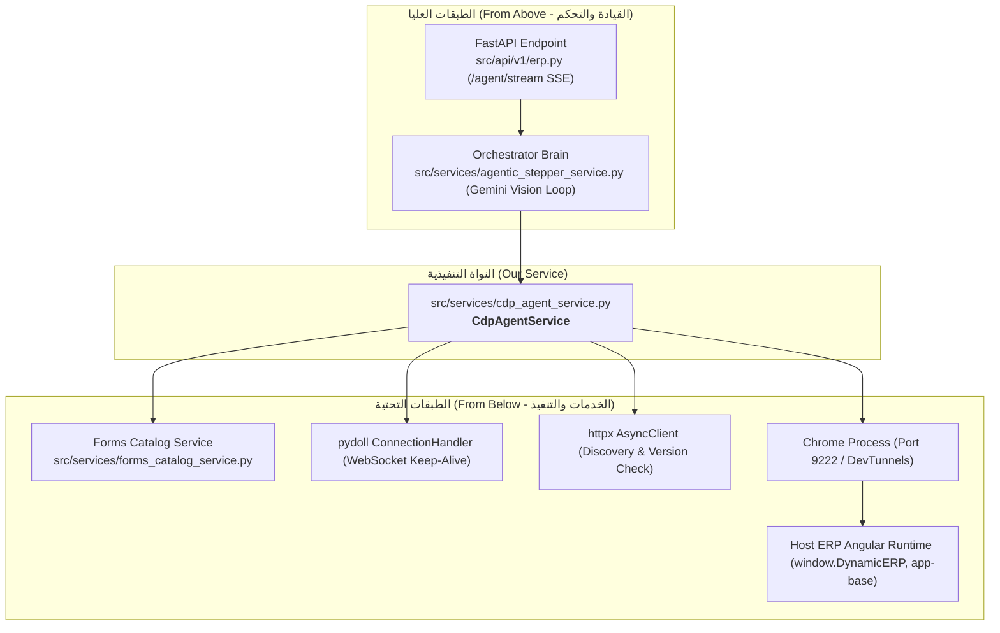
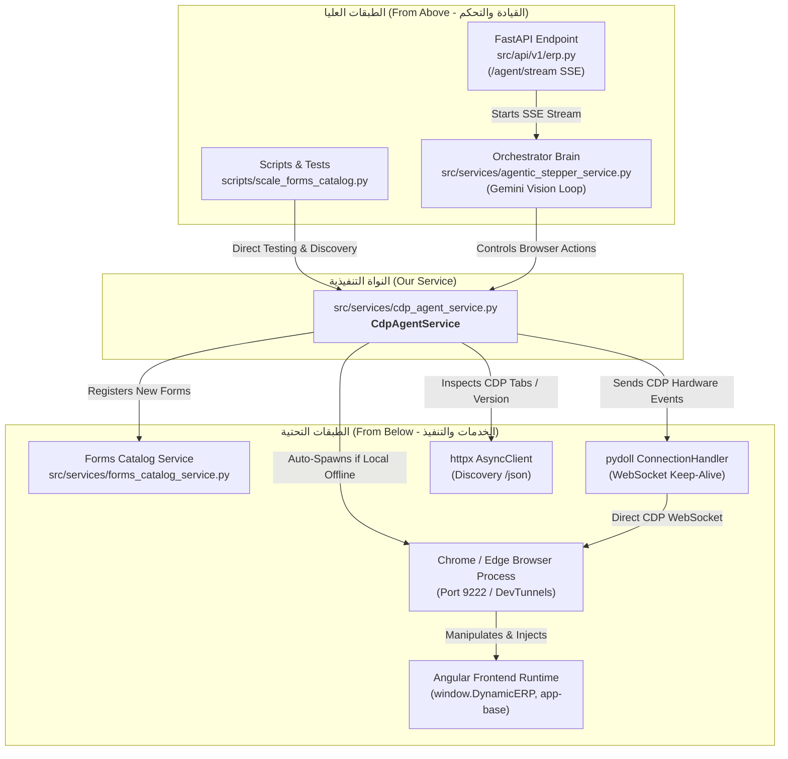

# الدليل الشامل لمحرك التحكم بالمتصفح: `cdp_agent_service.py`

## Chrome DevTools Protocol (CDP) Agent Service — The Browser Automation & Vision Engine

### ملخص تنفيذي لما تم توثيقه وشرحه داخل الملف

#### 1. دور الملف ومسؤوليته بأسلوب بسيط

ملف [`cdp_agent_service.py`](file:///e:/Mazen/EgyDynamic/LMS_CO_Pilot/src/services/cdp_agent_service.py) هو **"العين واليد التنفيذية للذكاء الاصطناعي داخل متصفح المستخدم الحقيقي"**.

- **المشكلة التي يحلها:** بدلاً من فتح متصفح خفي (Headless) يطلب تسجيل دخول جديد ويفقد جلسة المستخدم، يرتبط هذا السيرفيس مباشرة بمتصفح Chrome أو Edge المفتوح أمام المستخدم عبر بروتوكول **Chrome DevTools Protocol (CDP)** عبر المنفذ `9222` (أو أنفاق DevTunnels السحابية).
- **المسؤوليات الرئيسية:**
  1. **الرؤية البصرية الذكية:** التقاط لقطات الشاشة مع إخفاء نافذة المساعد الذكي لحظياً حتى لا يرى نفسه.
  2. **اللمس العتادي (Hardware Events):** إرسال أحداث ماوس وكيبورد حقيقية تتقبلها بيئة Angular بدون مشاكل في الـ Change Detection.
  3. **التنقل المباشر للمنظومة:** استدعاء جسور الـ ERP الداخلية (`window.DynamicERP` أو `pageService`) لفتح الشاشات بالرقم في 0 ثانية.
  4. **الحقن البرمجي للفواتير والنماذج:** ملء الحقول، والتعامل مع قوائم `ng-select` الذكية، وإدراج أسطر المنتجات، وحساب إجمالي الفاتورة والمدفوع نقداً آلياً.

---

#### 2. شبكة العلاقات المعمارية (من فوق ومن تحت)



- **من فوق (Upstream):**
  - [`src/services/agentic_stepper_service.py`](file:///e:/Mazen/EgyDynamic/LMS_CO_Pilot/src/services/agentic_stepper_service.py): العقل المدبر والمخطط التنفيذي الذي يقرر الخطوات ويطلب من `cdp_agent_service` التقاط الشاشة، النقر، الكتابة، والتنقل.
  - [`src/api/v1/erp.py`](file:///e:/Mazen/EgyDynamic/LMS_CO_Pilot/src/api/v1/erp.py): راوتر الـ API الذي يبث خطوات الرصد والتنفيذ للمستخدم حياً عبر Server-Sent Events (SSE).
- **من تحت (Downstream):**
  - [`src/services/forms_catalog_service.py`](file:///e:/Mazen/EgyDynamic/LMS_CO_Pilot/src/services/forms_catalog_service.py): كتالوج الشاشات الذي يُسجل فيه الشاشات المكتشفة تلقائياً.
  - **مكتبة `pydoll` (`ConnectionHandler`):** إدارة قنوات الـ WebSocket مع الحفاظ على الاتصال حياً (Keep-Alive).
  - **مكتبة `httpx` (`AsyncClient`):** فحص التبويبات وجاهزية المتصفح عبر REST endpoints.
  - **متصفح Chrome وجسر Angular (`window.DynamicERP`):** بيئة التنفيذ الحية في جهاز العميل.

---

#### 3. خريطة المناطق الهندسية الـ 5 (Regions) وكافة دوالها

| المنطقة (Region) | نطاق الأسطر | الدوال المشمولة | دور المنطقة باختصار |
| --- | --- | --- | --- |
| **Region 1: Lifecycle & Connection Management** | L79 - L251 | `__init__`, `_get_http_client`, `_get_pydoll_handler`, `aclose`, `_resolve_urls`, `is_cdp_available`, `ensure_cdp_available`, `get_active_erp_tab` | إدارة دورة حياة الاتصال، تشغيل Chrome تلقائياً إن كان مغلقاً، واكتشاف تبويب ERP عبر الشبكة المحلية أو أنفاق DevTunnels. |
| **Region 2: Low-Level CDP Protocol & Input Dispatch** | L254 - L404 | `execute_cdp_command`, `evaluate_script`, `click_at`, `type_text`, `press_key` | تنفيذ أوامر CDP الخام، تشغيل أكواد JS، إرسال نبضات الماوس العتادية المزدوجة، وكتابة النصوص وضغط الأزرار الخاصة. |
| **Region 3: Visual Grounding & DOM Inspection** | L407 - L745 | `normalize_ar`, `capture_screenshot`, `get_page_state`, `get_viewport_metrics`, `show_click_ripple`, `get_interactive_elements`, `wait_for_settle`, `click_element_or_coordinate` | التقاط الشاشة بدون نافذة الشات، قياس الـ DPI، تطبيع العربي، إظهار تموج النقر البصري الأحمر، وانتظار استقرار DOM، وجذب النقرات لمراكز الأزرار الحقيقية. |
| **Region 4: ERP Host Navigation & Form Detection** | L748 - L946 | `navigate_to_erp_screen`, `navigate_to_erp_screen_dom_click`, `get_user_authorized_screens`, `ensure_erp_form_open` | الانتقال الفوري للشاشات عبر جسر Angular أو الرابط، جلب صلاحيات شاشات المستخدم، وضمان فتح شاشة الإدخال (AddOrEdit Form). |
| **Region 5: Polymorphic Form Filling & Auto-Cataloging** | L949 - L1418 | `fill_erp_form_bridge`, `snapshot_form_state`, `get_active_screen_metadata`, `inspect_active_page_dom`, `auto_catalog_active_page` | محرك تعبئة الهيدر والأصناف وقوائم `ng-select` والمدفوعات آلياً، استخراج الميتاداتا في 0ms من ذاكرة Angular، وتسجيل الشاشات ذاتياً في الكتالوج. |

---

الملف التوثيقي الكامل جاهز ومفصل بكل شروحات الكود، والبارامترات، وأمثلة الاستخدام الحية في:
🔗 **[cdp_agent_service.md](file:///e:/Mazen/EgyDynamic/LMS_CO_Pilot/src/services/docs/cdp_agent_service.md)**

## 📑 الفهرس (Table of Contents)

1. [المقدمة: دور الملف ومسؤوليته بأسلوب بسيط](#1-المقدمة-دور-الملف-ومسؤوليته-بأسلوب-بسيط)
2. [أمثلة واقعية على عمل الخدمة في الميدان](#2-أمثلة-واقعية-على-عمل-الخدمة-في-الميدان)
3. [خريطة العلاقات المعمارية (من فوق ومن تحت)](#3-خريطة-العلاقات-المعمارية-من-فوق-ومن-تحت)
   - [الملفات المرتبطة من فوق (Callers & Orchestrators)](#أ-الملفات-المرتبطة-من-فوق-upstream--callers)
   - [الملفات والأنظمة المرتبطة من تحت (Downstream & Subsystems)](#ب-الملفات-والأنظمة-المرتبطة-من-تحت-downstream--subsystems)
4. [التشريح المفصل للمناطق البرمجية (Regions) والدوال](#4-التشريح-المفصل-للمناطق-البرمجية-regions-والدوال)
   - [Region 1: Lifecycle & Connection Management](#region-1-lifecycle--connection-management-إدارة-دورة-الحياة-واكتشاف-التبويبات)
   - [Region 2: Low-Level CDP Protocol & Input Dispatch](#region-2-low-level-cdp-protocol--input-dispatch-بروتوكول-cdp-ونبضات-الهاردوير)
   - [Region 3: Visual Grounding & DOM Inspection](#region-3-visual-grounding--dom-inspection-الرصد-البصري-وفحص-الاستقرار)
   - [Region 4: ERP Host Navigation & Form Detection](#region-4-erp-host-navigation--form-detection-التنقل-الذكي-وفتح-الشاشات)
   - [Region 5: Polymorphic Form Filling & Auto-Cataloging](#region-5-polymorphic-form-filling--auto-cataloging-محرك-التعبئة-والاستكشاف)
5. [جدول الملخص الشامل لكافة الدوال](#5-جدول-الملخص-الشامل-لكافة-الدوال)
6. [الخلاصة والقيمة الهندسية للمشروع](#6-الخلاصة-والقيمة-الهندسية-للمشروع)

---

## 1. المقدمة: دور الملف ومسؤوليته بأسلوب بسيط

ملف [`cdp_agent_service.py`](file:///e:/Mazen/EgyDynamic/LMS_CO_Pilot/src/services/cdp_agent_service.py) هو **"العين واليد التنفيذية للذكاء الاصطناعي داخل متصفح المستخدم الحقيقي"**.

### ما هي المشكلة التي يحلها؟

في الأنظمة التقليدية للأتمتة (مثل Selenium أو Playwright في الوضع الخفي Headless)، عندما يطلب المستخدم من الذكاء الاصطناعي تنفيذ إجراء في نظام الـ ERP، يضطر النظام لفتح نافذة متصفح جديدة منفصلة، ويطلب تسجيل دخول بكلمة مرور واسم مستخدم، وغالباً ما يفقد جلسة العمل النشطة أو يتعطل بسبب الـ Captcha أو مصادقة الشركات، كما أن المستخدم لا يرى ما يحدث أمامه!

### الحل الذي يقدمه هذا الملف

يقوم هذا الملف بربط الكوبيلوت الذكي مباشرة بمتصفح **Google Chrome** أو **Microsoft Edge** المفتوح بالفعل أمام المستخدم على جهازه، عبر بروتوكول التصحيح **Chrome DevTools Protocol (CDP)** عبر المنفذ الافتراضي `9222` (أو عبر نفق سحابي آمن Microsoft DevTunnel).

### المسؤوليات الأساسية الأربعة

1. **الرؤية البصرية (Vision Sensor):** يلتقط صور الشاشة (Screenshots) لحظياً بذكاء، مع إخفاء نافذة المساعد الذكي نفسه لحظة الالتقاط حتى لا يرى نفسه ويحدث تشتيت للـ AI Vision.
2. **اللمس والنقر الحقيقي (Hardware Touch):** يرسل أحداث الفأرة ولوحة المفاتيح على مستوى عتاد المتصفح الحقيقي (Hardware-Level Events)، حتى تفهم مكونات الواجهة المعقدة (Angular / TypeScript) أن هناك مستخدماً بشرياً حقيقياً يضغط ويكتب.
3. **التنقل المباشر (Direct ERP Host Navigation):** التحدث مباشرة مع محرك الـ ERP الداخلي (`window.DynamicERP` أو `pageService`) لفتح أي شاشة بالمعرف الرقمي الخاص بها فوراً في 0 ثانية دون الحاجة للبحث في القوائم التقليدية.
4. **تعبئة البيانات المعممة (Polymorphic Form Filling):** كتابة البيانات المعقدة في الفواتير والسندات، واختيار العناصر من القوائم المنسدلة الذكية `ng-select`، وإضافة أسطر المنتجات في الجداول مع ضبط تلقائي للمدفوعات والحسابات.

---

## 2. أمثلة واقعية على عمل الخدمة في الميدان

### السيناريو الأول: الانتقال لشاشة فواتير المشتريات

- **طلب المستخدم:** "افتح لي شاشة المشتريات".
- **دور `cdp_agent_service`:**
  1. يكتشف التبويب المفتوح لنظام ERP عبر `get_active_erp_tab()`.
  2. يستدعي دالة `navigate_to_erp_screen(ws_url, 289)`.
  3. تتصل الدالة ببيئة Angular الخاصة بالنظام وتستدعي `window.DynamicERP.navigateToScreen(289)`.
  4. الشاشة تفتح في متصفح المستخدم في أقل من ثانية، ثم تستدعي الخدمة `wait_for_settle()` للتأكد من اكتمال تحميل عناصر الصفحة قبل أن يكمل الكوبيلوت كلامه مع المستخدم!

### السيناريو الثاني: ملء فاتورة مشتريات بالكامل

- **طلب المستخدم:** "سجل فاتورة مشتريات من المورد الشركة الدولية، المخزن الرئيسي، صنف شاشة سامسونج كمية 5 بسعر 1000، وسداد نقدي كامل".
- **دور `cdp_agent_service`:**
  1. يستدعي `ensure_erp_form_open()` ليضغط تلقائياً على زر "إضافة جديد" إذا كان الفورم مغلقاً.
  2. يستدعي `fill_erp_form_bridge()` المجهز بخوارزمية البحث عن المورد داخل مكون `ng-select` وفتحه وكتابة الاسم واختيار الخيار الصحيح بدون تشتت مع الكلمات السلبية (مثل استبعاد كلمة "غير نشط").
  3. كتابة الكمية في جدول الأصناف ثم الضغط على زر "متابعة" أو "تأكيد" لإدراج السطر.
  4. حساب إجمالي الفاتورة لحظياً، والبحث عن حقل "المدفوع / المحصل نقداً"، وكتابة نفس القيمة فيه آلياً!
  5. أثناء كل نقرة، يرى المستخدم نقطة حمراء ناعمة تنبض مكان النقر (`show_click_ripple`) ليطمئن قلبه بأن الروبوت يعمل بوعي في الأماكن الصحيحة.

---

## 3. خريطة العلاقات المعمارية (من فوق ومن تحت)

يوضح المخطط التالي موقع `cdp_agent_service.py` الحيوي كمحور ارتكاز يربط بين الذكاء الاصطناعي والمتصفح:



---

### أ. الملفات المرتبطة من فوق (Upstream / Callers)

1. **[`src/services/agentic_stepper_service.py`](file:///e:/Mazen/EgyDynamic/LMS_CO_Pilot/src/services/agentic_stepper_service.py):**
   - **الدور:** هو العقل المدبر والمخطط التنفيذي للعميل البصري (Autonomous Stepper).
   - **نوع العلاقة:** يعتمد على `cdp_agent_service` كأداة وحيدة للتنفيذ. يطلب منه: "التقط صورة للشاشة"، "أعطني العناصر التفاعلية"، "انقر هنا"، "اكتب هذا النص"، "افتح شاشة كذا".
2. **[`src/api/v1/erp.py`](file:///e:/Mazen/EgyDynamic/LMS_CO_Pilot/src/api/v1/erp.py):**
   - **الدور:** نقطة نهاية الـ API العامة (`/agent/stream`) التي تبث أحداث الأتمتة الحية للمستخدم عبر تقنية Server-Sent Events (SSE).
   - **نوع العلاقة:** يستدعي `agentic_stepper_service` الذي بدوره يحرك `cdp_agent_service` خطوة بخطوة ويبث النتائج للواجهة الأمامية.
3. **سكربتات الاختبار والتوسعة (`scripts/scale_forms_catalog.py` و `tests/`):**
   - **الدور:** أدوات برمجية تقوم بالزحف الآلي داخل النظام لفحص الشاشات وتسجيل الميتاداتا وتوليد كتالوج الشاشات تلقائياً باستخدام `cdp_agent_service`.

---

### ب. الملفات والأنظمة المرتبطة من تحت (Downstream / Subsystems)

1. **[`src/services/forms_catalog_service.py`](file:///e:/Mazen/EgyDynamic/LMS_CO_Pilot/src/services/forms_catalog_service.py):**
   - **الدور:** بنك المعلومات المرجعي لجميع شاشات الـ ERP وحقولها ونوع كل حقل.
   - **نوع العلاقة:** يتم استدعاؤه داخل دالة `auto_catalog_active_page` في `cdp_agent_service` لتسجيل الشاشات المكتشفة تلقائياً في ملف الـ JSON المرجعي.
2. **مكتبة `pydoll` (`ConnectionHandler`):**
   - **الدور:** إدارة قنوات الـ WebSocket السريعة مع بروتوكول Chrome DevTools Protocol مع إبقاء الاتصال حياً (Connection Pooling / Keep-Alive) لمنع إعادة بناء الاتصال مع كل نقرة.
3. **مكتبة `httpx` (`AsyncClient`):**
   - **الدور:** التواصل مع نقاط فحص المتصفح السريعة `http://127.0.0.1:9222/json` لاكتشاف التبويبات والتأكد من عمل المتصفح.
4. **[`src/core/config.py`](file:///e:/Mazen/EgyDynamic/LMS_CO_Pilot/src/core/config.py):**
   - **الدور:** قراءة الإعدادات العامة للمشروع (مثل `settings.CDP_REMOTE_DEBUGGING_ADDRESS`).
5. **بيئة تشغيل Angular والـ ERP Bridge (`window.DynamicERP`):**
   - **الدور:** الواجهة البرمجية المضمنة في المتصفح التي أعدها فريق التطوير لتسهيل فتح النماذج وقراءة بيانات الشاشات النشطة.

---

## 4. التشريح المفصل للمناطق البرمجية (Regions) والدوال

تم تقسيم الملف هندسياً إلى **5 مناطق وظيفية واضحة (Regions)** لتسهيل الصيانة وعزل المسؤوليات:

---

### Region 1: Lifecycle & Connection Management (إدارة دورة الحياة واكتشاف التبويبات)

**السطور (79 - 251):** مسؤولة عن إنشاء وإدارة الاتصال بالمتصفح، وإعادة الاتصال الذاتي، واكتشاف تبويب الـ ERP المطلوب وتشغيل المتصفح آلياً إذا كان مغلقاً.

```
├── __init__(default_port: int = 9222)
├── _get_http_client() -> httpx.AsyncClient
├── _get_pydoll_handler(ws_url: str) -> ConnectionHandler
├── aclose() -> None
├── _resolve_urls(host: str, port: int) -> tuple[str, str]
├── is_cdp_available(port, host) -> bool
├── ensure_cdp_available(port, host) -> bool
└── get_active_erp_tab(port, host, title_match) -> dict | None
```

#### تفصيل الدوال

1. **`__init__(self, default_port: int = 9222) -> None`**:
   - **الهدف:** تهيئة كائن الخدمة.
   - **المدخلات:** منفذ الـ CDP الافتراضي (9222).
   - **ماذا تفعل؟** تُنشئ مصفوفة تتبع عمليات المتصفح، وقفل التزامن `_handler_lock` لمنع تعارض مؤشرات WebSocket، وقاموس حفظ قنوات الاتصال `_pydoll_handlers`.

2. **`_get_http_client(self) -> httpx.AsyncClient`**:
   - **الهدف:** مسبح اتصالات HTTP مشترك (Connection Pool).
   - **ماذا تفعل؟** تضمن وجود عميل HTTP واحد مشترك مدار، لتجنب استنزاف المقابس (Socket Exhaustion) عند فحص جاهزية المتصفح المستمر.

3. **`_get_pydoll_handler(self, ws_url: str) -> ConnectionHandler`**:
   - **الهدف:** إدارة قنوات الـ WebSocket للتبويب المطلوب عبر مكتبة `pydoll`.
   - **ماذا تفعل؟** تتحقق ما إذا كان الاتصال القديم بهذا التبويب لا يزال حياً. إن كان حياً تعيد استخدامه فوراً (Keep-Alive)، وإن كان مغلقاً أو معطوباً تقوم بإغلاقه وبناء `ConnectionHandler` جديد وتخزينه.

4. **`aclose(self) -> None`**:
   - **الهدف:** الإغلاق الآمن للموارد عند إيقاف السيرفر أو انتهاء الجلسة.
   - **ماذا تفعل؟** تغلق عميل الـ HTTP وجميع اتصالات الـ WebSocket التابعة لـ `pydoll` لتفريغ الذاكرة ومنع تسريب المقابس.

5. **`_resolve_urls(self, host: str, port: int) -> tuple[str, str]`**:
   - **الهدف:** تحويل الـ Host والـ Port إلى روابط HTTP و WebSocket متوافقة تماماً.
   - **الذكاء الهندسي:** تدعم الاتصال المحلي والـ IP المباشر، وتتعامل بذكاء فائق مع أنفاق مايكروسوفت DevTunnels (`.devtunnels.ms`) بتحويلها تلقائياً إلى بروتوكول مشفر `https://` و `wss://` عبر المنفذ 443 وإزالة أي أرقام منافذ زائدة.

6. **`is_cdp_available(self, port: int | None = None, host: str = "127.0.0.1") -> bool`**:
   - **الهدف:** فحص هل المتصفح يعمل ومنفذ التصحيح متاح؟
   - **ماذا تفعل؟** ترسل طلب `GET /json/version` مع محاولة إعادة سريعة (Retry) للتأكد من استجابة المتصفح أو النفق السحابي.

7. **`ensure_cdp_available(self, port: int | None = None, host: str = "127.0.0.1") -> bool`**:
   - **الهدف:** ضمان تشغيل المتصفح التلقائي (Zero-Friction Auto-Spawn).
   - **ماذا تفعل؟** إذا كان المنفذ مغلقاً والاتصال محلياً، تبحث الخدمة في مسارات التثبيت المعروفة لـ Google Chrome وتشغل المتصفح كعملية منفصلة (`subprocess.Popen` مع بروفايل معزول ومنفذ 9222 مقيد على `127.0.0.1` أمنياً)، وتنتظر حتى يستجيب المنفذ بنجاح.

8. **`get_active_erp_tab(self, port: int | None = None, host: str = "127.0.0.1", title_match: str = "") -> dict[str, Any] | None`**:
   - **الهدف:** اكتشاف تبويب الـ ERP النشط في المتصفح.
   - **ماذا تفعل؟** تستعلم من المتصفح عبر `/json` عن التبويبات المفتوحة من نوع `page`، وتبحث عن التبويب الذي يحوي عنوانه أو رابطه كلمات مثل `dynamic` أو `core` أو `4200` أو الكلمة الممررة، وتجهز رابط تصحيح WebSocket الصالح للعمل وتُرجعه.

---

### Region 2: Low-Level CDP Protocol & Input Dispatch (بروتوكول CDP ونبضات الهاردوير)

**السطور (254 - 404):** مسؤولة عن التفاعل منخفض المستوى مع المتصفح، وإرسال الأوامر عبر WebSocket ونبضات الماوس والكيبورد العتادية الحقيقية.

```
├── execute_cdp_command(ws_url, method, params, timeout) -> dict[str, Any]
├── evaluate_script(ws_url, script, timeout) -> Any
├── click_at(ws_url, x, y) -> None
├── type_text(ws_url, text, delay_ms) -> None
└── press_key(ws_url, key_name) -> None
```

#### تفصيل الدوال

1. **`execute_cdp_command(self, ws_url: str, method: str, params: dict | None = None, timeout: float = 6.0) -> dict`**:
   - **الهدف:** النواة التنفيذية لإرسال أي أمر CDP رسمي (مثل `Input.dispatchMouseEvent` أو `Runtime.evaluate`).
   - **ماذا تفعل؟** تنفذ الأمر عبر `pydoll Handler` مع ميزة التعافي الذاتي (Self-Healing Retry): إذا انقطع الاتصال أو فشل، تقوم بإنعاش المقبس وإعادة إرسال الأمر مرة واحدة قبل إرجاع الخطأ.

2. **`evaluate_script(self, ws_url: str, script: str, timeout: float = 15.0) -> Any`**:
   - **الهدف:** تنفيذ أكواد JavaScript مباشرة في سياق نافذة المتصفح واسترجاع النتائج.
   - **ماذا تفعل؟** تستدعي أمر `Runtime.evaluate` مع تفعيل `awaitPromise=True` لدعم الدوال غير المتزامنة (Async Functions).

3. **`click_at(self, ws_url: str, x: int, y: int) -> None`**:
   - **الهدف:** تنفيذ نقرة ماوس موثوقة ومزدوجة (Dual-Action Dispatch).
   - **خطوات التنفيذ:**
     1. استدعاء `show_click_ripple` لعرض دائرة حمراء نابضة يراها المستخدم.
     2. نقر العنصر برمجياً عبر الـ DOM باستخدام `document.elementFromPoint(x, y)` وتنشيط أي زر أب (`closest('button, a, .dp-btn')`) لضمان تنبيه Angular.
     3. إرسال أحداث ماوس عتادية كاملة عبر CDP (`mouseMoved` ثم `mousePressed` ثم `mouseReleased`).

4. **`type_text(self, ws_url: str, text: str, delay_ms: float = 30) -> None`**:
   - **الهدف:** كتابة نص في الحقل النشط.
   - **ماذا تفعل؟** تستخدم أمر `Input.insertText` الذي يدعم اللغة العربية بالكامل وعلامات الترقيم دون أخطاء في اتجاه النص أو تشويه للحروف.

5. **`press_key(self, ws_url: str, key_name: str) -> None`**:
   - **الهدف:** الضغط على مفاتيح لوحة المفاتيح الخاصة.
   - **ماذا تفعل؟** تدعم أزرار مثل `Enter`, `Tab`, `Escape`, `Backspace` وتترجمها إلى رموز الـ Virtual Key Codes الرسمية لنظام Windows وترسل حدثي `rawKeyDown` و `keyUp`.

---

### Region 3: Visual Grounding & DOM Inspection (الرصد البصري وفحص الاستقرار)

**السطور (407 - 745):** مسؤولة عن استخراج معالم الصفحة، ولقطات الشاشة، وحسابات الـ DPI، ومطابقة النصوص العربية، وجذب النقرات لمراكز الأزرار الحقيقية.

```
├── normalize_ar(s: str) -> str [Static]
├── capture_screenshot(ws_url, quality, mask_chat) -> str (Base64)
├── get_page_state(ws_url) -> dict[str, Any]
├── get_viewport_metrics(ws_url) -> dict[str, float]
├── show_click_ripple(ws_url, x, y) -> None
├── get_interactive_elements(ws_url) -> list[dict[str, Any]]
├── wait_for_settle(ws_url, initial_url, max_wait_sec) -> float
└── click_element_or_coordinate(ws_url, x, y, target_text, interactive_elements) -> tuple[int, int, bool]
```

#### تفصيل الدوال

1. **`normalize_ar(s: str) -> str` [دالة استاتيكية]**:
   - **الهدف:** تطبيع النصوص العربية لمطابقة الأزرار دون التأثر بفروق الإملاء.
   - **ماذا تفعل؟** توحد أشكال الهمزات (`أ`, `إ`, `آ` إلى `ا`)، وتحول التاء المربوطة `ة` إلى `ه`، والياء/الألف المقصورة `ى/ي` إلى `ي`، وتزيل التشكيل والمسافات الزائدة.

2. **`capture_screenshot(self, ws_url: str, quality: int = 80, mask_chat: bool = True) -> str`**:
   - **الهدف:** التقاط صورة الشاشة الحالية بدقة وسرعة بصيغة JPEG مشفرة كـ Base64.
   - **الابتكار الهندسي:** تحتوي على بارامتر `mask_chat=True` يقوم بإخفاء نافذة المساعد الذكي نفسه (`lms-copilot-chat`) لحظياً في جزء من الثانية أثناء اللقطة ثم يعيد إظهارها فوراً، لكي يرى نموذج الرؤية شاشة الـ ERP النقية فقط دون أن يرى نافذة المحادثة ويحاول النقر عليها أو إغلاقها!

3. **`get_page_state(self, ws_url: str) -> dict[str, Any]`**:
   - **الهدف:** قراءة ملخص حالة الشاشة المفتوحة حالياً.
   - **ماذا تفعل؟** تجمع عنوان المتصفح، ورابط الصفحة الحالية، وأبرز العناوين الظاهرة (`h1`, `h2`, `h3`, `.active`)، ومعلومات الشاشة النشطة من جسر الـ ERP أو `app-base`.

4. **`get_viewport_metrics(self, ws_url: str) -> dict[str, float]`**:
   - **الهدف:** استخراج مقاسات الشاشة ومعدل التكبير.
   - **ماذا تفعل؟** تقرأ `innerWidth` و `innerHeight` ومعدل `devicePixelRatio` (معدل تكبير شاشات الويندوز 125% أو 150%) لضمان إسقاط إحداثيات النقر البصري بدقة مطلقة دون انحراف.

5. **`show_click_ripple(self, ws_url: str, x: int, y: int) -> None`**:
   - **الهدف:** إظهار تأثير بصري (Visual Ripple Effect) مكان النقر.
   - **ماذا تفعل؟** تحقن مؤقتاً دائرة نيون حمراء ناعمة تتمدد وتختفي خلال 500 ملي ثانية في المكان الذي سينقر فيه الروبوت، مما يمنح تجربة مستخدم مذهلة ومريحة بصرياً.

6. **`get_interactive_elements(self, ws_url: str) -> list[dict[str, Any]]`**:
   - **الهدف:** مسح شامل لكافة العناصر القابلة للنقر في الصفحة.
   - **ماذا تفعل؟** تستخرج جميع الأزرار والروابط والبطاقات وحقول الإدخال والـ `ng-select` وخيارات القوائم المنسدلة، مع استبعاد عناصر نافذة الشات والعناصر المخفية، وترجع نصوصها وإحداثيات مراكزها الدقيقة `(x, y)` وأبعادها `rect`.

7. **`wait_for_settle(self, ws_url: str, initial_url: str = "", max_wait_sec: float = 2.5) -> float`**:
   - **الهدف:** فحص استقرار الصفحة بعد كل نقرة أو انتقال (DOM-Settle Detection).
   - **المنطق الهندسي:** تقيس اكتمال جاهزية المستند (`readyState === 'complete'`)، وتراقب ثبات عدد عناصر الـ DOM التفاعلية عبر دورتي فحص متتاليتين للتأكد من انتهاء عمليات التحميل والـ Rendering في Angular.

8. **`click_element_or_coordinate(self, ws_url: str, x: int, y: int, target_text: str | None = None, interactive_elements: list[dict] | None = None) -> tuple[int, int, bool]`**:
   - **الهدف:** النقر الذكي المنجذب ذاتياً (DOM-Anchored Snapped Click).
   - **المنطق الهندسي:**
     - **محاولة 1:** إذا طُلب النقر على "زر إضافة"، تطابق النص العربي المعاير مع عناصر الصفحة، وتجذب النقر إلى مركز العنصر المطابق بنسبة 100%.
     - **محاولة 2:** إذا لم يتطابق النص ولكن الإحداثيات `(x, y)` قريبة جداً (< 40px) من زر تفاعلي، تنجذب إليه تلقائياً (Proximity Snapping).
     - **محاولة 3 (Fallback):** النقر المباشر عند الإحداثيات المحددة.
     - **المخرجات:** `(final_x, final_y, was_snapped)`.

---

### Region 4: ERP Host Navigation & Form Detection (التنقل الذكي وفتح الشاشات)

**السطور (748 - 946):** مسؤولة عن التحكم التفاعلي عالي المستوى مع تطبيق الـ ERP، والتنقل الفوري بين الشاشات، وفتح نوافذ الإدخال.

```
├── navigate_to_erp_screen(ws_url, screen_id_or_name) -> bool
├── navigate_to_erp_screen_dom_click(ws_url, screen_id_or_name) -> bool
├── get_user_authorized_screens(ws_url) -> list[dict[str, Any]]
└── ensure_erp_form_open(ws_url, timeout_sec) -> dict[str, Any]
```

#### تفصيل الدوال

1. **`navigate_to_erp_screen(self, ws_url: str, screen_id_or_name: Any) -> bool`**:
   - **الهدف:** الانتقال المباشر لأي شاشة في الـ ERP بخطوة واحدة برمجية.
   - **تسلسل الأولويات:**
     1. جسر الـ ERP الرسمي: `window.DynamicERP.navigateToScreen(target)`.
     2. خدمة Angular الداخلية للنظام: الوصول إلى `app-base` واستدعاء `pageService.addNewPage(pageAuth.Page)` داخل `ngZone.run()` لتحديث الواجهة فوراً.
     3. الرابط المباشر: تغيير عنوان المتصفح إلى `/core?p={targetPid}&a={targetPid}`.

2. **`navigate_to_erp_screen_dom_click(self, ws_url: str, screen_id_or_name: Any) -> bool`**:
   - **الهدف:** الملاحة البديلة بالـ DOM عند تعطل الجسور البرمجية.
   - **ماذا تفعل؟** تبحث في الصفحة عن بطاقات الشاشات أو الروابط أو القائمة الجانبية التي تحمل سمة `[data-page-id]` أو `[routerlink]` أو اسم الشاشة بالعربية، وتقوم بالنقر عليها مباشرة.

3. **`get_user_authorized_screens(self, ws_url: str) -> list[dict[str, Any]]`**:
   - **الهدف:** استخراج قائمة الشاشات المسموحة للمستخدم الحالي مباشرة من ذاكرة المتصفح.
   - **ماذا تفعل؟** تستدعي `window.DynamicERP.listUserPages()` لتجلب أسماء الشاشات وأرقامها والموديولات التابعة لها دون الحاجة للاستعلام من قاعدة البيانات.

4. **`ensure_erp_form_open(self, ws_url: str, timeout_sec: float = 8.0) -> dict[str, Any]`**:
   - **الهدف:** ضمان أن نافذة الإدخال (AddOrEdit Form) مفتوحة وجاهزة لاستقبال البيانات.
   - **ماذا تفعل؟** تفحص هل الفورم مفتوح بالفعل في الـ DOM أو في سياق الجسر؟ إن لم يكن مفتوحاً، تستدعي `window.DynamicERP.triggerAddNew()` أو تبحث عن زر "إضافة جديد" أو الزر الحاوي لأيقونة `+` وتنقر عليه، وتنتظر ظهور الحقول لتؤكد الجاهزية.

---

### Region 5: Polymorphic Form Filling & Auto-Cataloging (محرك التعبئة والاستكشاف)

**السطور (949 - 1418):** القلب النابض للحقن المتقدم، والتعامل مع مكونات Angular والـ `ng-select` وجداول الأصناف، والاستكشاف والتسجيل الذاتي للشاشات الجديدة.

```
├── fill_erp_form_bridge(ws_url, payload) -> dict[str, Any]
├── snapshot_form_state(ws_url) -> dict[str, Any]
├── get_active_screen_metadata(ws_url) -> list[dict[str, Any]]
├── inspect_active_page_dom(ws_url) -> dict[str, Any]
└── auto_catalog_active_page(ws_url, persist) -> dict[str, Any]
```

#### تفصيل الدوال

1. **`fill_erp_form_bridge(self, ws_url: str, payload: dict[str, Any]) -> dict[str, Any]`**:
   - **الهدف:** المحرك المعمم فائق الدقة لحقن بيانات أي فورم وفاتورة وجدول أصناف.
   - **الميزات الهندسية:**
     - **دعم `ng-select` المعقد:** يفتح القائمة المنسدلة، ويكتب النص المطلوب في حقل البحث، وينتظر ظهور خيارات `ng-dropdown-panel`، ويستبعد الخيارات السلبية (مثل "غير متاح" أو "غير نشط")، وينقر على الخيار الأنسب، أو يغلق القائمة بـ Escape إذا لم يجد تطابقاً.
     - **المطابقة بالـ Labels:** إذا لم يجد الحقل بالمعرف الإنجليزي، يبحث عن التسمية العربية للـ `<label>` ويصل للحقل المرتبط بها.
     - **تعبئة الأصناف (Grid Lines):** يملأ صنف الصنف والكمية في الجدول، ويضغط على زر "متابعة" أو "تأكيد" لإدراج السطر في الفاتورة.
     - **التسوية الآلية للمدفوعات:** يحسب إجمالي الفاتورة آلياً بعد إدراج الأصناف ويكتبه تلقائياً في حقل "المدفوع نقداً / المحصل نقداً" لإتمام حفظ الفاتورة بنجاح.

2. **`snapshot_form_state(self, ws_url: str) -> dict[str, Any]`**:
   - **الهدف:** أخذ لقطة فورية لكامل حالة النموذج لحفظها في الصندوق الأسود (Telemetry Log).
   - **ماذا تفعل؟** تقرأ ما يصل إلى 120 حقل إدخال في الصفحة (أسماء الحقول، تسمياتها، هل هي معطلة أم مفعلة)، بالإضافة إلى كائن `dataObject` من جسر Angular.

3. **`get_active_screen_metadata(self, ws_url: str) -> list[dict[str, Any]]`**:
   - **الهدف:** استخراج ميتاداتا وتوصيف الشاشة النشطة لحظياً في **0 ملي ثانية**.
   - **الابتكار الهندسي:** تقرأ كائن RxJS `columnList BehaviorSubject` مباشرة من ذاكرة مكون Angular (بدون DOM Scraping وبدون استعلامات SQL)، وتستخرج الأعمدة الإلزامية والمرئية، والتسميات العربية، ونوع الحقل، ومصدر القوائم `DroModel`.

4. **`inspect_active_page_dom(self, ws_url: str) -> dict[str, Any]`**:
   - **الهدف:** محرك الاستكشاف الذاتي بالـ DOM للشاشات غير المعروفة مسبقاً.
   - **ماذا تفعل؟** تستخرج رقم الصفحة من الرابط، والعنوان، وجميع حقول الإدخال وتسمياتها العربية، وجداول البيانات وأعمدتها لحفظ هيكلية الشاشة.

5. **`auto_catalog_active_page(self, ws_url: str, persist: bool = False) -> dict[str, Any]`**:
   - **الهدف:** التعلم والتسجيل الذاتي للشاشة في كتالوج النماذج.
   - **ماذا تفعل؟** تفحص الشاشة عبر `inspect_active_page_dom`، ثم تمرر النتيجة لخدمة [`forms_catalog_service`](file:///e:/Mazen/EgyDynamic/LMS_CO_Pilot/src/services/forms_catalog_service.py) لتسجيلها وحفظها في الكتالوج المرجعي إذا كان خيار `persist=True`.

---

## 5. جدول الملخص الشامل لكافة الدوال

| المنطقة | اسم الدالة | نوعها | المدخلات الرئيسية | المخرجات | الدور باختصار |
| --- | --- | --- | --- | --- | --- |
| **Region 1** | `__init__` | Sync | `default_port: int` | `None` | تهيئة الخدمة وإعداد أقفال التزامن وقواميس الاتصال |
| **Region 1** | `_get_http_client` | Async | - | `httpx.AsyncClient` | توفير مسبح اتصالات HTTP مشترك مدار |
| **Region 1** | `_get_pydoll_handler` | Async | `ws_url: str` | `ConnectionHandler` | إدارة اتصال WebSocket حي بالتبويب عبر pydoll |
| **Region 1** | `aclose` | Async | - | `None` | تنظيف وإغلاق كافة المقابس والموارد المشتركة بأمان |
| **Region 1** | `_resolve_urls` | Sync | `host: str, port: int` | `tuple[str, str]` | توحيد ومعالجة روابط HTTP/WS وعناوين DevTunnels |
| **Region 1** | `is_cdp_available` | Async | `port, host` | `bool` | التحقق من استجابة منفذ التصحيح للمتصفح |
| **Region 1** | `ensure_cdp_available` | Async | `port, host` | `bool` | التأكد من المنفذ مع تشغيل المتصفح تلقائياً إن كان مغلقاً |
| **Region 1** | `get_active_erp_tab` | Async | `port, host, title_match` | `dict \| None` | العثور على تبويب الـ ERP واستخراج رابط WebSocket |
| **Region 2** | `execute_cdp_command` | Async | `ws_url, method, params` | `dict[str, Any]` | إرسال أمر CDP خام مع إعادة المحاولة الذاتية عند الانقطاع |
| **Region 2** | `evaluate_script` | Async | `ws_url, script, timeout` | `Any` | تشغيل كود JavaScript داخل المتصفح مع دعم الوعود |
| **Region 2** | `click_at` | Async | `ws_url, x, y` | `None` | نقرة ماوس مزدوجة (DOM Dispatch + Hardware Mouse) |
| **Region 2** | `type_text` | Async | `ws_url, text, delay_ms` | `None` | كتابة نصوص عربية وإنجليزية عبر إدخال الكيبورد المباشر |
| **Region 2** | `press_key` | Async | `ws_url, key_name` | `None` | ضغط أزرار خاصة (Enter, Tab, Escape, Backspace) |
| **Region 3** | `normalize_ar` | Static | `s: str` | `str` | تطبيع ومعايرة النصوص العربية لمطابقة الأزرار |
| **Region 3** | `capture_screenshot` | Async | `ws_url, quality, mask_chat` | `str (Base64)` | التقاط لقطة شاشة مضغوطة مع إخفاء نافذة المساعد الذكي |
| **Region 3** | `get_page_state` | Async | `ws_url` | `dict[str, Any]` | استخراج الرابط والعنوان والعناوين البارزة والشاشة النشطة |
| **Region 3** | `get_viewport_metrics` | Async | `ws_url` | `dict[str, float]` | استخراج أبعاد نافذة العرض ومعدل تكبير الشاشة (DPR) |
| **Region 3** | `show_click_ripple` | Async | `ws_url, x, y` | `None` | عرض مؤشر دائري نابض مكان النقر لمشاهدة المستخدم |
| **Region 3** | `get_interactive_elements` | Async | `ws_url` | `list[dict]` | فحص واستخراج العناصر التفاعلية الظاهرة وإحداثياتها |
| **Region 3** | `wait_for_settle` | Async | `ws_url, initial_url, max_wait` | `float (ms)` | الانتظار الذكي حتى تستقر الصفحة وثبات عدد عناصر DOM |
| **Region 3** | `click_element_or_coordinate` | Async | `ws_url, x, y, target_text` | `tuple[int, int, bool]` | النقر المنجذب ذاتياً لمراكز العناصر بالنص أو القرب |
| **Region 4** | `navigate_to_erp_screen` | Async | `ws_url, screen_id_or_name` | `bool` | فتح أي شاشة بالمعرف الرقمي عبر الجسر أو خدمة Angular |
| **Region 4** | `navigate_to_erp_screen_dom_click` | Async | `ws_url, screen_id_or_name` | `bool` | ملاحة بديلة بالنقر على عناصر القائمة والروابط في DOM |
| **Region 4** | `get_user_authorized_screens` | Async | `ws_url` | `list[dict]` | جلب الشاشات المسموحة للمستخدم من ذاكرة المتصفح |
| **Region 4** | `ensure_erp_form_open` | Async | `ws_url, timeout_sec` | `dict[str, Any]` | التحقق من فتح فورم الإدخال أو الضغط على "إضافة جديد" |
| **Region 5** | `fill_erp_form_bridge` | Async | `ws_url, payload: dict` | `dict[str, Any]` | محرك تعبئة الهيدر والأصناف وقوائم ng-select والمدفوعات |
| **Region 5** | `snapshot_form_state` | Async | `ws_url` | `dict[str, Any]` | تسجيل لقطة شاملة لبيانات وحقول النموذج للصندوق الأسود |
| **Region 5** | `get_active_screen_metadata` | Async | `ws_url` | `list[dict]` | قراءة ميتاداتا الشاشة في 0ms من كائن RxJS columnList |
| **Region 5** | `inspect_active_page_dom` | Async | `ws_url` | `dict[str, Any]` | الفحص التلقائي للـ DOM لاكتشاف حقول وجداول الشاشة |
| **Region 5** | `auto_catalog_active_page` | Async | `ws_url, persist: bool` | `dict[str, Any]` | تسجيل الشاشة المكتشفة تلقائياً في كتالوج النماذج |

---

## 6. الخلاصة والقيمة الهندسية للمشروع

يعد ملف [`cdp_agent_service.py`](file:///e:/Mazen/EgyDynamic/LMS_CO_Pilot/src/services/cdp_agent_service.py) نقلة نوعية في مشروع المساعد الذكي لـ ERP للأسباب التالية:

1. **السرعة الفائقة والأداء المباشر:** الانتقال بين الشاشات واستخراج الميتاداتا يتم في جزء من الثانية من خلال التواصل المباشر مع بيئة تشغيل المتصفح والـ Angular Runtime.
2. **الاعتمادية العالية (Fault-Tolerance):** يطبق نمط الـ Fallback في كل عملية: إن فشل الجسر البرمجي ينتقل للنقر بالـ DOM، وإن انحرفت إحداثيات الرؤية البصرية ينجذب النقر ذاتياً للمركز الهندسي للزر الحقيقي، وإن انقطع الاتصال يتعافى ذاتياً دون إزعاج المستخدم.
3. **التجربة الإنسانية المريحة:** المستخدم يشاهد الروبوت ينفذ المهام أمامه في شاشته مع مؤشر مرئي واضح ونصوص عربية دقيقة دون الحاجة لتسجيل دخول إضافي أو انتظار متصفحات خفية.
