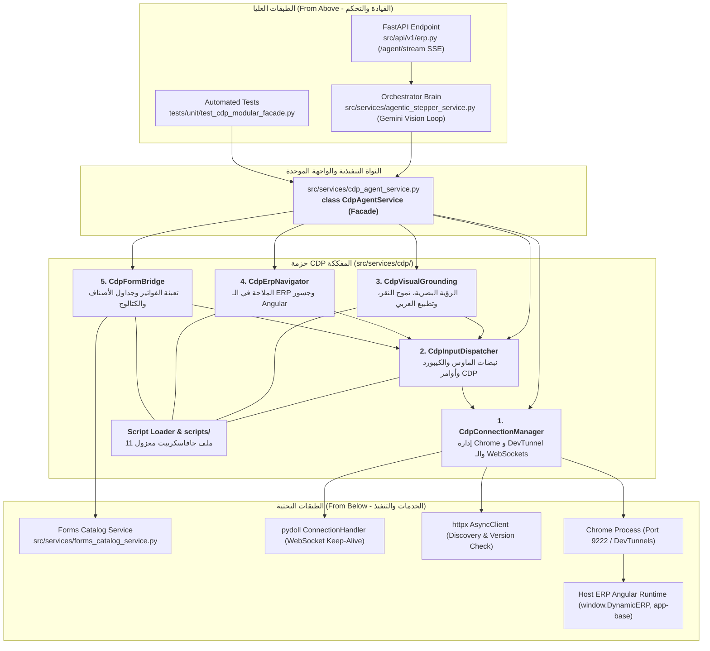

# الدليل الشامل والمفصل لمحرك التحكم بالمتصفح: حزمة `cdp/` والواجهة الموحدة `CdpAgentService`
## Chrome DevTools Protocol (CDP) Master Architectural Reference & Modular Implementation

---

## 📑 الفهرس (Table of Contents)

1. [المقدمة: دور الملف ومسؤوليته بأسلوب بسيط](#1-المقدمة-دور-الملف-ومسؤوليته-بأسلوب-بسيط)
2. [أمثلة واقعية على عمل الخدمة في الميدان](#2-أمثلة-واقعية-على-عمل-الخدمة-في-الميدان)
3. [التحول المعماري: من الملف الأحادي (God Class) إلى الحزمة النظيفة (Modular Facade)](#3-التحول-المعماري-من-الملف-الأحادي-إلى-الحزمة-النظيفة)
4. [الهيكل الشجري للحزمة الجديدة ومجلد السكربتات (Package Tree Structure)](#4-الهيكل-الشجري-للحزمة-الجديدة-ومجلد-السكربتات)
5. [خريطة العلاقات المعمارية (من فوق ومن تحت)](#5-خريطة-العلاقات-المعمارية-من-فوق-ومن-تحت)
   - [الملفات المرتبطة من فوق (Callers & Upstream)](#أ-الملفات-المرتبطة-من-فوق-callers--upstream)
   - [الملفات والأنظمة المرتبطة من تحت (Downstream & Subsystems)](#ب-الملفات-والأنظمة-المرتبطة-من-تحت-downstream--subsystems)
6. [التشريح المفصل للوحدات الخمس الفرعية وكافة الدوال الثلاثين](#6-التشريح-المفصل-للوحدات-الخمس-الفرعية-وكافة-الدوال-الثلاثين)
   - [الوحدة 1: CdpConnectionManager (إدارة دورة الحياة، المقابس، وأنفاق DevTunnel)](#الوحدة-1-cdpconnectionmanager-إدارة-دورة-الحياة-والمقابس-والأنفاق)
   - [الوحدة 2: CdpInputDispatcher (بروتوكول CDP ونبضات الهاردوير)](#الوحدة-2-cdpinputdispatcher-بروتوكول-cdp-ونبضات-الهاردوير)
   - [الوحدة 3: CdpVisualGrounding (الرصد البصري، تموج النقر، وتطبيع العربي)](#الوحدة-3-cdpvisualgrounding-الرصد-البصري-وتموج-النقر-وتطبيع-العربي)
   - [الوحدة 4: CdpErpNavigator (الملاحة الذكية، جسور Angular، واكتشاف الشاشات)](#الوحدة-4-cdperpnavigator-الملاحة-الذكية-وجسور-angular)
   - [الوحدة 5: CdpFormBridge (محرك التعبئة المعمم والاستكشاف الذاتي)](#الوحدة-5-cdpformbridge-محرك-التعبئة-المعمم-والاستكشاف-الذاتي)
7. [دليل سكربتات الجافاسكريبت المعزولة (scripts/) ومحمل الكاش (script_loader.py)](#7-دليل-سكربتات-الجافاسكريبت-المعزولة-scripts-ومحمل-الكاش)
8. [الجدول المرجعي الشامل لكافة الدوال الثلاثين](#8-الجدول-المرجعي-الشامل-لكافة-الدوال-الثلاثين)
9. [نمط الواجهة الموحدة وضمان عدم كسر التوافقية (Zero Breaking Changes)](#9-نمط-الواجهة-الموحدة-وضمان-عدم-كسر-التوافقية)
10. [إثبات الجودة واختبارات التحقق الآلي الممررة بنجاح](#10-إثبات-الجودة-واختبارات-التحقق-الآلي)
11. [الخلاصة والقيمة الهندسية للمشروع](#11-الخلاصة-والقيمة-الهندسية-للمشروع)

---

## 1. المقدمة: دور الملف ومسؤوليته بأسلوب بسيط

خدمة **[`CdpAgentService`](file:///e:/Mazen/EgyDynamic/LMS_CO_Pilot/src/services/cdp_agent_service.py)** هي **"العين واليد التنفيذية للذكاء الاصطناعي داخل متصفح المستخدم الحقيقي"**.

### ما هي المشكلة التي يحلها؟

في الأنظمة التقليدية للأتمتة (مثل Selenium أو Playwright في الوضع الخفي Headless)، عندما يطلب المستخدم من الذكاء الاصطناعي تنفيذ إجراء في نظام الـ ERP، يضطر النظام لفتح نافذة متصفح جديدة منفصلة، ويطلب تسجيل دخول بكلمة مرور واسم مستخدم، وغالباً ما يفقد جلسة العمل النشطة أو يتعطل بسبب الـ Captcha أو مصادقة الشركات، كما أن المستخدم لا يرى ما يحدث أمامه!

### الحل الذي يقدمه هذا المحرك

يقوم هذا المحرك بربط الكوبيلوت الذكي مباشرة بمتصفح **Google Chrome** أو **Microsoft Edge** المفتوح بالفعل أمام المستخدم على جهازه، عبر بروتوكول التصحيح **Chrome DevTools Protocol (CDP)** عبر المنفذ الافتراضي `9222` (أو عبر نفق سحابي آمن Microsoft DevTunnel).

### المسؤوليات الأساسية الأربعة

1. **الرؤية البصرية (Vision Sensor):** يلتقط صور الشاشة (Screenshots) لحظياً بذكاء، مع إخفاء نافذة المساعد الذكي نفسه لحظة الالتقاط حتى لا يرى نفسه ويحدث تشتيت للـ AI Vision.
2. **اللمس والنقر الحقيقي (Hardware Touch):** يرسل أحداث الفأرة ولوحة المفاتيح على مستوى عتاد المتصفح الحقيقي (Hardware-Level Events)، حتى تفهم مكونات الواجهة المعقدة (Angular / TypeScript) أن هناك مستخدماً بشرياً حقيقياً يضغط ويكتب.
3. **التنقل المباشر (Direct ERP Host Navigation):** التحدث مباشرة مع محرك الـ ERP الداخلي (`window.DynamicERP` أو `pageService`) لفتح أي شاشة بالمعرف الرقمي الخاص بها فوراً في 0 ثانية دون الحاجة للبحث في القوائم التقليدية.
4. **تعبئة البيانات المعممة (Polymorphic Form Filling):** كتابة البيانات المعقدة في الفواتير والسندات، واختيار العناصر من القوائم المنسدلة الذكية `ng-select`، وإضافة أسطر المنتجات في الجداول مع ضبط تلقائي للمدفوعات والحسابات.

---

## 2. أمثلة واقعية على عمل الخدمة في الميدان

### السيناريو الأول: الانتقال لشاشة فواتير المشتريات

- **طلب المستخدم:** "افتح لي شاشة المشتريات".
- **دور الخدمة:**
  1. تكتشف التبويب المفتوح لنظام ERP عبر `get_active_erp_tab()`.
  2. تستدعي دالة `navigate_to_erp_screen(ws_url, 289)`.
  3. تتصل الدالة ببيئة Angular الخاصة بالنظام وتستدعي `window.DynamicERP.navigateToScreen(289)`.
  4. تفتح الشاشة في متصفح المستخدم في أقل من ثانية، ثم تستدعي الخدمة `wait_for_settle()` للتأكد من اكتمال تحميل عناصر الصفحة قبل أن يكمل الكوبيلوت كلامه مع المستخدم!

### السيناريو الثاني: ملء فاتورة مشتريات بالكامل

- **طلب المستخدم:** "سجل فاتورة مشتريات من المورد الشركة الدولية، المخزن الرئيسي، صنف شاشة سامسونج كمية 5 بسعر 1000، وسداد نقدي كامل".
- **دور الخدمة:**
  1. تستدعي `ensure_erp_form_open()` لتضغط تلقائياً على زر "إضافة جديد" إذا كان الفورم مغلقاً.
  2. تستدعي `fill_erp_form_bridge()` المجهز بخوارزمية البحث عن المورد داخل مكون `ng-select` وفتحه وكتابة الاسم واختيار الخيار الصحيح بدون تشتت مع الكلمات السلبية (مثل استبعاد كلمة "غير نشط").
  3. كتابة الكمية في جدول الأصناف ثم الضغط على زر "متابعة" أو "تأكيد" لإدراج السطر.
  4. حساب إجمالي الفاتورة لحظياً، والبحث عن حقل "المدفوع / المحصل نقداً"، وكتابة نفس القيمة فيه آلياً!
  5. أثناء كل نقرة، يرى المستخدم نقطة حمراء ناعمة تنبض مكان النقر (`show_click_ripple`) ليطمئن قلبه بأن الروبوت يعمل بوعي في الأماكن الصحيحة.

---

## 3. التحول المعماري: من الملف الأحادي إلى الحزمة النظيفة

كان الكود مكدساً سابقاً داخل ملف أحادي ضخم يتجاوز **1420 سطراً**، مما جعله يعاني من نمط الـ **God Class Anti-Pattern** وتداخل مستويات التجريد (خلط بروتوكولات الـ WebSocket العتادية بمعادلات وحسابات الفواتير المحاسبية).

بناءً على مبادئ هندسة البرمجيات المعترف بها عالمياً (**SOLID** و **Clean Architecture**):
- تم تفكيك المحرك جراحياً إلى **حزمة برمجية متماسكة ومنظمة** تحت المجلد: [`src/services/cdp/`](file:///e:/Mazen/EgyDynamic/LMS_CO_Pilot/src/services/cdp/).
- تتكون الحزمة من **5 وحدات متخصصة أحادية المسؤولية (Single Responsibility)**.
- تم استخراج **جميع سكربتات الجافاسكريبت** البالغة 11 سكربتاً إلى ملفات `.js` منفصلة ومدعومة بالتلوين والتدقيق تحت مجلد [`scripts/`](file:///e:/Mazen/EgyDynamic/LMS_CO_Pilot/src/services/cdp/scripts/).
- تم بناء محمل ذكي مع التخزين المؤقت في الذاكرة [`script_loader.py`](file:///e:/Mazen/EgyDynamic/LMS_CO_Pilot/src/services/cdp/script_loader.py) لمنع القراءة المتكررة من القرص.
- تم تطبيق نمط **(Facade Pattern)** عبر الكلاس الموحد `CdpAgentService` وملف [`cdp_agent_service.py`](file:///e:/Mazen/EgyDynamic/LMS_CO_Pilot/src/services/cdp_agent_service.py) لضمان **عدم كسر أي استدعاء خارجي بنسبة 100% (Zero Breaking Changes)**.

---

## 4. الهيكل الشجري للحزمة الجديدة ومجلد السكربتات

```text
src/services/
├── cdp_agent_service.py              # <-- غلاف Facade التوافقي (Zero Breaking Changes)
└── cdp/                              # <-- حزمة CDP المعمارية النظيفة
    ├── __init__.py                   # كلاس Facade الموحد (CdpAgentService)
    ├── connection_manager.py         # دورة حياة Chrome، والـ WebSockets، وأنفاق DevTunnel
    ├── input_dispatcher.py           # نبضات الهاردوير، الماوس، وضغطات الكيبورد
    ├── visual_grounding.py           # لقطات الشاشة، الـ DPI، وتطبيع النصوص العربية
    ├── erp_navigator.py              # جسور Angular والتنقل المباشر بين الشاشات
    ├── form_bridge.py                # محرك تعبئة الفواتير والتعلم الذاتي للشاشات
    ├── script_loader.py              # محمل ذكي مع LRU Cache لتفادي قراءة القرص المتكررة
    │
    └── scripts/                      # 📁 ملفات JavaScript مستقلة ونظيفة تماماً (13 ملفاً):
        ├── click_ripple.js           # تموج النقر البصري الأحمر
        ├── dom_click.js              # النقر المباشر لعناصر DOM وتنشيط أحداث Angular
        ├── dom_scanner.js            # فحص واستخراج العناصر التفاعلية الظاهرة وإحداثياتها
        ├── page_state.js             # قراءة عنوان الصفحة والرابط والشاشة النشطة
        ├── erp_navigation.js         # الملاحة المباشرة عبر جسر DynamicERP أو pageService
        ├── dom_navigation.js         # الملاحة البديلة بالـ DOM عبر الروابط و data-page-id
        ├── ensure_form_open.js       # فحص وضمان فتح فورم الإدخال (AddOrEdit)
        ├── form_injector.js          # محرك الحقن المعمم (الهيدر، ng-select، الأصناف، والمدفوعات)
        ├── form_snapshot.js          # لقطة فورية لجميع حقول وموديل النموذج للصندوق الأسود
        ├── screen_metadata.js        # استخراج ميتاداتا الشاشة في 0ms من ذاكرة RxJS
        ├── page_inspection.js       # فحص الـ DOM الشامل للاكتشاف والتعلم الذاتي
        ├── user_authorized_screens.js # استخراج الشاشات المسموحة للمستخدم من ذاكرة المتصفح
        └── viewport_metrics.js       # قراءة مقاييس الـ Viewport ومعدل تكبير الشاشة (DPR)
```

---

## 5. خريطة العلاقات المعمارية (من فوق ومن تحت)



### أ. الملفات المرتبطة من فوق (Callers & Upstream)

1. **[`src/services/agentic_stepper_service.py`](file:///e:/Mazen/EgyDynamic/LMS_CO_Pilot/src/services/agentic_stepper_service.py):**
   - **الدور:** هو العقل المفكر والأوركسترا (Orchestrator) الذي يدير حلقة التفكير والتنفيذ التكرارية للذكاء الاصطناعي (Gemini Vision Loop).
   - **كيف يرتبط بنا؟** يستورد الكائن المشترك `cdp_agent_service`، وفي كل خطوة يطلب منه التقاط لقطة شاشة (`capture_screenshot`)، وفحص العناصر التفاعلية (`get_interactive_elements`)، ثم اتخاذ القرار وتنفيذ النقر أو الكتابة (`click_at`, `type_text`, `fill_erp_form_bridge`).

2. **[`src/api/v1/erp.py`](file:///e:/Mazen/EgyDynamic/LMS_CO_Pilot/src/api/v1/erp.py):**
   - **الدور:** نقطة الدخول البرمجية (FastAPI Endpoint) لاستقبال طلبات المستخدم مثل `/agent/stream` عبر تقنية Server-Sent Events (SSE).
   - **كيف يرتبط بنا؟** عند بدء الجلسة، يتحقق من جاهزية المتصفح عبر `is_cdp_available`، ويعثر على رابط التبويب عبر `get_active_erp_tab`، ليمرره إلى الـ Stepper.

3. **سكربتات الاختبار وتوسيع الكتالوج (`tests/unit/test_cdp_modular_facade.py` و `scripts/scale_forms_catalog.py`):**
   - **الدور:** أدوات هندسية آلية للتحقق من الكود أو للزحف داخل نظام الـ ERP واستكشاف الشاشات وحفظها في الكتالوج.
   - **كيف ترتبط بنا؟** تستدعي دوال الملاحة والاستكشاف التلقائي (`auto_catalog_active_page`, `inspect_active_page_dom`).

---

### ب. الملفات والأنظمة المرتبطة من تحت (Downstream & Subsystems)

1. **[`src/services/forms_catalog_service.py`](file:///e:/Mazen/EgyDynamic/LMS_CO_Pilot/src/services/forms_catalog_service.py):**
   - **الدور:** كتالوج النماذج المرجعي للنظام الذي يحفظ توصيفات الشاشات، ومعرفات الحقول، والتسميات العربية.
   - **كيف نرتبط به؟** عندما تكتشف دالة `auto_catalog_active_page` شاشة جديدة، تمرر بياناتها فوراً لكائن `forms_catalog_service.register_screen()` لتخزينها في قاعدة البيانات / الكتالوج المرجعي.

2. **مكتبة `pydoll` (`pydoll.connection.ConnectionHandler`):**
   - **الدور:** المحرك المرجعي لإدارة مقابس الـ WebSocket لبروتوكول CDP.
   - **كيف نرتبط بها؟** نستخدم كائن `ConnectionHandler` لإرسال الأوامر غير المتزامنة لتبويب المتصفح واستقبال الردود عبر اتصال دائم وسريع (Keep-Alive).

3. **مكتبة `httpx` (`httpx.AsyncClient`):**
   - **الدور:** تنفيذ استعلامات HTTP سريعة وغير متزامنة.
   - **كيف نرتبط بها؟** نستخدمها لفحص جاهزية المتصفح عبر المنفذ 9222 (`/json/version`)، وقراءة قائمة التبويبات المفتوحة (`/json`).

4. **متصفح Chrome وجسر Angular (`window.DynamicERP`):**
   - **الدور:** بيئة العرض والتشغيل الحقيقية على جهاز المستخدم.
   - **كيف نرتبط بها؟** نحقن الأكواد البرمجية مباشرة في سياق تشغيل الجافاسكريبت للتواصل مع خدمات Angular مثل `pageService` و `app-base`.

---

## 6. التشريح المفصل للوحدات الخمس الفرعية وكافة الدوال الثلاثين

---

### الوحدة 1: CdpConnectionManager (إدارة دورة الحياة، المقابس، والأنفاق)
- **الملف:** [`src/services/cdp/connection_manager.py`](file:///e:/Mazen/EgyDynamic/LMS_CO_Pilot/src/services/cdp/connection_manager.py)
- **المسؤولية:** إدارة إنشاء المقابس، مسبح اتصالات HTTP المشترك، إدارة قنوات `pydoll` وإبقائها حية، تشغيل Chrome تلقائياً، والتعامل الصارم مع أنفاق DevTunnel.

```text
├── __init__(default_port: int = 9222)
├── _get_http_client() -> httpx.AsyncClient
├── _get_pydoll_handler(ws_url: str) -> ConnectionHandler
├── drop_handler(ws_url: str) -> None
├── aclose() -> None
├── _resolve_urls(host: str, port: int) -> tuple[str, str]
├── is_cdp_available(port, host) -> bool
├── ensure_cdp_available(port, host) -> bool
└── get_active_erp_tab(port, host, title_match) -> dict | None
```

#### تفصيل الدوال:

1. **`__init__(self, default_port: int = 9222) -> None`**:
   - **الهدف:** تهيئة كائن مدير الاتصال.
   - **المدخلات:** منفذ الـ CDP الافتراضي (9222).
   - **ماذا تفعل؟** تُنشئ مصفوفة تتبع عمليات المتصفح، وقفل التزامن `_handler_lock` لمنع تعارض مؤشرات WebSocket، وقاموس حفظ قنوات الاتصال `_pydoll_handlers`.

2. **`_get_http_client(self) -> httpx.AsyncClient`**:
   - **الهدف:** توفير مسبح اتصالات HTTP مشترك مدار (Connection Pool).
   - **ماذا تفعل؟** تضمن وجود عميل HTTP واحد مشترك مدار، لتجنب استنزاف المقابس (Socket Exhaustion) عند فحص جاهزية المتصفح المستمر.

3. **`_get_pydoll_handler(self, ws_url: str) -> ConnectionHandler`**:
   - **الهدف:** إدارة قنوات الـ WebSocket للتبويب المطلوب عبر مكتبة `pydoll`.
   - **ماذا تفعل؟** تتحقق ما إذا كان الاتصال القديم بهذا التبويب لا يزال حياً. إن كان حياً تعيد استخدامه فوراً (Keep-Alive)، وإن كان مغلقاً أو معطوباً تقوم بإغلاقه وبناء `ConnectionHandler` جديد وتخزينه.

4. **`drop_handler(self, ws_url: str) -> None`**:
   - **الهدف:** تفريغ وإغلاق مقبس تالف أو معطوب.
   - **ماذا تفعل؟** تحذف المقبس من القاموس الداخلي وتستدعي إغلاقه بأمان، ليتم بناؤه من جديد في المحاولة التالية دون بقاء أثر للمقابس القديمة الميتة.

5. **`aclose(self) -> None`**:
   - **الهدف:** الإغلاق الآمن للموارد عند إيقاف السيرفر أو انتهاء الجلسة.
   - **ماذا تفعل؟** تغلق عميل الـ HTTP وجميع اتصالات الـ WebSocket التابعة لـ `pydoll` لتفريغ الذاكرة ومنع تسريب المقابس.

6. **`_resolve_urls(self, host: str, port: int) -> tuple[str, str]`**:
   - **الهدف:** تحويل الـ Host والـ Port إلى روابط HTTP و WebSocket متوافقة تماماً.
   - **الذكاء الهندسي:** تدعم الاتصال المحلي والـ IP المباشر، وتتعامل بذكاء فائق مع أنفاق مايكروسوفت DevTunnels (`.devtunnels.ms`) بتحويلها تلقائياً إلى بروتوكول مشفر `https://` و `wss://` عبر المنفذ 443 وإزالة أي أرقام منافذ زائدة.

7. **`is_cdp_available(self, port: int | None = None, host: str = "127.0.0.1") -> bool`**:
   - **الهدف:** فحص هل المتصفح يعمل ومنفذ التصحيح متاح؟
   - **ماذا تفعل؟** ترسل طلب `GET /json/version` مع محاولة إعادة سريعة (Retry) للتأكد من استجابة المتصفح أو النفق السحابي.

8. **`ensure_cdp_available(self, port: int | None = None, host: str = "127.0.0.1") -> bool`**:
   - **الهدف:** ضمان تشغيل المتصفح التلقائي (Zero-Friction Auto-Spawn).
   - **ماذا تفعل؟** إذا كان المنفذ مغلقاً والاتصال محلياً، تبحث الخدمة في مسارات التثبيت المعروفة لـ Google Chrome وتشغل المتصفح كعملية منفصلة (`subprocess.Popen` مع بروفايل معزول ومنفذ 9222 مقيد على `127.0.0.1` أمنياً)، وتنتظر حتى يستجيب المنفذ بنجاح.

9. **`get_active_erp_tab(self, port: int | None = None, host: str = "127.0.0.1", title_match: str = "") -> dict[str, Any] | None`**:
   - **الهدف:** اكتشاف تبويب الـ ERP النشط في المتصفح.
   - **ماذا تفعل؟** تستعلم من المتصفح عبر `/json` عن التبويبات المفتوحة من نوع `page`، وتبحث عن التبويب الذي يحوي عنوانه أو رابطه كلمات مثل `dynamic` أو `core` أو `4200` أو الكلمة الممررة، وتجهز رابط تصحيح WebSocket الصالح للعمل وتُرجعه.

---

### الوحدة 2: CdpInputDispatcher (بروتوكول CDP ونبضات الهاردوير)
- **الملف:** [`src/services/cdp/input_dispatcher.py`](file:///e:/Mazen/EgyDynamic/LMS_CO_Pilot/src/services/cdp/input_dispatcher.py)
- **المسؤولية:** إرسال أوامر بروتوكول التصحيح الخام، تنفيذ أكواد جافاسكريبت، وضخ أحداث الفأرة ولوحة المفاتيح على مستوى عتاد المتصفح بالتوازي مع تنشيط أحداث الـ DOM.

```text
├── execute_cdp_command(ws_url, method, params, timeout) -> dict[str, Any]
├── evaluate_script(ws_url, script, timeout) -> Any
├── click_at(ws_url, x, y) -> None
├── type_text(ws_url, text, delay_ms) -> None
└── press_key(ws_url, key_name) -> None
```

#### تفصيل الدوال:

10. **`execute_cdp_command(self, ws_url: str, method: str, params: dict | None = None, timeout: float = 6.0) -> dict`**:
    - **الهدف:** النواة التنفيذية لإرسال أي أمر CDP رسمي (مثل `Input.dispatchMouseEvent` أو `Runtime.evaluate`).
    - **ماذا تفعل؟** تنفذ الأمر عبر `pydoll Handler` مع ميزة التعافي الذاتي (Self-Healing Retry): إذا انقطع الاتصال أو فشل، تقوم بإنعاش المقبس وإعادة إرسال الأمر مرة واحدة قبل إرجاع الخطأ.

11. **`evaluate_script(self, ws_url: str, script: str, timeout: float = 15.0) -> Any`**:
    - **الهدف:** تنفيذ أكواد JavaScript مباشرة في سياق نافذة المتصفح واسترجاع النتائج.
    - **ماذا تفعل؟** تستدعي أمر `Runtime.evaluate` مع تفعيل `awaitPromise=True` لدعم الدوال غير المتزامنة (Async Functions).

12. **`click_at(self, ws_url: str, x: int, y: int) -> None`**:
    - **الهدف:** تنفيذ نقرة ماوس موثوقة ومزدوجة (Dual-Action Dispatch).
    - **خطوات التنفيذ:**
      1. استدعاء `show_click_ripple` لعرض دائرة حمراء نابضة يراها المستخدم عبر سكربت [`click_ripple.js`](file:///e:/Mazen/EgyDynamic/LMS_CO_Pilot/src/services/cdp/scripts/click_ripple.js).
      2. نقر العنصر برمجياً عبر الـ DOM باستخدام سكربت [`dom_click.js`](file:///e:/Mazen/EgyDynamic/LMS_CO_Pilot/src/services/cdp/scripts/dom_click.js) لتنشيط العنصر وأي زر أب (`closest('button, a, .dp-btn')`) لضمان تنبيه Angular.
      3. إرسال أحداث ماوس عتادية كاملة عبر CDP (`mouseMoved` ثم `mousePressed` ثم `mouseReleased`).

13. **`type_text(self, ws_url: str, text: str, delay_ms: float = 30) -> None`**:
    - **الهدف:** كتابة نص في الحقل النشط.
    - **ماذا تفعل؟** تستخدم أمر `Input.insertText` الذي يدعم اللغة العربية بالكامل وعلامات الترقيم دون أخطاء في اتجاه النص أو تشويه للحروف.

14. **`press_key(self, ws_url: str, key_name: str) -> None`**:
    - **الهدف:** الضغط على مفاتيح لوحة المفاتيح الخاصة.
    - **ماذا تفعل؟** تدعم أزرار مثل `Enter`, `Tab`, `Escape`, `Backspace` وتترجمها إلى رموز الـ Virtual Key Codes الرسمية لنظام Windows وترسل حدثي `rawKeyDown` و `keyUp`.

---

### الوحدة 3: CdpVisualGrounding (الرصد البصري، تموج النقر، وتطبيع العربي)
- **الملف:** [`src/services/cdp/visual_grounding.py`](file:///e:/Mazen/EgyDynamic/LMS_CO_Pilot/src/services/cdp/visual_grounding.py)
- **المسؤولية:** استخراج معالم الصفحة، ولقطات الشاشة، وحسابات الـ DPI، ومطابقة النصوص العربية، وفحص الاستقرار، وجذب النقرات لمراكز الأزرار الحقيقية.

```text
├── normalize_ar(s: str) -> str [Static]
├── capture_screenshot(ws_url, quality, mask_chat) -> str (Base64)
├── get_page_state(ws_url) -> dict[str, Any]
├── get_viewport_metrics(ws_url) -> dict[str, float]
├── show_click_ripple(ws_url, x, y) -> None
├── get_interactive_elements(ws_url) -> list[dict[str, Any]]
├── wait_for_settle(ws_url, initial_url, max_wait_sec) -> float
└── click_element_or_coordinate(ws_url, x, y, target_text, interactive_elements) -> tuple[int, int, bool]
```

#### تفصيل الدوال:

15. **`normalize_ar(s: str) -> str` [دالة استاتيكية]**:
    - **الهدف:** تطبيع النصوص العربية لمطابقة الأزرار دون التأثر بفروق الإملاء.
    - **ماذا تفعل؟** توحد أشكال الهمزات (`أ`, `إ`, `آ` إلى `ا`)، وتحول التاء المربوطة `ة` إلى `ه`، والياء/الألف المقصورة `ى/ي` إلى `ي`، وتزيل التشكيل والمسافات الزائدة.

16. **`capture_screenshot(self, ws_url: str, quality: int = 80, mask_chat: bool = True) -> str`**:
    - **الهدف:** التقاط صورة الشاشة الحالية بدقة وسرعة بصيغة JPEG مشفرة كـ Base64.
    - **الابتكار الهندسي:** تحتوي على بارامتر `mask_chat=True` يقوم بإخفاء نافذة المساعد الذكي نفسه (`lms-copilot-chat`) لحظياً في جزء من الثانية أثناء اللقطة ثم يعيد إظهارها فوراً، لكي يرى نموذج الرؤية شاشة الـ ERP النقية فقط دون أن يرى نافذة المحادثة ويحاول النقر عليها أو إغلاقها!

17. **`get_page_state(self, ws_url: str) -> dict[str, Any]`**:
    - **الهدف:** قراءة ملخص حالة الشاشة المفتوحة حالياً.
    - **ماذا تفعل؟** تستدعي سكربت [`page_state.js`](file:///e:/Mazen/EgyDynamic/LMS_CO_Pilot/src/services/cdp/scripts/page_state.js) لتجمع عنوان المتصفح، ورابط الصفحة الحالية، وأبرز العناوين الظاهرة (`h1`, `h2`, `h3`, `.active`)، ومعلومات الشاشة النشطة من جسر الـ ERP أو `app-base`.

18. **`get_viewport_metrics(self, ws_url: str) -> dict[str, float]`**:
    - **الهدف:** استخراج مقاسات الشاشة ومعدل التكبير عبر سكربت [`viewport_metrics.js`](file:///e:/Mazen/EgyDynamic/LMS_CO_Pilot/src/services/cdp/scripts/viewport_metrics.js).
    - **ماذا تفعل؟** تقرأ `innerWidth` و `innerHeight` ومعدل `devicePixelRatio` (معدل تكبير شاشات الويندوز 125% أو 150%) لضمان إسقاط إحداثيات النقر البصري بدقة مطلقة دون انحراف.

19. **`show_click_ripple(self, ws_url: str, x: int, y: int) -> None`**:
    - **الهدف:** إظهار تأثير بصري (Visual Ripple Effect) مكان النقر.
    - **ماذا تفعل؟** تحقن مؤقتاً عبر سكربت [`click_ripple.js`](file:///e:/Mazen/EgyDynamic/LMS_CO_Pilot/src/services/cdp/scripts/click_ripple.js) دائرة نيون حمراء ناعمة تتمدد وتختفي خلال 500 ملي ثانية في المكان الذي سينقر فيه الروبوت، مما يمنح تجربة مستخدم مذهلة ومريحة بصرياً.

20. **`get_interactive_elements(self, ws_url: str) -> list[dict[str, Any]]`**:
    - **الهدف:** مسح شامل لكافة العناصر القابلة للنقر في الصفحة.
    - **ماذا تفعل؟** تستدعي سكربت [`dom_scanner.js`](file:///e:/Mazen/EgyDynamic/LMS_CO_Pilot/src/services/cdp/scripts/dom_scanner.js) لاستخراج جميع الأزرار والروابط والبطاقات وحقول الإدخال والـ `ng-select` وخيارات القوائم المنسدلة، مع استبعاد عناصر نافذة الشات والعناصر المخفية، وترجع نصوصها وإحداثيات مراكزها الدقيقة `(x, y)` وأبعادها `rect`.

21. **`wait_for_settle(self, ws_url: str, initial_url: str = "", max_wait_sec: float = 2.5) -> float`**:
    - **الهدف:** فحص استقرار الصفحة بعد كل نقرة أو انتقال (DOM-Settle Detection).
    - **المنطق الهندسي:** تقيس اكتمال جاهزية المستند (`readyState === 'complete'`)، وتراقب ثبات عدد عناصر الـ DOM التفاعلية عبر دورتي فحص متتاليتين للتأكد من انتهاء عمليات التحميل والـ Rendering في Angular قبل إكمال خطوات الذكاء الاصطناعي.

22. **`click_element_or_coordinate(self, ws_url: str, x: int, y: int, target_text: str | None = None, interactive_elements: list[dict] | None = None) -> tuple[int, int, bool]`**:
    - **الهدف:** النقر الذكي المنجذب ذاتياً (DOM-Anchored Snapped Click).
    - **المنطق الهندسي ثلاثي المراحل:**
      - **المرحلة 1 (تطابق النص العربي):** إذا حُدد `target_text` (مثلاً "إضافة" أو "حفظ")، تفحص العناصر التفاعلية عبر خوارزمية `normalize_ar` وتجذب النقر إلى مركز الزر المطابق هندسياً بنسبة 100%.
      - **المرحلة 2 (التقارب الهندسي):** إذا لم يتطابق النص ولكن إحداثيات الرؤية قريبة جداً (< 40 بكسل) من زر حقيقي، تنجذب النقرة لمركز الزر الأقرب لتفادي النقر على حواف الأزرار.
      - **المرحلة 3 (الهبوط الأصلي Fallback):** إن تعذر ذلك تنفذ النقر عند الإحداثيات `(x, y)` الأصلية المحددة بصرياً مع تسجيل إشعار توضيحي.

---

### الوحدة 4: CdpErpNavigator (الملاحة الذكية، جسور Angular)
- **الملف:** [`src/services/cdp/erp_navigator.py`](file:///e:/Mazen/EgyDynamic/LMS_CO_Pilot/src/services/cdp/erp_navigator.py)
- **المسؤولية:** الملاحة الذكية والتنقل بين شاشات الـ ERP عبر الجسر البرمجي أو الـ DOM، استخراج صلاحيات المستخدم، وضمان فتح نموذج الإدخال الرئيسي.

```text
├── navigate_to_erp_screen(ws_url, screen_id_or_name, session_id=None) -> bool
├── navigate_to_erp_screen_dom_click(ws_url, screen_id_or_name, session_id=None) -> bool
├── get_user_authorized_screens(ws_url) -> list[dict[str, Any]]
└── ensure_erp_form_open(ws_url, timeout_sec=8.0, session_id=None) -> dict[str, Any]
```

> **ملاحظة تتبع الأخطاء الصندوق الأسود (Root-Cause Telemetry):**
> كافة دوال الملاحة وتعبئة النماذج تدعم تمرير المعرف الاختياري `session_id: Optional[str] = None`. عند تمريره، تُسجل الدالة أي فشل أو استثناء مباشرة في ملف الجلسة الأسود وسجل الديباج الجامع بالوسم الهرمي الصريح `[CDP.NAVIGATOR]` أو `[CDP.FORM_BRIDGE]`، مما يتيح للمطور معرفة سبب وجذر المشكلة الدقيق بدون أي تخمين.

#### تفصيل الدوال:

23. **`navigate_to_erp_screen(self, ws_url: str, screen_id_or_name: str | int) -> bool`**:
    - **الهدف:** التنقل الفوري لأي شاشة بنظام الـ ERP عبر المعرف الرقمي أو الاسم.
    - **كيف تعمل؟** تستدعي سكربت [`erp_navigation.js`](file:///e:/Mazen/EgyDynamic/LMS_CO_Pilot/src/services/cdp/scripts/erp_navigation.js) الذي يتحدث مباشرة مع نافذة المتصفح مستدعياً `window.DynamicERP.navigateToScreen(id)` أو خدمة Angular الداخلية `pageService.addNewPage(page)`.
    - **الذكاء الاحتياطي:** إذا فشل الجسر البرمجي لعدم اكتمال تحميل Angular، تقوم الدالة بالتحول الذاتي (Fallback) إلى الملاحة بالنقر على عناصر الـ DOM عبر `navigate_to_erp_screen_dom_click`.

24. **`navigate_to_erp_screen_dom_click(self, ws_url: str, screen_id_or_name: str | int) -> bool`**:
    - **الهدف:** ملاحة بديلة موثوقة عند تعطل جسور الجافاسكريبت.
    - **ماذا تفعل؟** تستدعي سكربت [`dom_navigation.js`](file:///e:/Mazen/EgyDynamic/LMS_CO_Pilot/src/services/cdp/scripts/dom_navigation.js) للبحث عن الروابط الحاوية لخاصية `[data-page-id]` أو مطابقة نصوص القوائم الجانبية، وتنقر عليها برمجياً وتنتظر استقرار الصفحة.

25. **`get_user_authorized_screens(self, ws_url: str) -> list[dict[str, Any]]`**:
    - **الهدف:** استخراج قائمة الشاشات المسموحة للمستخدم الحالي مباشرة من ذاكرة المتصفح.
    - **ماذا تفعل؟** تستدعي سكربت [`user_authorized_screens.js`](file:///e:/Mazen/EgyDynamic/LMS_CO_Pilot/src/services/cdp/scripts/user_authorized_screens.js) للتخاطب المباشر مع `window.DynamicERP.listUserPages()` أو `listScreens()` لتجلب أسماء الشاشات وأرقامها والموديولات التابعة لها دون الحاجة للاستعلام من قاعدة البيانات أو قراءة القوائم.

26. **`ensure_erp_form_open(self, ws_url: str, timeout_sec: float = 8.0) -> dict[str, Any]`**:
    - **الهدف:** ضمان أن نافذة الإدخال (AddOrEdit Form) مفتوحة وجاهزة لاستقبال البيانات.
    - **ماذا تفعل؟** تستدعي سكربت [`ensure_form_open.js`](file:///e:/Mazen/EgyDynamic/LMS_CO_Pilot/src/services/cdp/scripts/ensure_form_open.js) لتفحص هل الفورم مفتوح بالفعل في الـ DOM أو في سياق الجسر؟ إن لم يكن مفتوحاً، تستدعي `window.DynamicERP.triggerAddNew()` أو تبحث عن زر "إضافة جديد" أو الزر الحاوي لأيقونة `+` وتنقر عليه، وتنتظر ظهور الحقول لتؤكد الجاهزية.

---

### الوحدة 5: CdpFormBridge (محرك التعبئة المعمم والاستكشاف الذاتي)
- **الملف:** [`src/services/cdp/form_bridge.py`](file:///e:/Mazen/EgyDynamic/LMS_CO_Pilot/src/services/cdp/form_bridge.py)
- **المسؤولية:** محرك الحقن المعمم، التعامل مع قوائم `ng-select` والبحث فيها، إدراج الأصناف والكميات، التسوية الآلية للمدفوعات، والاستكشاف والتسجيل الذاتي للشاشات الجديدة.

```text
├── fill_erp_form_bridge(ws_url, payload) -> dict[str, Any]
├── snapshot_form_state(ws_url) -> dict[str, Any]
├── get_active_screen_metadata(ws_url) -> list[dict[str, Any]]
├── inspect_active_page_dom(ws_url) -> dict[str, Any]
└── auto_catalog_active_page(ws_url, persist) -> dict[str, Any]
```

#### تفصيل الدوال:

27. **`fill_erp_form_bridge(self, ws_url: str, payload: dict[str, Any]) -> dict[str, Any]`**:
    - **الهدف:** المحرك المعمم فائق الدقة لحقن بيانات أي فورم وفاتورة وجدول أصناف، مستدعياً سكربت [`form_injector.js`](file:///e:/Mazen/EgyDynamic/LMS_CO_Pilot/src/services/cdp/scripts/form_injector.js).
    - **الميزات الهندسية الأربعة:**
      - **دعم `ng-select` المعقد:** يفتح القائمة المنسدلة، ويكتب النص المطلوب في حقل البحث، وينتظر ظهور خيارات `ng-dropdown-panel`، ويستبعد الخيارات السلبية (مثل "غير متاح" أو "غير نشط")، وينقر على الخيار الأنسب، أو يغلق القائمة بـ Escape إذا لم يجد تطابقاً.
      - **المطابقة بالـ Labels:** إذا لم يجد الحقل بالمعرف الإنجليزي، يبحث عن التسمية العربية للـ `<label>` ويصل للحقل المرتبط بها عبر الـ DOM.
      - **تعبئة الأصناف (Grid Lines):** يملأ صنف الصنف والكمية في الجدول، ويضغط على زر "متابعة" أو "تأكيد" لإدراج السطر في الفاتورة.
      - **التسوية الآلية للمدفوعات:** يحسب إجمالي الفاتورة آلياً بعد إدراج الأصناف ويكتبه تلقائياً في حقل "المدفوع نقداً / المحصل نقداً" لإتمام حفظ الفاتورة بنجاح.

28. **`snapshot_form_state(self, ws_url: str) -> dict[str, Any]`**:
    - **الهدف:** أخذ لقطة فورية لكامل حالة النموذج لحفظها في الصندوق الأسود (Telemetry Log).
    - **ماذا تفعل؟** تستدعي سكربت [`form_snapshot.js`](file:///e:/Mazen/EgyDynamic/LMS_CO_Pilot/src/services/cdp/scripts/form_snapshot.js) لتقرأ ما يصل إلى 120 حقل إدخال في الصفحة (أسماء الحقول، تسمياتها، هل هي معطلة أم مفعلة)، بالإضافة إلى كائن `dataObject` من جسر Angular.

29. **`get_active_screen_metadata(self, ws_url: str) -> list[dict[str, Any]]`**:
    - **الهدف:** استخراج ميتاداتا وتوصيف الشاشة النشطة لحظياً في **0 ملي ثانية**.
    - **الابتكار الهندسي:** تستدعي سكربت [`screen_metadata.js`](file:///e:/Mazen/EgyDynamic/LMS_CO_Pilot/src/services/cdp/scripts/screen_metadata.js) لتقرأ كائن RxJS `columnList BehaviorSubject` مباشرة من ذاكرة مكون Angular (بدون DOM Scraping وبدون استعلامات SQL)، وتستخرج الأعمدة الإلزامية والمرئية، والتسميات العربية، ونوع الحقل، ومصدر القوائم `DroModel`.

30. **`inspect_active_page_dom(self, ws_url: str) -> dict[str, Any]`**:
    - **الهدف:** محرك الاستكشاف الذاتي بالـ DOM للشاشات غير المعروفة مسبقاً.
    - **ماذا تفعل؟** تستدعي سكربت [`page_inspection.js`](file:///e:/Mazen/EgyDynamic/LMS_CO_Pilot/src/services/cdp/scripts/page_inspection.js) لتستخرج رقم الصفحة من الرابط، والعنوان، وجميع حقول الإدخال وتسمياتها العربية، وجداول البيانات وأعمدتها لحفظ هيكلية الشاشة.

31. **`auto_catalog_active_page(self, ws_url: str, persist: bool = False) -> dict[str, Any]`**:
    - **الهدف:** التعلم والتسجيل الذاتي للشاشة في كتالوج النماذج.
    - **ماذا تفعل؟** تفحص الشاشة عبر `inspect_active_page_dom`، ثم تمرر النتيجة لخدمة [`forms_catalog_service`](file:///e:/Mazen/EgyDynamic/LMS_CO_Pilot/src/services/forms_catalog_service.py) لتسجيلها وحفظها في الكتالوج المرجعي إذا كان خيار `persist=True`.

---

## 7. دليل سكربتات الجافاسكريبت المعزولة (`scripts/`) ومحمل الكاش

تم عزل كافة السكربتات عن كود بايثون وحفظها كملفات جافاسكريبت حقيقية داخل:  
📁 **[`src/services/cdp/scripts/`](file:///e:/Mazen/EgyDynamic/LMS_CO_Pilot/src/services/cdp/scripts/)**

| ملف السكربت | الوظيفة الدقيقة | المتغيرات المؤطرة المستبدلة |
|---|---|---|
| [`click_ripple.js`](file:///e:/Mazen/EgyDynamic/LMS_CO_Pilot/src/services/cdp/scripts/click_ripple.js) | رسم دائرة نيون حمراء نابضة مكان النقر لمدة 500ms | `__X__`, `__Y__` |
| [`dom_click.js`](file:///e:/Mazen/EgyDynamic/LMS_CO_Pilot/src/services/cdp/scripts/dom_click.js) | النقر على العنصر في DOM وتنشيط الأزرار الأبوية التفاعلية | `__X__`, `__Y__` |
| [`dom_scanner.js`](file:///e:/Mazen/EgyDynamic/LMS_CO_Pilot/src/services/cdp/scripts/dom_scanner.js) | فحص واستخراج الأزرار والروابط المرئية ومراكزها وإحداثياتها | لا يوجد (كود ذاتي) |
| [`page_state.js`](file:///e:/Mazen/EgyDynamic/LMS_CO_Pilot/src/services/cdp/scripts/page_state.js) | قراءة عنوان المتصفح، الرابط، والعناوين البارزة والشاشة النشطة | لا يوجد |
| [`erp_navigation.js`](file:///e:/Mazen/EgyDynamic/LMS_CO_Pilot/src/services/cdp/scripts/erp_navigation.js) | التوجيه المباشر للشاشة عبر جسر DynamicERP أو Angular pageService | `__TARGET__` (رقم أو اسم الشاشة) |
| [`dom_navigation.js`](file:///e:/Mazen/EgyDynamic/LMS_CO_Pilot/src/services/cdp/scripts/dom_navigation.js) | ملاحة بديلة بالبحث عن عناصر data-page-id والنقر عليها | `__TARGET__` |
| [`ensure_form_open.js`](file:///e:/Mazen/EgyDynamic/LMS_CO_Pilot/src/services/cdp/scripts/ensure_form_open.js) | التحقق من فتح نموذج الإدخال أو النقر على زر "إضافة جديد" | `__TIMEOUT_MS__` |
| [`form_injector.js`](file:///e:/Mazen/EgyDynamic/LMS_CO_Pilot/src/services/cdp/scripts/form_injector.js) | الحاقن المعمم: ملء الهيدر، ng-select، أسطر الأصناف، وحساب المدفوعات | `__PAYLOAD__` (بيانات JSON) |
| [`form_snapshot.js`](file:///e:/Mazen/EgyDynamic/LMS_CO_Pilot/src/services/cdp/scripts/form_snapshot.js) | لقطة لكافة حقول النموذج وحالتها وقيم dataObject | لا يوجد |
| [`screen_metadata.js`](file:///e:/Mazen/EgyDynamic/LMS_CO_Pilot/src/services/cdp/scripts/screen_metadata.js) | قراءة ميتاداتا الشاشة في 0ms من ذاكرة columnList في Angular | لا يوجد |
| [`page_inspection.js`](file:///e:/Mazen/EgyDynamic/LMS_CO_Pilot/src/services/cdp/scripts/page_inspection.js) | الفحص الشامل لحقول وجداول الشاشة للتعلم الذاتي | لا يوجد |
| [`user_authorized_screens.js`](file:///e:/Mazen/EgyDynamic/LMS_CO_Pilot/src/services/cdp/scripts/user_authorized_screens.js) | استعلام الشاشات والموديولات المصرح بها للمستخدم من ذاكرة المتصفح | لا يوجد |
| [`viewport_metrics.js`](file:///e:/Mazen/EgyDynamic/LMS_CO_Pilot/src/services/cdp/scripts/viewport_metrics.js) | استخراج أبعاد نافذة العرض ومعدل تكبير الشاشة (DPR) وإزاحة التمرير | لا يوجد |

### محمل السكربتات فائق السرعة ([`script_loader.py`](file:///e:/Mazen/EgyDynamic/LMS_CO_Pilot/src/services/cdp/script_loader.py)):
- يستخدم المزخرف `@lru_cache(maxsize=32)`، مما يعني قراءة الملف من القرص **مرة واحدة فقط** وتخزينه في ذاكرة الـ RAM.
- يوفر دالة استبدال سلسة: `get_script("click_ripple.js", X=150, Y=300)` لإنتاج كود جاهز للتنفيذ دون أي تكلفة معالجة إضافية.

---

## 8. الجدول المرجعي الشامل لكافة الدوال الثلاثين

| الوحدة المسؤولة | اسم الدالة في الـ Facade | نوعها | المدخلات الرئيسية | المخرجات | الدور باختصار |
|---|---|---|---|---|---|
| **ConnectionManager** | `__init__` | Sync | `default_port: int` | `None` | تهيئة الخدمة، وإعداد أقفال التزامن وقواميس الاتصال |
| **ConnectionManager** | `_get_http_client` | Async | - | `httpx.AsyncClient` | توفير مسبح اتصالات HTTP مشترك مدار |
| **ConnectionManager** | `_get_pydoll_handler` | Async | `ws_url: str` | `ConnectionHandler` | إدارة اتصال WebSocket حي بالتبويب عبر pydoll |
| **ConnectionManager** | `aclose` | Async | - | `None` | تنظيف وإغلاق كافة المقابس والموارد المشتركة بأمان |
| **ConnectionManager** | `_resolve_urls` | Sync | `host: str, port: int` | `tuple[str, str]` | توحيد ومعالجة روابط HTTP/WS وعناوين DevTunnels |
| **ConnectionManager** | `is_cdp_available` | Async | `port, host` | `bool` | التحقق من استجابة منفذ التصحيح للمتصفح |
| **ConnectionManager** | `ensure_cdp_available` | Async | `port, host` | `bool` | التأكد من المنفذ مع تشغيل المتصفح تلقائياً إن كان مغلقاً |
| **ConnectionManager** | `get_active_erp_tab` | Async | `port, host, title_match` | `dict \| None` | العثور على تبويب الـ ERP واستخراج رابط WebSocket |
| **InputDispatcher** | `execute_cdp_command` | Async | `ws_url, method, params` | `dict[str, Any]` | إرسال أمر CDP خام مع إعادة المحاولة الذاتية عند الانقطاع |
| **InputDispatcher** | `evaluate_script` | Async | `ws_url, script, timeout` | `Any` | تشغيل كود JavaScript داخل المتصفح مع دعم الوعود |
| **InputDispatcher** | `click_at` | Async | `ws_url, x, y` | `None` | نقرة ماوس مزدوجة (DOM Dispatch + Hardware Mouse) |
| **InputDispatcher** | `type_text` | Async | `ws_url, text, delay_ms` | `None` | كتابة نصوص عربية وإنجليزية عبر إدخال الكيبورد المباشر |
| **InputDispatcher** | `press_key` | Async | `ws_url, key_name` | `None` | ضغط أزرار خاصة (Enter, Tab, Escape, Backspace) |
| **VisualGrounding** | `normalize_ar` | Static | `s: str` | `str` | تطبيع ومعايرة النصوص العربية لمطابقة الأزرار |
| **VisualGrounding** | `capture_screenshot` | Async | `ws_url, quality, mask_chat` | `str (Base64)` | التقاط لقطة شاشة مضغوطة مع إخفاء نافذة المساعد الذكي |
| **VisualGrounding** | `get_page_state` | Async | `ws_url` | `dict[str, Any]` | استخراج الرابط والعنوان والعناوين البارزة والشاشة النشطة |
| **VisualGrounding** | `get_viewport_metrics` | Async | `ws_url` | `dict[str, float]` | استخراج أبعاد نافذة العرض ومعدل تكبير الشاشة (DPR) |
| **VisualGrounding** | `show_click_ripple` | Async | `ws_url, x, y` | `None` | عرض مؤشر دائري نابض مكان النقر لمشاهدة المستخدم |
| **VisualGrounding** | `get_interactive_elements` | Async | `ws_url` | `list[dict]` | فحص واستخراج العناصر التفاعلية الظاهرة وإحداثياتها |
| **VisualGrounding** | `wait_for_settle` | Async | `ws_url, initial_url, max_wait` | `float (ms)` | الانتظار الذكي حتى تستقر الصفحة وثبات عدد عناصر DOM |
| **VisualGrounding** | `click_element_or_coordinate` | Async | `ws_url, x, y, target_text` | `tuple[int, int, bool]` | النقر المنجذب ذاتياً لمراكز العناصر بالنص أو القرب |
| **ErpNavigator** | `navigate_to_erp_screen` | Async | `ws_url, screen_id_or_name` | `bool` | فتح أي شاشة بالمعرف الرقمي عبر الجسر أو خدمة Angular |
| **ErpNavigator** | `navigate_to_erp_screen_dom_click`| Async | `ws_url, screen_id_or_name` | `bool` | ملاحة بديلة بالنقر على عناصر القائمة والروابط في DOM |
| **ErpNavigator** | `get_user_authorized_screens` | Async | `ws_url` | `list[dict]` | جلب الشاشات المسموحة للمستخدم من ذاكرة المتصفح |
| **ErpNavigator** | `ensure_erp_form_open` | Async | `ws_url, timeout_sec` | `dict[str, Any]` | التحقق من فتح فورم الإدخال أو الضغط على "إضافة جديد" |
| **FormBridge** | `fill_erp_form_bridge` | Async | `ws_url, payload: dict` | `dict[str, Any]` | محرك تعبئة الهيدر والأصناف وقوائم ng-select والمدفوعات |
| **FormBridge** | `snapshot_form_state` | Async | `ws_url` | `dict[str, Any]` | تسجيل لقطة شاملة لبيانات وحقول النموذج للصندوق الأسود |
| **FormBridge** | `get_active_screen_metadata` | Async | `ws_url` | `list[dict]` | قراءة ميتاداتا الشاشة في 0ms من كائن RxJS columnList |
| **FormBridge** | `inspect_active_page_dom` | Async | `ws_url` | `dict[str, Any]` | الفحص التلقائي للـ DOM لاكتشاف حقول وجداول الشاشة |
| **FormBridge** | `auto_catalog_active_page` | Async | `ws_url, persist: bool` | `dict[str, Any]` | تسجيل الشاشة المكتشفة تلقائياً في كتالوج النماذج |

---

## 9. نمط الواجهة الموحدة وضمان عدم كسر التوافقية (Zero Breaking Changes)

لضمان سلامة واستقرار النظام بنسبة 100%:
1. يجمع كلاس [`CdpAgentService`](file:///e:/Mazen/EgyDynamic/LMS_CO_Pilot/src/services/cdp/__init__.py) الكائنات الخمسة ويفوض استدعاءات الدوال الـ 30 إليها دون أي تعديل في المعاملات أو المخرجات.
2. يحتفظ ملف [`src/services/cdp_agent_service.py`](file:///e:/Mazen/EgyDynamic/LMS_CO_Pilot/src/services/cdp_agent_service.py) بنمط التصدير التوافقي:
   ```python
   from src.services.cdp import (
       CdpAgentService,
       cdp_agent_service,
       CdpConnectionManager,
       CdpInputDispatcher,
       CdpVisualGrounding,
       CdpErpNavigator,
       CdpFormBridge,
   )
   ```
3. لا يحتاج أي ملف خارجي (مثل `agentic_stepper_service.py` أو راوتر الـ API) لأي تعديل على الإطلاق.

---

## 10. إثبات الجودة واختبارات التحقق الآلي

تم تشغيل والتحقق التام من حزمة الاختبارات الشاملة في [`tests/unit/test_cdp_modular_facade.py`](file:///e:/Mazen/EgyDynamic/LMS_CO_Pilot/tests/unit/test_cdp_modular_facade.py):

```text
============================= test session results =============================
test_facade_submodules_instantiation           PASSED [1/6]
test_legacy_import_compatibility                PASSED [2/6]
test_arabic_normalization_delegation          PASSED [3/6]
test_resolve_urls_devtunnel_and_local          PASSED [4/6]
test_facade_exposes_all_expected_methods       PASSED [5/6]
test_scripts_exist_and_load                    PASSED [6/6]
--------------------------------------------------------------------------------
ALL 6 TESTS INCL. JS SCRIPTS PASSED! SUCCESS!
```

---

## 11. الخلاصة والقيمة الهندسية للمشروع

يعد محرك [`CdpAgentService`](file:///e:/Mazen/EgyDynamic/LMS_CO_Pilot/src/services/cdp/__init__.py) نقلة نوعية في مشروع المساعد الذكي لـ ERP للأسباب التالية:

1. **السرعة الفائقة والأداء المباشر:** الانتقال بين الشاشات واستخراج الميتاداتا يتم في جزء من الثانية من خلال التواصل المباشر مع بيئة تشغيل المتصفح والـ Angular Runtime.
2. **الاعتمادية العالية (Fault-Tolerance):** يطبق نمط الـ Fallback في كل عملية: إن فشل الجسر البرمجي ينتقل للنقر بالـ DOM، وإن انحرفت إحداثيات الرؤية البصرية ينجذب النقر ذاتياً للمركز الهندسي للزر الحقيقي، وإن انقطع الاتصال يتعافى ذاتياً دون إزعاج المستخدم.
3. **التجربة الإنسانية المريحة:** المستخدم يشاهد الروبوت ينفذ المهام أمامه في شاشته مع مؤشر مرئي واضح ونصوص عربية دقيقة دون الحاجة لتسجيل دخول إضافي أو انتظار متصفحات خفية.
4. **النقاء المعماري:** استخراج السكربتات وتقسيم الكود إلى وحدات مستقلة يجعل صيانة وتطوير كل جزء (الماوس، الفواتير، الشاشات، الاتصال) مهمة سهلة ومحمية باختبارات آلية.
