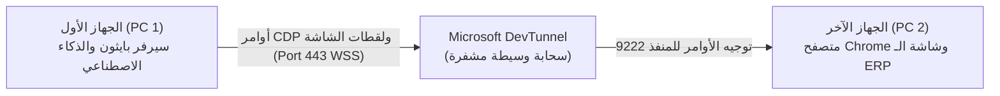
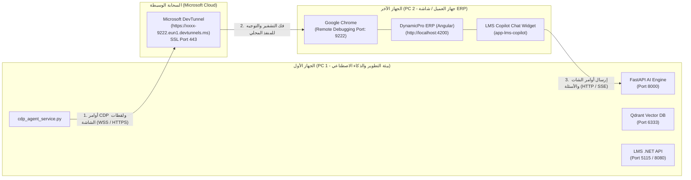
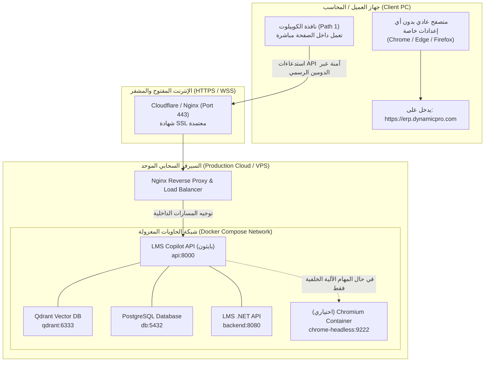

# الدليل الشامل لمعمارية الاتصال بين الخدمات والأجهزة و DevTunnel والتحول للإنتاج

## Cross-Device Communication, DevTunnel Architecture & Production Migration Guide

وفيما يلي شرح مبسط وواضح يجيب عن كل تساؤلاتك بشكل مباشر وموجز:

---

### 1. طريقة الاتصال الحالية: من يتحدث مع من؟ وما هو دور DevTunnel؟

في مرحلة الاختبار الحالية، النظام مقسم على **جهازين فعليين**:

1. **الجهاز الأول (PC 1 - جهاز السيرفر والذكاء الاصطناعي):**
   - يعمل عليه خادم بايثون [`LMS_CO_Pilot`](file:///e:/Mazen/EgyDynamic/LMS_CO_Pilot) (المنفذ 8000)، ومحرك الذكاء الاصطناعي، وقواعد بيانات Qdrant، وخادم دوت نت.
2. **الجهاز الآخر (PC 2 - جهاز العميل / شاشة الـ ERP):**
   - يعمل عليه متصفح Chrome وشاشة الـ ERP الحقيقية التي يدخل عليها الموظف.
   - مشغل فيه متصفح Chrome بمنفذ تصحيح أخطاء مفتوح: `--remote-debugging-port=9222`.

#### لماذا نستخدم DevTunnel حالياً؟

- لأن الجهازين إما موجودان على شبكات مختلفة، أو متصلان بنفس الراوتر لكن الراوتر يعزلهما أمنياً (Wi-Fi AP Isolation & Firewalls)، فلا يستطيع بايثون في PC 1 الوصول لآي بي PC 2 (`192.168.1.61:9222`).
- **وظيفة Microsoft DevTunnel:** ينشئ نفقاً سحابياً مشفراً بين جهاز PC 2 وسيرفرات ميكروسوفت، ويعطينا رابطاً سحابياً مؤقتاً يبدأ بـ `https://` (مثل `https://ppbpzkns-9222.eun1.devtunnels.ms`).
- يقوم سيرفر بايثون في PC 1 بإرسال أوامر النقر ولقطات الشاشة للرابط السحابي على المنفذ `443`، فيقوم النفق بتوصيلها لمتصفح Chrome على PC 2 فوراً!



---

### 2. الحقيقة المعمارية الأهم: المسار الداخلي vs مسار الـ CDP الخارجي

النظام مصمم معمارياً ليعمل بأسلوبين (Dual-Path Strategy):

1. **المسار الأول (Path 1: In-Browser Host Bridge) — وهو الأساسي (95% من الاستخدام):**
   - نافذة شات الكوبيلوت مدمجة أصلاً داخل صفحة الـ ERP في المتصفح.
   - عندما يطلب الموظف: *"افتح لي شاشة المشتريات"* أو *"سجل فاتورة"*، يرسل الشات طلب API عادي لخادم بايثون.
   - يرجع بايثون البيانات، ويقوم **كود الجافاسكريبت داخل المتصفح نفسه** بفتح الشاشة وملء الفورم عبر جسر `window.DynamicERP`.
   - **المفاجأة:** هذا المسار **لا يحتاج منفذ 9222، ولا يحتاج DevTunnel، ولا يلمس جهاز الموظف بأي شكل خارجي!**
2. **المسار الثاني (Path 2: Autonomous Vision Agent via CDP) — (5% للعمليات المعقدة):**
   - هو الذي يتحكم في المتصفح من الخارج بروبوت مستقل ويرسل نقرات ماوس عتادية (Hardware Clicks) ويلتقط صوراً. وهذا المسار فقط هو الذي يحتاج منفذ 9222 واستخدمنا فيه DevTunnel للربط بين الجهازين أثناء الاختبار.

---

### 3. كيف سيتغير هذا المشهد عند رفع المشروع على سيرفر إنتاج (Production Server)؟

عند حجز سيرفر حقيقي للشركة (Cloud VPS بنظام Linux و Docker و Nginx مع دومين رسمي مثل `erp.dynamicpro.com`):

1. **اختفاء DevTunnel تماماً:**
   - DevTunnel أداة مؤقتة للمطورين فقط أثناء الاختبار؛ في الإنتاج السيرفر لديه عنوان IP ثابت واسم نطاق رسمي (Public Domain) مع شهادة SSL معتمدة.
2. **عدم فتح المنفذ 9222 على أجهزة الموظفين نهائياً:**
   - لن نطلب من أي محاسب أو موظف تشغيل أوامر أو فتح بورتات في جهازه.
   - الموظف يفتح لابتوبه ويدخل على رابط الشركة `https://erp.dynamicpro.com` كأي موقع عادي في العالم.
   - يتحدث الموظف مع الكوبيلوت المدمج في الشاشة (Path 1) الذي يتواصل مع السيرفر عبر الـ HTTPS الطبيعي دون أي متطلبات خاصة.
3. **أين سيعمل المسار المستقل (Path 2) في الإنتاج؟**
   - إذا أرادت المنظومة تشغيل روبوتات أتمتة ليلية مستقلة، يتم تشغيل متصفح **Chromium Container داخل السيرفر نفسه** (على نفس شبكة الـ Docker محلياً `http://chrome-headless:9222`) ولا علاقة له بأجهزة الموظفين الشخصية.

---

### 4. ما الذي سيتغير في الأكواد بالضبط؟ (الكود والإعدادات)

التغييرات محصورة وبسيطة جداً وتتعلق بملفات الإعدادات وليس منطق العمل الداخلي:

| الملف المستهدف | ما هو موجود حالياً في مرحلة الاختبار | ما سيتغير في الإنتاج على السيرفر |
| --- | --- | --- |
| **ملف البيئة [`.env`](file:///e:/Mazen/EgyDynamic/LMS_CO_Pilot/.env)** | `ENVIRONMENT=development`<br/>`CDP_HOST=https://...devtunnels.ms` | `ENVIRONMENT=production`<br/>`CDP_HOST=http://chrome-headless:9222` |
| **إعدادات الـ CORS في [`config.py`](file:///e:/Mazen/EgyDynamic/LMS_CO_Pilot/src/core/config.py) و [`src/main.py`](file:///e:/Mazen/EgyDynamic/LMS_CO_Pilot/src/main.py)** | Regex يسمح بنطاقات `*.devtunnels.ms` و `localhost` | إغلاق الـ Regex والسماح فقط بدومينات الشركة الرسمية (`https://erp.dynamicpro.com`) |
| **خدمة المتصفح [`cdp_agent_service.py`](file:///e:/Mazen/EgyDynamic/LMS_CO_Pilot/src/services/cdp_agent_service.py)** | تحويل نطاقات `.devtunnels.ms` وإزالة البورت 9222 | الكود جاهز ومرن أصلاً؛ في الإنتاج سيتعامل مع الـ URL الداخلي للـ Docker مباشرة |
| **واجهة Angular (`environment.prod.ts`)** | `copilotApiUrl = 'http://localhost:8000'` أو رابط نفق | `copilotApiUrl = 'https://copilot.dynamicpro.com/v1'` ثم عمل `npm run build:element` |
| **خادم Nginx العكسي** | غير مستخدم (تشغيل Uvicorn مباشر) | إعداد Nginx لتمرير شهادات الـ SSL وتمرير قنوات الـ SSE والـ WebSocket |

---

الملف المرجعي التفصيلي متوفر الآن بكافة المخططات وجداول الـ Docker وقوائم التحقق خطوة بخطوة في:
🔗 **[cross_device_devtunnel_and_production_guide.md](file:///e:/Mazen/EgyDynamic/LMS_CO_Pilot/src/services/docs/cross_device_devtunnel_and_production_guide.md)**
---

## 📑 الفهرس (Table of Contents)

1. [نظرة عامة ومقدمة مبسطة: من يتحدث مع من؟](#1-نظرة-عامة-ومقدمة-مبسطة-من-يتحدث-مع-من)
2. [معمارية الاتصال الحالية في مرحلة الاختبار (Development & Testing Phase)](#2-معمارية-الاتصال-الحالية-في-مرحلة-الاختبار-development--testing-phase)
   - [أطراف المنظومة الحالية (The 3 Actors)](#أ-أطراف-المنظومة-الحالية-the-3-actors)
   - [لماذا نستخدم DevTunnel؟ وما المشكلة التي يحلها؟](#ب-لماذا-نستخدم-devtunnel-وما-المشكلة-التي-يحلها)
   - [المساران: المسار الداخلي (Path 1) مقابل المسار المستقل (Path 2)](#ج-المساران-المسار-الداخلي-path-1-مقابل-المسار-المستقل-path-2)
3. [كيف يعمل DevTunnel في الكود حالياً؟ (Code Walkthrough)](#3-كيف-يعمل-devtunnel-في-الكود-حالياً-code-walkthrough)
4. [كيف سيتغير هذا المشهد عند رفع المشروع على سيرفر إنتاج (Production Server)؟](#4-كيف-سيتغير-هذا-المشهد-عند-رفع-المشروع-على-سيرفر-إنتاج-production-server)
   - [ما الذي سيختفي تماماً؟ ولماذا؟](#أ-ما-الذي-سيختفي-تماماً-ولماذا)
   - [أين ستعيش الخدمات والبيانات في الإنتاج؟ (Production Topology)](#ب-أين-ستعيش-الخدمات-والبيانات-في-الإنتاج-production-topology)
   - [كيف ستتم الأتمتة والتحكم في شاشة الموظف في الإنتاج؟](#ج-كيف-ستتم-الأتمتة-والتحكم-في-شاشة-الموظف-في-الإنتاج)
5. [ما الذي سيتغير في الأكواد بالضبط؟ (Detailed Code & Config Delta)](#5-ما-الذي-سيتغير-في-الأكواد-بالضبط-detailed-code--config-delta)
   - [1. ملفات البيئة والإعدادات (.env و config.py)](#1-ملفات-البيئة-والإعدادات-env-و-configpy)
   - [2. حماية الـ CORS وميدل وير السيرفر (src/main.py)](#2-حماية-الـ-cors-وميدل-وير-السيرفر-srcmainpy)
   - [3. خدمة المتصفح (cdp_agent_service.py)](#3-خدمة-المتصفح-cdp_agent_servicepy)
   - [4. الواجهة الأمامية Angular ومكون الكوبيلوت](#4-الواجهة-الأمامية-angular-ومكون-الكوبيلوت)
   - [5. إعداد خادم Nginx العكسي (Reverse Proxy)](#5-إعداد-خادم-nginx-العكسي-reverse-proxy)
6. [مقارنة سريعة: بيئة الاختبار الحالية vs بيئة الإنتاج السحابية](#6-مقارنة-سريعة-بيئة-الاختبار-الحالية-vs-بيئة-الإنتاج-السحابية)
7. [قائمة التحقق للانتقال للإنتاج (Production Readiness Checklist)](#7-قائمة-التحقق-للانتقال-للإنتاج-production-readiness-checklist)

---

## 1. نظرة عامة ومقدمة مبسطة: من يتحدث مع من؟

في هذا المشروع، نحن لا نبني موقعاً بسيطاً من صفحة واحدة، بل نبني **منظومة ذكاء اصطناعي تفاعلية معقدة (Enterprise AI Ecosystem)** تتكون من:

1. **مشروع الكوبيلوت الذكي ([`LMS_CO_Pilot`](file:///e:/Mazen/EgyDynamic/LMS_CO_Pilot)):** خادم Python FastAPI يحوي محرك الذكاء الاصطناعي، وقواعد بيانات المتجهات (Qdrant)، ومحرك الرؤية البصرية (Gemini Vision)، ومحرك التحكم بالمتصفح ([`cdp_agent_service.py`](file:///e:/Mazen/EgyDynamic/LMS_CO_Pilot/src/services/cdp_agent_service.py)).
2. **مشروع المنصة التعليمية ([`DynamicProLearn`](file:///e:/Mazen/DynamicProLearn)):** يشمل الـ Backend الرئيسي (.NET 10 API) وواجهة Angular 19.
3. **مشروع الـ ERP الميداني (`EgyDynamic ERP`):** برنامج إدارة الشركات الضخم (Angular Frontend + ERP WebAPI) الذي يعمل عليه الموظفون يومياً.
4. **المتصفح (Google Chrome / Edge):** بيئة العمل الحقيقية التي يدخل عليها الموظف لفتح شاشات المبيعات والمشتريات والقيود المحاسبية.

> [!NOTE]
> **السؤال الجوهري:** كيف يتحدث خادم الذكاء الاصطناعي (الموجود في مكان ما) مع متصفح Chrome الخاص بالموظف (الموجود في جهاز آخر)، دون أن نطلب من الموظف تسجيل دخول جديد أو تثبيت برامج معقدة؟ هنا يأتي دور معمارية الاتصال الحالية.

---

## 2. معمارية الاتصال الحالية في مرحلة الاختبار (Development & Testing Phase)

### أ. أطراف المنظومة الحالية (The 3 Actors)

في مرحلة الاختبار الحالية، النظام موزع على جهازين فعليين:



---

### ب. لماذا نستخدم DevTunnel؟ وما المشكلة التي يحلها؟

1. **مشكلة عزل الشبكات المحلية (Wi-Fi AP Isolation & NAT):**
   - عندما يكون الجهاز الأول (PC 1) والجهاز الثاني (PC 2) متصلين على شبكة Wi-Fi واحدة في المكتب أو المنزل، غالباً ما يقوم الراوتر بعزل الأجهزة عن بعضها أمنياً (AP Isolation)، فلا يستطيع PC 1 الوصول إلى عنوان IP الخاص بـ PC 2 (مثلاً `192.168.1.61:9222`).
   - وإذا كان الجهازان في مكانين مختلفين (مثلاً أنت تعمل من المنزل والجهاز الآخر في الشركة)، فهناك جدران حماية (Firewalls) ومودم يمنع الاتصال المباشر.

2. **كيف يحل Microsoft DevTunnel هذه المشكلة؟**
   - نشغل على الجهاز الثاني (PC 2) أمراً بسيطاً:

     ```bash
     devtunnel host -p 9222 --allow-anonymous
     ```

   - هذا الأمر يفتح نفقاً سحابياً مشفراً وآمناً بين جهاز PC 2 وسيرفرات ميكروسوفت (في غرب أوروبا `eun1`).
   - يعطينا رابطاً سحابياً عاماً يبدأ بـ `https://` مثل:
     `https://ppbpzkns-9222.eun1.devtunnels.ms`
   - الآن، يستطيع سيرفر بايثون على PC 1 التحدث مع المتصفح على PC 2 من أي مكان في العالم عبر المنفذ الآمن الموحد `443` (HTTPS / WSS)، وكأنهما على نفس الجهاز تماماً!

---

### ج. المساران: المسار الداخلي (Path 1) مقابل المسار المستقل (Path 2)

من المهم جداً فهم أن النظام مصمم معمارياً ليعمل عبر **مسارين منفصلين تماماً**:

| وجه المقارنة | المسار الأول: الودجت المدمج (Path 1: In-Browser Host Bridge) | المسار الثاني: الوكيل البصري المستقل (Path 2: Hybrid CDP Agent) |
| --- | --- | --- |
| **فكرة المسار** | نافذة شات صغيرة (Widget) مدمجة داخل صفحة الـ ERP في المتصفح. | روبوت خارجي يتحكم في المتصفح مثل مستخدم بشري يجلس أمام الشاشة. |
| **كيف ينفذ الأوامر؟** | يرسل طلب JSON عادي لخادم بايثون، ثم ينفذ النتيجة مباشرة بكود جافاسكريبت داخل الصفحة عبر `window.DynamicERP`. | خادم بايثون يرسل نبضات ماوس وكيبورد عتادية عبر مقبس WebSocket الخاص بالمتصفح. |
| **هل يحتاج منفذ 9222؟** | ❌ **نهائياً!** لا يحتاج فتح أي منفذ تصحيح. | ✅ **نعم**، يحتاج منفذ 9222 مفتوحاً للتحكم بالمتصفح. |
| **هل يحتاج DevTunnel؟** | ❌ **لا**، يتواصل مع السيرفر عبر روابط الـ API العادية. | ✅ **نعم** (في مرحلة الاختبار بين جهازين). |
| **نسبة الاستخدام المتوقعة** | **95% من عمل الموظفين اليومي** (استفسارات، فتح شاشات، ملء بيانات). | **5% للعمليات المعقدة**، وتخطي النوافذ المنبثقة، والفحص التلقائي. |

---

## 3. كيف يعمل DevTunnel في الكود حالياً؟ (Code Walkthrough)

لقد تم تصميم الكود الحالي ليكون ذكياً بحيث يكتشف تلقائياً هل الرابط محلي أم نفق DevTunnel:

### 1. معالجة الروابط في [`cdp_agent_service.py`](file:///e:/Mazen/EgyDynamic/LMS_CO_Pilot/src/services/cdp_agent_service.py) (الأسطر 88-108)

```python
def _resolve_urls(self, host: str, port: int) -> tuple[str, str]:
    clean_h = host.strip().rstrip("/")

    # التعامل الآلي الصارم مع أنفاق مايكروسوفت السحابية DevTunnels
    if ".devtunnels.ms" in clean_h:
        if not clean_h.startswith("http"):
            clean_h = "https://" + clean_h
        clean_h = re.sub(r":\d+$", "", clean_h)  # حذف :9222 لأن النفق يعمل على 443
        base_http = clean_h
        base_ws = "wss://" + clean_h[len("https://"):]
        return base_http, base_ws
    ...
```

- **السبب:** أنفاق DevTunnel لا تقبل الاتصال على المنفذ `9222` مباشرة من الخارج؛ بل تمرر كل شيء عبر المنفذ `443` الآمن مشفراً (`https://` و `wss://`). لو أضفنا `:9222` لفشل الاتصال فوراً.

### 2. السماح بمرور البيانات في الـ CORS في [`src/main.py`](file:///e:/Mazen/EgyDynamic/LMS_CO_Pilot/src/main.py) (الأسطر 93-100)

```python
app.add_middleware(
    CORSMiddleware,
    allow_origins=_static_origins,
    allow_origin_regex=r"https://[a-z0-9\-]+\.(devtunnels\.ms|ngrok\.io|ngrok-free\.app)",
    allow_credentials=True,
    allow_methods=["*"],
    allow_headers=["*"],
)
```

- تم إضافة تعبير نمطي (Regex) يسمح لمتصفح العميل بالحديث مع السيرفر دون أن يمنعه المتصفح بسبب سياسة الأمان (CORS Policy) عندما تتغير روابط DevTunnel الديناميكية.

---

## 4. كيف سيتغير هذا المشهد عند رفع المشروع على سيرفر إنتاج (Production Server)؟

عندما ننقل المشروع إلى سيرفر حقيقي (مثل VPS أو Cloud Server بنظام Linux و Docker و Nginx مع اسم نطاق رسمي مثل `dynamicpro.com`):

### أ. ما الذي سيختفي تماماً؟ ولماذا؟

1. **اختفاء DevTunnel بالكامل:**
   - DevTunnel أداة مخصصة للمطورين فقط أثناء بناء البرمجيات.
   - في الإنتاج، السيرفر يمتلك عنوان IP ثابت واسم نطاق عام (Public FQDN) وشهادة أمان معتمدة (SSL/TLS)، فلا حاجة لأي أنفاق وسيطة.
2. **اختفاء طلب فتح المنفذ 9222 على أجهزة المستخدمين:**
   - من المستحيل أمنياً وتقنياً أن نطلب من كل محاسب أو موظف في الشركة تشغيل سطر أوامر أو فتح منفذ 9222 على لابتوبه الشخصي؛ فهذا خطر أمني ومستحيل التطبيق في بيئات العمل الحقيقية.

---

### ب. أين ستعيش الخدمات والبيانات في الإنتاج؟ (Production Topology)

المعمارية الإنتاجية تعتمد على توزيع نقي وآمن:



---

### ج. كيف ستتم الأتمتة والتحكم في شاشة الموظف في الإنتاج؟

هناك حالتان واضحتان للأتمتة في بيئة الإنتاج:

#### الحالة الأولى: الاستخدام اليومي للموظفين (95% من الحالات — عبر Path 1)

- الموظف يفتح المتصفح العادي ويدخل على `https://erp.dynamicpro.com`.
- يجد نافذة الكوبيلوت في زاوية الشاشة.
- يكتب الموظف: *"اعمل لي فاتورة مشتريات للمورد شركة الأمل بمبلغ 5000"*.
- ودجت الكوبيلوت ترسل الطلب لسيرفر بايثون عبر `POST /v1/erp/...`.
- سيرفر بايثون يحلل الطلب بـ Gemini ويرجع كائن JSON يحوي رقم الشاشة والبيانات.
- **كود الجافاسكريبت داخل المتصفح نفسه** هو الذي يفتح الشاشة ويملأ الحقول أمام عين الموظف عبر `window.DynamicERP`.
- **النتيجة:** أسرع، بدون أي برامج إضافية على كمبيوتر الموظف، وبأعلى معايير الأمان للشركات!

#### الحالة الثانية: المهام المؤتمتة المستقلة بالرؤية البصرية (Path 2 المستقل)

إذا أردنا تشغيل روبوت مستقل يعمل ليلاً أو يولد تقارير بدون وجود موظف بشري أصلاً:

- يتم تشغيل حاوية Docker تحوي متصفح Chromium خفي (Headless Chromium) **داخل السيرفر نفسه**.
- يتصل `cdp_agent_service.py` بالمتصفح المحلي داخل شبكة Docker عبر العنوان الداخلي السريع `http://chrome-headless:9222`.
- لا علاقة له بأجهزة الموظفين، ويعمل بكفاءة 100% دون أن يتأثر بسرعة الإنترنت لدى المستخدمين!

---

## 5. ما الذي سيتغير في الأكواد بالضبط؟ (Detailed Code & Config Delta)

فيما يلي قائمة التغييرات البرمجية الدقيقة المطلوبة عند النقل للإنتاج:

### 1. ملفات البيئة والإعدادات (`.env` و `config.py`)

في ملف [`.env`](file:///e:/Mazen/EgyDynamic/LMS_CO_Pilot/.env):

```diff
- ENVIRONMENT=development
+ ENVIRONMENT=production

- # روابط التطوير المحلية
- LMS_BASE_URL=http://localhost:8080
+ # الروابط الإنتاجية المعتمدة
+ LMS_BASE_URL=http://dynamicprolearn-app:8080
+ PRODUCTION_DOMAIN=https://copilot.dynamicpro.com

- # CDP Host أثناء الاختبار بالنفق
- CDP_HOST=https://ppbpzkns-9222.eun1.devtunnels.ms
+ # CDP الداخلي داخل بيئة Docker (إن تم تفعيل Headless Worker)
+ CDP_HOST=http://chrome-headless:9222
```

وفي ملف [`src/core/config.py`](file:///e:/Mazen/EgyDynamic/LMS_CO_Pilot/src/core/config.py):

```diff
    CORS_ORIGINS: list[str] | str = [
-       "http://localhost:4200",
-       "https://*.devtunnels.ms",
-       "https://*.ngrok.io",
+       "https://erp.dynamicpro.com",
+       "https://learn.dynamicpro.com",
+       "https://copilot.dynamicpro.com"
    ]
```

---

### 2. حماية الـ CORS وميدل وير السيرفر ([`src/main.py`](file:///e:/Mazen/EgyDynamic/LMS_CO_Pilot/src/main.py))

في الإنتاج، نقوم بتعطيل السماح بالـ Wildcard للأنفاق المفتوحة لحماية السيرفر من هجمات تزوير الطلبات:

```python
# في بيئة الإنتاج: تقييد الـ CORS فقط على دومينات المؤسسة الرسمية
if settings.ENVIRONMENT == "production":
    app.add_middleware(
        CORSMiddleware,
        allow_origins=settings.CORS_ORIGINS,
        allow_credentials=True,
        allow_methods=["GET", "POST", "PUT", "DELETE", "OPTIONS"],
        allow_headers=["*"],
    )
else:
    # بيئة الاختبار فقط (تدعم أنفاق DevTunnel و ngrok)
    app.add_middleware(
        CORSMiddleware,
        allow_origins=_static_origins,
        allow_origin_regex=r"https://[a-z0-9\-]+\.(devtunnels\.ms|ngrok\.io|ngrok-free\.app)",
        allow_credentials=True,
        allow_methods=["*"],
        allow_headers=["*"],
    )
```

---

### 3. خدمة المتصفح ([`cdp_agent_service.py`](file:///e:/Mazen/EgyDynamic/LMS_CO_Pilot/src/services/cdp_agent_service.py))

**المفاجأة السارة:** كود [`cdp_agent_service.py`](file:///e:/Mazen/EgyDynamic/LMS_CO_Pilot/src/services/cdp_agent_service.py) مكتوب بالفعل بطريقة مرنة جداً (Adaptive Architecture):

- دالة `_resolve_urls()` تفحص الرابط:
  - إن كان الرابط اسم خادم محلي مثل `chrome-headless` أو `127.0.0.1`، تتعامل معه كـ HTTP و WS محلي.
  - وإن كان رابط دومين خارجي مشفر `https://`، تتعامل معه كـ HTTPS و WSS.
- **ما سيتغير فقط:** في دالة `ensure_cdp_available()`، في بيئة لينكس السحابية لا نشغل `chrome.exe` الخاص بويندوز، بل يتم الاعتماد على حاوية `chromium` الجاهزة المضمنة في [`docker-compose.yml`](file:///e:/Mazen/EgyDynamic/LMS_CO_Pilot/docker-compose.yml).

---

### 4. الواجهة الأمامية Angular ومكون الكوبيلوت

في ملف إعدادات بيئة Angular الإنتاجية (`environment.prod.ts`):

```typescript
export const environment = {
  production: true,
  // تغيير رابط الـ API من localhost أو رابط النفق إلى دومين السيرفر الرسمي المشفر
  copilotApiUrl: 'https://copilot.dynamicpro.com/v1',
  lmsApiUrl: 'https://api.dynamicpro.com'
};
```

ثم إعادة تجميع حزمة الودجت بأمر:

```bash
npm run build:element
```

لينتج ملف `lms-copilot.bundle.js` خفيف ومستقل يتم وضعه في مجلد أصول نظام الـ ERP.

---

### 5. إعداد خادم Nginx العكسي (Reverse Proxy)

على السيرفر، يتم إعداد Nginx ليتولى فك تشفير الـ SSL وتمرير الـ WebSockets والـ Server-Sent Events (SSE) بسلاسة:

```nginx
# إعداد توجيه الكوبيلوت في Nginx
server {
    server_name copilot.dynamicpro.com;

    location / {
        proxy_pass http://localhost:8000;
        proxy_http_version 1.1;
        
        # دعم الـ WebSockets والـ SSE الحي بدون تقطيع
        proxy_set_header Upgrade $http_upgrade;
        proxy_set_header Connection "upgrade";
        proxy_set_header Host $host;
        proxy_cache_bypass $http_upgrade;
        
        # منع الـ Buffering لدعم Server-Sent Events (SSE) اللحظي
        proxy_buffering off;
        proxy_read_timeout 86400s;
    }
}
```

---

## 6. مقارنة سريعة: بيئة الاختبار الحالية vs بيئة الإنتاج السحابية

| وجه المقارنة | مرحلة الاختبار الحالية (Now) | مرحلة الإنتاج على السيرفر (Production) |
| --- | --- | --- |
| **مكان تشغيل بايثون والذكاء الاصطناعي** | جهاز المطور الأول (PC 1) | سيرفر سحابي (VPS / Cloud Container) |
| **مكان تشغيل واجهة الـ ERP** | جهاز المطور الثاني (PC 2) | متصفح الموظف عبر الدومين الرسمي |
| **طريقة ربط الأجهزة ببعضها** | أنفاق ميكروسوفت DevTunnel المؤقتة | شبكة الإنترنت الرسمية عبر HTTPS / DNS |
| **منفذ المتصفح 9222** | مفتوح يدوياً على جهاز PC 2 بأمر طرفية | مغلق تماماً لدى الموظفين (حماية أمنية) |
| **بروتوكول الـ API** | روابط ديناميكية متغيرة (`*.devtunnels.ms`) | رابط ثابت مشفر (`https://copilot.dynamicpro.com`) |
| **إعدادات CORS** | نمط Regex مفتوح لاستيعاب أي نفق سحابي | قائمة مغلقة وصارمة بنطاقات المنشأة فقط |
| **سرعة الاستجابة وزمن التأخير** | يتأثر بمسار النفق عبر خوادم غرب أوروبا (1.5s - 2.5s) | استجابة فائقة السرعة على نفس السيرفر المحلي (10ms - 50ms) |

---

## 7. قائمة التحقق للانتقال للإنتاج (Production Readiness Checklist)

عند اتخاذ قرار الرفع على سيرفر الإنتاج، اتبع الخطوات المرتبة التالية:

- [ ] **1. تجهيز أسماء النطاقات (DNS Records):** توجيه `copilot.dynamicpro.com` و `erp.dynamicpro.com` لـ IP السيرفر.
- [ ] **2. إعداد شهادة الأمان (SSL Certificate):** تشغيل Let's Encrypt / Certbot لتوليد شهادات HTTPS صالحة ومحدثة تلقائياً.
- [ ] **3. ضبط المتغيرات البيئية:** إنشاء ملف `.env.production` مع تعيين مفاتيح الـ API السرية (`GEMINI_API_KEY`, `JWT_SECRET`, `POSTGRES_PASSWORD`).
- [ ] **4. تنظيف CORS:** إزالة نمط DevTunnels وتثبيت أسماء النطاقات المعتمدة في `config.py`.
- [ ] **5. إعادة بناء الودجت الإنتاجي:** تشغيل `npm run build:element` داخل مشروع Angular لربطه بعنوان الـ API الجديد.
- [ ] **6. تشغيل الحاويات الموحدة:** تشغيل المنظومة عبر Docker Compose:

  ```bash
  docker compose -f docker-compose.yml up -d --build
  ```

- [ ] **7. فحص الجاهزية (Health Check):** التأكد من عمل السيرفر وقاعدة البيانات عبر:

  ```bash
  curl https://copilot.dynamicpro.com/health
  # المتوقع: {"status": "ok", "environment": "production"}
  ```

---

## 8. الخلاصة للمطورين والفريق التقني

1. **ما قمنا به عبر DevTunnel ليس عيباً، بل هو أفضل ممارسة هندسية معتمدة عالمياً:** لقد مكننا DevTunnel من محاكاة بيئة الشركات الحقيقية واختبار فصل السيرفر عن جهاز العميل بالكامل دون دفع تكاليف خوادم سحابية مبكرة.
2. **الكود مصمم ومبني ليكون جاهزاً للإنتاج فوراً:** كل المنطق البرمجي معزول، وعند رفع المشروع على السيرفر لن نعيد كتابة أي منطق عمل (Business Logic)، بل سنكتفي فقط بتحديث ملفات الإعدادات والبيئة (Configuration Drift Zero).
